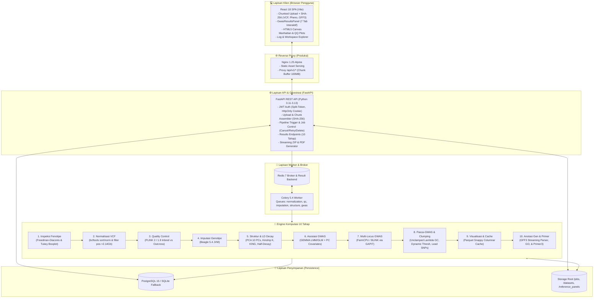
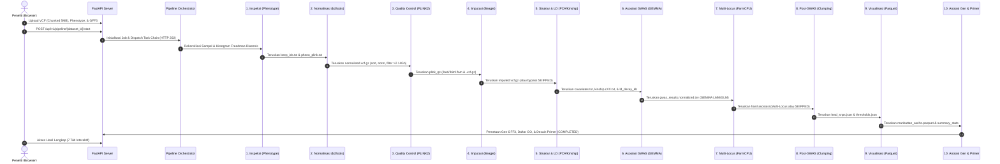

# 🧬 Automated End-to-End GWAS Web Platform (10-Phase Pipeline)

Platform bioinformatika berbasis web (*full-stack*) untuk mengotomatisasi analisis **Genome-Wide Association Study (GWAS)** dari hulu ke hilir (*end-to-end*). Mengimplementasikan panduan ilmiah komprehensif **`Pipeline_Gwas.md`** dengan prinsip utama **"Inspect $\rightarrow$ Validate $\rightarrow$ Run"**, platform ini mengubah alur kerja CLI bioinformatika yang kompleks (**bcftools**, **PLINK 2 / 1.9**, **Beagle 5.4**, **GEMMA**, **GAPIT/R**, **Primer3**, dan parser **GFF3**) menjadi antarmuka web modern yang interaktif, transparan, berkinerja tinggi, dan siap direproduksi (*reproducible*).

---

## 📌 Daftar Isi

1. [Panduan Cepat (Quick Start)](#-1-panduan-cepat-quick-start)
2. [Tabel Perintah (Commands Reference)](#-2-tabel-perintah-commands-reference)
3. [Ringkasan Arsitektur Sistem & ADRs](#-3-ringkasan-arsitektur-sistem--adrs)
   - [Diagram Arsitektur Sistem](#diagram-arsitektur-sistem)
   - [Tech Stack & Alasan Pemilihan](#tech-stack--alasan-pemilihan)
   - [Architecture Decision Records (ADRs)](#architecture-decision-records-adrs)
4. [Alur Kerja Pipeline Bioinformatika 10 Tahap](#-4-alur-kerja-pipeline-bioinformatika-10-tahap)
5. [Antarmuka Hasil & 7 Tab Visualisasi Interaktif](#-5-antarmuka-hasil--7-tab-visualisasi-interaktif)
6. [Referensi REST API](#-6-referensi-rest-api)
7. [Pengujian Otomatis (Testing) & Kualitas Kode](#-7-pengujian-otomatis-testing--kualitas-kode)
8. [Panduan Kontribusi & Standar Kode](#-8-panduan-kontribusi--standar-kode)

---

## 🚀 1. Panduan Cepat (Quick Start)

### Prasyarat Sistem
- **Docker & Docker Compose** (Rekomendasi untuk lingkungan produksi/replikasi penuh): Docker v24+ & Docker Compose v2+.
- **Atau Lingkungan Lokal (Dual-Mode)**:
  - **Python**: v3.11 – v3.13
  - **Node.js**: v18+ atau v20+ & npm
  - **CLI Bioinformatika** (opsional untuk tahap terkait): `bcftools`, `plink2`/`plink`, `gemma`, `beagle.jar`, `primer3_core`.

---

### Opsi A: Menjalankan Menggunakan Docker Compose (Direkomendasikan)

1. **Clone repositori**:
   ```bash
   git clone https://github.com/Akbar3776/gwas-platform-magang-pkl.git
   cd gwas-platform-magang-pkl
   ```

2. **Siapkan berkas lingkungan (`.env`)**:
   ```bash
   cp backend/.env.example backend/.env
   ```

3. **Jalankan seluruh service kontainer**:
   ```bash
   docker compose -f infra/docker-compose.yml up -d --build
   ```
   *Service yang berjalan: FastAPI (`:8000`), PostgreSQL (`:5432`), Redis (`:6379`), Celery Worker.*

4. **Jalankan Frontend (Vite Dev Server)**:
   ```bash
   cd frontend
   npm install
   npm run dev
   ```

5. **Akses Aplikasi**:
   - **Frontend UI Web**: `http://localhost:5173`
   - **Backend REST API**: `http://localhost:8000`
   - **Swagger UI API Docs**: `http://localhost:8000/docs`
   - **Redoc Alternative Docs**: `http://localhost:8000/redoc`

---

### Opsi B: Menjalankan Lokal Tanpa Docker (Mode Pengembangan Cepat)

Backend mendukung **SQLite fallback otomatis** dan perutean engine lokal sehingga Anda dapat menjalankan backend dan frontend tanpa perlu memasang PostgreSQL dan Redis.

1. **Setup & Jalankan Backend**:
   ```powershell
   # Dari direktori root repositori
   cd backend
   python -m venv venv
   .\venv\Scripts\Activate.ps1    # Linux/macOS: source venv/bin/activate
   pip install -r requirements.txt
   
   # Jalankan API server FastAPI
   uvicorn app.main:app --host 127.0.0.1 --port 8000 --reload
   ```

2. **Setup & Jalankan Frontend**:
   ```powershell
   # Buka terminal baru
   cd frontend
   npm install
   npm run dev
   ```

3. **Akses & Registrasi Akun**:
   - Buka `http://localhost:5173/register` di browser untuk membuat akun peneliti pertama.
   - Masuk (*login*) dan mulai unggah berkas genotipe VCF, fenotipe, atau GFF3 di ruang kerja.

---

## 💻 2. Tabel Perintah (Commands Reference)

Berikut adalah daftar perintah utama yang sering digunakan dalam pengembangan, pengujian, dan pemeliharaan platform:

| Kategori | Perintah | Deskripsi & Kegunaan |
| :--- | :--- | :--- |
| **Docker** | `docker compose -f infra/docker-compose.yml up -d` | Menjalankan seluruh stack layanan (Backend, DB, Redis, Celery) di latar belakang. |
| **Docker** | `docker compose -f infra/docker-compose.yml down` | Menghentikan dan menghapus kontainer stack. |
| **Docker** | `docker compose -f infra/docker-compose.yml logs -f backend` | Memantau log aplikasi FastAPI secara *real-time*. |
| **Docker** | `docker compose -f infra/docker-compose.yml logs -f celery_worker` | Memantau log eksekusi tugas antrean Celery worker. |
| **Backend** | `uvicorn app.main:app --host 0.0.0.0 --port 8000 --reload` | Menjalankan FastAPI development server dengan fitur *auto-reload*. |
| **Backend** | `pytest backend/tests -v` | Menjalankan seluruh rangkaian 55 pengujian unit dan integrasi e2e backend. |
| **Backend** | `pytest backend/tests/test_qc_commands.py -v` | Menjalankan pengujian logika QC, filtering PLINK, dan histogram komparasi. |
| **Backend** | `pytest backend/tests/test_normalization_indexing.py -v` | Menjalankan pengujian normalisasi VCF, penanganan overflow 32-bit, dan index Tabix. |
| **Backend** | `alembic upgrade head` | Menjalankan migrasi skema database relasional ke versi terbaru. |
| **Frontend** | `npm --prefix frontend run dev` | Menjalankan Vite development server frontend pada `http://localhost:5173`. |
| **Frontend** | `npm --prefix frontend run test` | Menjalankan 12 pengujian unit Jest frontend (`--runInBand`). |
| **Frontend** | `npm --prefix frontend run lint` | Menjalankan pemeriksaan kualitas kode ESLint (0 errors, 0 warnings). |
| **Frontend** | `npm --prefix frontend run build` | Melakukan kompilasi aset frontend siap produksi (*production bundle*). |
| **Git** | `git status` | Memeriksa integritas dan status sinkronisasi branch dengan `origin/main`. |

---

## 🏗️ 3. Ringkasan Arsitektur Sistem & ADRs

### Diagram Arsitektur Sistem

Platform dirancang dengan arsitektur berlapis (*layered architecture*) yang memisahkan tanggung jawab antara antarmuka visual, kontrol orkestrasi asinkron, engine bioinformatika komputasi berat, serta lapisan persistensi:



---

### Tech Stack & Alasan Pemilihan

| Komponen | Teknologi | Alasan Pemilihan Teknis (*Design Rationale*) |
| :--- | :--- | :--- |
| **Backend Framework** | **FastAPI (Python 3.11–3.13)** | Kinerja konkurensi tinggi berbasis *async/await*, validasi otomatis via Pydantic v2 (Rust core), dokumentasi OpenAPI/Swagger otomatis, serta interoperabilitas langsung dengan library bioinformatika ilmiah Python. |
| **Database & ORM** | **SQLAlchemy 2.0 (PostgreSQL / SQLite)** | Transaksi ACID yang andal untuk manajemen *User*, *Dataset*, *AnalysisJob*, dan *Result*. Mendukung tipe `JSONVariant` (JSONB di PostgreSQL, Text JSON di SQLite) untuk fleksibilitas metadata tanpa mengorbankan portabilitas lokal. |
| **Asynchronous Task Queue** | **Celery 5.4 + Redis 7** | Menangani eksekusi pipeline komputasi berat secara non-blocking dengan dukungan pembagian antrean (*queues*), pemantauan status tugas, serta mekanisme pembatalan paksa (*task revocation*). |
| **Komputasi Bioinformatika** | **PLINK 2 / 1.9, bcftools, Beagle, GEMMA** | *De facto gold standard* di komunitas genomik global. Menjamin efisiensi memori, akurasi algoritma statistik asosiasi Linear Mixed Model (LMM), dan kecepatan pemrosesan genomik skala besar. |
| **Komputasi Ilmiah & Caching** | **NumPy, SciPy, Pandas, PyArrow** | Komputasi aljabar linier untuk matriks kekerabatan (*kinship*), dekomposisi PCA, perhitungan $\lambda_{GC}$ tanpa *clamping*, serta format kolumnar Apache Parquet dengan kompresi Snappy untuk perenderan instan. |
| **Frontend SPA** | **React 18 + Vite** | Hot Module Replacement (HMR) sub-detik untuk pengalaman pengembangan cepat, struktur komponen modular, serta ekosistem pengujian modern (Jest + React Testing Library). |
| **Engine Visualisasi Big Data** | **HTML5 2D Canvas Kustom** | Merender hingga jutaan varian SNP pada Manhattan Plot dan QQ Plot menggunakan teknik *pixel-bucket deduplication*, menjamin visualisasi bebas lag (*60 FPS*, waktu render $< 5\text{ ms}$). |

---

### Architecture Decision Records (ADRs)

Seluruh keputusan teknis penting dan kompromi arsitektural (*trade-offs*) didokumentasikan secara formal dalam direktori [`docs/decisions/`](docs/decisions/):

| Dokumen ADR | Judul Keputusan | Status | Cakupan & Fokus Keputusan |
| :--- | :--- | :--- | :--- |
| [ADR-001](docs/decisions/ADR-001-database-strategy-and-orm.md) | **Strategi Database Relasional Ganda (PostgreSQL & SQLite Fallback)** | `Accepted` | Menjamin sistem dapat berjalan baik di cluster kontainer produksi (PostgreSQL) maupun laptop peneliti mandiri tanpa setup database eksternal (SQLite). |
| [ADR-002](docs/decisions/ADR-002-authentication-and-data-isolation.md) | **Arsitektur Autentikasi JWT (Split-Token) dan Isolasi Data** | `Accepted` | Memisahkan short-lived Access Token (memori klien) dan long-lived Refresh Token (HttpOnly Cookie) untuk mencegah eksfiltrasi token via XSS/CSRF. |
| [ADR-003](docs/decisions/ADR-003-task-orchestration-and-pipeline-engine.md) | **Orkestrasi Asynchronous Pipeline (Celery + Redis)** | `Accepted` | Memilih arsitektur Celery Chaining yang ringan dan modular daripada workflow engine monolitik seperti Airflow/Nextflow untuk efisiensi resource. |
| [ADR-004](docs/decisions/ADR-004-bioinformatics-execution-engine.md) | **Strategi Eksekusi Engine Bioinformatika (Subprocess Wrapper)** | `Accepted` | Menggunakan pembungkus CLI subprocess terstandarisasi dengan penanganan error streaming, pencegahan fallback Python yang lambat, dan toleransi format WSL. |
| [ADR-005](docs/decisions/ADR-005-variant-data-storage-and-caching.md) | **Penyimpanan & Caching Data Varian Genomik (Apache Parquet)** | `Accepted` | Menggantikan scanning berkas TSV mentah berukuran gigabyte dengan pembacaan terindeks kolom Parquet Snappy terkompresi. |
| [ADR-006](docs/decisions/ADR-006-real-time-streaming-and-state-synchronization.md) | **Streaming Real-time & Sinkronisasi Status Job (Adaptive Polling)** | `Accepted` | Menerapkan adaptive polling dengan *exponential backoff* dan streaming log parsial untuk ketahanan jaringan tanpa overhead koneksi persisten WebSockets. |
| [ADR-007](docs/decisions/ADR-007-data-validation-and-serialization.md) | **Validasi Skema Data & Serialisasi API (Pydantic v2 Rust Core)** | `Accepted` | Menjamin validasi parameter biologis yang ketat (*fail-fast*) pada level HTTP gateway sebelum meneruskan payload ke engine komputasi. |
| [ADR-008](docs/decisions/ADR-008-frontend-big-data-plotting-engine.md) | **Mesin Visualisasi Data Genomik Skala Besar (HTML5 2D Canvas)** | `Accepted` | Menggantikan DOM SVG berat (D3/Plotly) dengan canvas HTML5 2D berteknologi *pixel decimation* untuk visualisasi Manhattan & QQ plot anti-freeze. |
| [ADR-009](docs/decisions/ADR-009-frontend-architecture-and-build-toolchain.md) | **Arsitektur Frontend & Perangkat Pembundel (Vite + React 18 SPA)** | `Accepted` | Membangun Single Page Application statis tanpa kebutuhan runtime Node.js di server produksi, dilayani langsung oleh Nginx reverse proxy. |

---

## 🔬 4. Alur Kerja Pipeline Bioinformatika 10 Tahap

Alur kerja dirangkai oleh [`pipeline_orchestrator.py`](backend/app/tasks/pipeline_orchestrator.py) mengikuti prinsip **"Inspect $\rightarrow$ Validate $\rightarrow$ Run"**:



### Rincian Fase Komputasi:
1. **Fase 1: Fenotipe & Inspeksi Data**: Rekonsiliasi ID sampel antara VCF vs Fenotipe, penanganan missing values, statistik deskriptif, histogram aturan **Freedman-Diaconis**, boxplot outlier Tukey, serta pembuatan `keep_ids.txt` dan `pheno_plink.txt`.
2. **Fase 1B: Normalisasi VCF (`bcftools`)**: Validasi header `#CHROM POS ID REF ALT`, penyaringan posisi $> 2.14\text{ Gb}$ untuk mencegah *integer overflow* 32-bit pada library C, pengurutan koordinat (`sort`), *left-alignment* (`norm`), dan pembuatan indeks Tabix (`.tbi`).
3. **Fase 2: Quality Control Lanjutan (`PLINK 2 / 1.9`)**: Dukungan mode organisme (`inbred` galur murni tanpa filter HWE vs `outcross` dengan filter HWE), `--snps-only just-acgt`, `--max-alleles 2`, penataan ID varian `@:#`, serta kalkulasi riil metrik komparasi before/after QC beserta histogram MAF & missingness.
4. **Fase Imputasi Genotipe Opsional (`Beagle 5.4`)**: Mode `none` (bypass dengan status transparan `[SKIPPED]`), `reference` (menggunakan panel referensi), dan `reference_free`.
5. **Fase 3 + 4D: Struktur Populasi, Kinship & LD Decay**: LD pruning pairwise, analisis PCA 10 komponen + PVE + k-means, Centered Kinship Matrix ($K = \frac{1}{p}WW^T$), tabel kekerabatan robust KING, kurva peluruhan LD decay ($r^2$ vs jarak pasangan basa), serta rekomendasi otomatis GLM vs LMM.
6. **Fase 4A/4B: Analisis Asosiasi GWAS (GEMMA & GLM)**: Pengujian Linear Mixed Model (`gemma -lmm 4 -c covariates.txt`) dengan koreksi kovariat PC, sinkronisasi format baris WSL, dan normalisasi output ke format kanonikal TSV 10 kolom.
7. **Fase 4C: Multi-Locus GWAS (`FarmCPU` & `BLINK`)**: Analisis multi-lokus iteratif menggunakan library GAPIT di lingkungan R (dengan penanganan graceful skip jika R tidak terpasang).
8. **Fase 4E/4F: Pasca-GWAS, Lambda GC, Dynamic Thresholds & Clumping**: Estimasi faktor inflasi genomik $\lambda_{GC}$ tanpa batas semu (*unclamped*), kalkulasi ambang dinamis (Bonferroni, Suggestive, FDR Benjamini-Hochberg, LOD), dan LD-aware clumping untuk mengekstrak **Lead SNPs** independen.
9. **Fase 4G: Visualisasi & Caching Berkinerja Tinggi**: Pembentukan cache kolumnar berformat **Apache Parquet (Snappy)** dengan metadata ambang batas dan Lead SNPs tersemat.
10. **Fase 5: Anotasi Gen Kandidat GFF3 & Desain Primer**: Parser GFF3 streaming, pemetaan Lead SNPs ke fitur gen terdekat dalam jendela LD decay, klasifikasi biologis (*Genik*, *Near-gen*, *Intergenik*), ekspor `Daftar_Gen_Untuk_GO.txt`, dan perancangan primer PCR otomatis via **Primer3**.

---

## 📊 5. Antarmuka Hasil & 7 Tab Visualisasi Interaktif

Halaman visualisasi hasil ([`GwasResultsPanel.jsx`](frontend/src/components/GwasResultsPanel.jsx)) menyajikan 7 tab interaktif yang dilengkapi fitur **paginasi cerdas** untuk mencegah kelebihan beban memori browser (*browser overload*):

1. **📊 Manhattan & QQ Plot**:
   - Manhattan Plot & QQ Plot berbasis HTML5 2D Canvas berkinerja tinggi.
   - Bilah pengatur ambang batas dinamis yang mengubah garis signifikansi secara *real-time*.
   - Filter pemilihan kromosom spesifik (`ALL`, `1`, `2`, ..., `22`).
2. **🎯 Ambang Batas & Lead SNPs**:
   - Pemilih metode threshold interaktif beserta kartu nilai $-\log_{10}(p)$.
   - Tabel Lead SNPs hasil clumping dengan paginasi, rincian alel, efek beta, standar error, dan daftar SNP yang ter-clump.
3. **🧬 Struktur Populasi & LD**:
   - Kartu rekomendasi model statistik GLM vs LMM berdasarkan evaluasi PCA dan Kinship.
   - Plot sebaran PCA (PC1 vs PC2) dengan klaster k-means dan Scree Plot (PVE).
   - Heatmap matriks kekerabatan (Centered Kinship) dan kurva peluruhan LD decay dengan penanda garis *half-decay*.
4. **🔍 Inspeksi & QC**:
   - Panel inspeksi fenotipe dengan histogram Freedman-Diaconis, boxplot outlier Tukey, dan metrik rekonsiliasi sampel.
   - Panel perbandingan QC sebelum vs sesudah filter varian dan sampel dilengkapi histogram MAF dan missingness.
5. **🔬 Multi-Locus GWAS**:
   - Tabel perbandingan lokus puncak asosiasi antara Single-Locus vs Multi-Locus (FarmCPU & BLINK) dengan navigasi halaman.
6. **🌿 Anotasi Gen GFF3 & GO**:
   - Tabel berpaginasi pemetaan Lead SNPs ke fitur gen terdekat dengan badge kategori biologis (Genik, Near-gen, Intergenik).
   - Panel pengayaan Gene Ontology (GO) dan tombol unduh satu klik untuk berkas `Daftar_Gen_Untuk_GO.txt`.
7. **🧪 Flanking & Primer3**:
   - Panel desain primer PCR otomatis untuk varian Lead SNPs menggunakan engine Primer3 dengan pengaturan parameter amplikon, melting temperature ($T_m$), dan ukuran produk PCR.

---

## 🔌 6. Referensi REST API

Seluruh endpoint backend berada di bawah prefix `/api/v1` (kecuali `/health`). Dokumentasi Swagger UI interaktif dapat diakses pada `http://localhost:8000/docs`.

### Ringkasan Rute Utama:
| Modul | Metode | Endpoint | Deskripsi |
| :--- | :--- | :--- | :--- |
| **Auth** | `POST` | `/api/v1/auth/register` | Mendaftarkan akun peneliti baru (`email`, `password`, `full_name`). |
| **Auth** | `POST` | `/api/v1/auth/login` | Masuk ke sistem; mengembalikan Access Token & menyetel Refresh Cookie. |
| **Auth** | `POST` | `/api/v1/auth/refresh` | Memperbarui Access Token menggunakan HttpOnly Cookie. |
| **Upload** | `GET` | `/api/v1/upload` | Mengambil daftar seluruh dataset yang tersedia di ruang kerja. |
| **Upload** | `POST` | `/api/v1/upload/chunk` | Mengunggah potongan (chunk) biner 5 MB berkas genotipe VCF. |
| **Upload** | `POST` | `/api/v1/upload/complete` | Menggabungkan chunk, memverifikasi SHA-256, dan validasi header VCF. |
| **Upload** | `POST` | `/api/v1/upload/phenotype` | Mengunggah berkas fenotipe dan memvalidasi kolom trait serta ID sampel. |
| **Upload** | `POST` | `/api/v1/upload/annotation` | Mengunggah berkas anotasi genom GFF3 (`.gff3` / `.gff3.gz`). |
| **Pipeline**| `POST` | `/api/v1/pipeline/{dataset_id}/start` | Memulai eksekusi pipeline 10 tahap secara asinkron (`HTTP 202 Accepted`). |
| **Jobs** | `GET` | `/api/v1/jobs` | Mengambil daftar riwayat job analisis milik pengguna. |
| **Jobs** | `GET` | `/api/v1/jobs/{job_id}/status` | Mengambil status eksekusi terkini, tahap aktif, dan waktu proses. |
| **Jobs** | `GET` | `/api/v1/jobs/{job_id}/logs` | Mengambil teks log eksekusi lengkap dari seluruh tahapan. |
| **Jobs** | `GET` | `/api/v1/jobs/{job_id}/files` | Menjelajahi berkas input, intermediate, dan output dari sebuah job. |
| **Jobs** | `POST` | `/api/v1/jobs/{job_id}/cancel` | Membatalkan job yang sedang berjalan dan mencabut task Celery. |
| **Jobs** | `POST` | `/api/v1/jobs/{job_id}/retry` | Menjalankan ulang job dari tahap terakhir atau dari awal. |
| **Results** | `GET` | `/api/v1/results/{job_id}/manhattan-data` | Data terkompresi CHR, BP, SNP, $-\log_{10}(p)$ untuk Manhattan & QQ Plot. |
| **Results** | `GET` | `/api/v1/results/{job_id}/inspection` | Data hasil inspeksi fenotipe, histogram, dan boxplot (Fase 1). |
| **Results** | `GET` | `/api/v1/results/{job_id}/qc-comparison` | Data perbandingan QC sebelum vs sesudah filter varian dan sampel (Fase 2). |
| **Results** | `GET` | `/api/v1/results/{job_id}/pca` | Koordinat 10 komponen utama PCA dan proporsi varians PVE (Fase 3). |
| **Results** | `GET` | `/api/v1/results/{job_id}/kinship` | Matriks kekerabatan Centered Kinship dan tabel KING (Fase 3). |
| **Results** | `GET` | `/api/v1/results/{job_id}/ld-decay` | Data evaluasi peluruhan LD $r^2$ terhadap jarak fisik (Fase 4D). |
| **Results** | `GET` | `/api/v1/results/{job_id}/thresholds` | Nilai ambang signifikansi dinamis Bonferroni, FDR, LOD, Suggestive. |
| **Results** | `GET` | `/api/v1/results/{job_id}/lead-snps` | Daftar varian Lead SNPs independen hasil clumping pasca-GWAS. |
| **Results** | `GET` | `/api/v1/results/{job_id}/candidate-genes` | Pemetaan Lead SNPs ke fitur gen GFF3 dan daftar GO enrichment. |
| **Results** | `GET` | `/api/v1/results/{job_id}/primers` | Data rancangan primer PCR Primer3 untuk varian Lead SNPs. |
| **Results** | `GET` | `/api/v1/results/{job_id}/export` | Aliran *streaming* unduhan berkas arsip `.zip` seluruh artefak job. |
| **Results** | `GET` | `/api/v1/results/{job_id}/report` | Unduhan dokumen laporan ilmiah resmi berformat PDF. |

---

## 🧪 7. Pengujian Otomatis (Testing) & Kualitas Kode

Platform memiliki cakupan pengujian otomatis yang komprehensif pada lapisan backend dan frontend:

### A. Backend Unit & E2E Testing (`pytest`)
Seluruh **55 pengujian otomatis backend** telah berhasil lulus (**55 passed**):
```powershell
pytest backend/tests -v
```

Cakupan pengujian backend meliputi:
- `test_qc_commands.py`: Ekstraksi metrik PLINK, penanganan mode inbred/outcross, dan kalkulasi histogram komparasi QC.
- `test_normalization_indexing.py`: Normalisasi VCF, penanganan batas koordinat $> 2.14\text{ Gb}$, dan pembuatan indeks Tabix.
- `test_structure_service.py`: Dekomposisi PCA, matriks Centered Kinship, tabel KING, dan estimasi kurva LD decay.
- `test_assoc_normalizer.py`: Normalisasi format hasil asosiasi GEMMA/PLINK ke format TSV kanonikal 10 kolom.
- `test_postgwas_service.py`: Kalkulasi $\lambda_{GC}$ tanpa clamping, ambang batas dinamis, dan LD clumping.
- `test_annotation_service.py`: Parsing streaming GFF3, normalisasi nama kromosom, dan klasifikasi biologis gen.
- `test_phenotype_service.py`: Rekonsiliasi sampel, histogram Freedman-Diaconis, dan boxplot outlier Tukey.
- `test_pipeline_e2e.py`: Pengujian integrasi alur kerja 10 tahap secara penuh.
- `test_jobs_api.py`, `test_m0_foundation.py`, `test_m1_models_schemas.py`, `test_process.py`: Keamanan, status jobs, model ORM, dan eksekusi proses subprocess.

### B. Frontend Unit Testing (`jest`)
Seluruh **12 pengujian unit frontend** pada 4 test suites berhasil lulus (**12 passed**):
```powershell
npm --prefix frontend test
```
- `QcComparisonPanel.test.jsx`: Pengujian render metrik komparasi QC dan tab histogram.
- `Pagination.test.jsx`: Pengujian navigasi halaman, pemilihan ukuran entri per halaman, dan komputasi offset.
- `JobStatusTracker.test.jsx`: Pengujian pembaruan status job dan indikator visual progress.
- `manhattan.test.js`: Pengujian logika pengelompokan kromosom dan kalkulasi koordinat canvas.

### C. Pemeriksaan Mutu Kode & Build
```powershell
# ESLint check (0 errors, 0 warnings)
npm --prefix frontend run lint

# Kompilasi build frontend produksi
npm --prefix frontend run build
```

---

## 🤝 8. Panduan Kontribusi & Standar Kode

1. **Format Commit**: Gunakan konvensi [Conventional Commits](https://www.conventionalcommits.org/) (`feat:`, `fix:`, `chore:`, `docs:`, `refactor:`, `test:`).
2. **Kualitas Kode**: Pastikan seluruh pengujian backend (`pytest backend/tests`) dan frontend (`npm --prefix frontend test`) dalam keadaan hijau sebelum mengajukan *Pull Request*.
3. **Dokumentasi Keputusan (ADR)**: Setiap perubahan arsitektur fundamental, perubahan database, atau penambahan dependensi utama wajib disertai dokumen ADR baru pada direktori [`docs/decisions/`](docs/decisions/).
4. **Prinsip Kebersihan**: Hindari meninggalkan kode yang dikomentari (*commented-out code*). Tulis komentar yang menjelaskan alasan mendasar (*why*), bukan mengulangi apa yang sudah jelas dari nama variabel atau fungsi (*what*).
