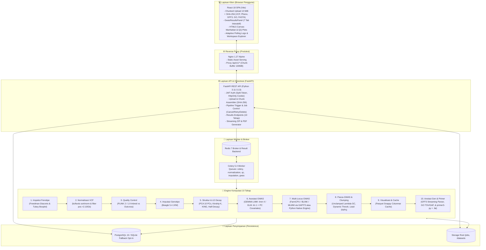

# 🧬 Automated End-to-End GWAS Web Platform (10-Phase Pipeline)

Platform bioinformatika berbasis web (*full-stack*) untuk mengotomatisasi analisis **Genome-Wide Association Study (GWAS)** dari hulu ke hilir (*end-to-end*). Mengimplementasikan panduan ilmiah komprehensif **`Pipeline_Gwas.md`** dengan prinsip utama **"Inspect $\rightarrow$ Validate $\rightarrow$ Run"**, platform ini mengubah alur kerja CLI bioinformatika yang kompleks (**bcftools**, **PLINK 2 / 1.9**, **Beagle 5.4**, **GEMMA**, **GAPIT/R**, **Primer3**, dan parser **GFF3**) menjadi antarmuka web modern yang interaktif, transparan, berkinerja tinggi, dan siap direproduksi (*reproducible*).

---

## 📌 Daftar Isi

1. [Panduan Cepat (Quick Start)](#-1-panduan-cepat-quick-start)
   - [Menyiapkan Genom Referensi & Pemetaan GO](#menyiapkan-genom-referensi--pemetaan-go)
2. [Tabel Perintah (Commands Reference)](#-2-tabel-perintah-commands-reference)
3. [Ringkasan Arsitektur Sistem & ADRs](#-3-ringkasan-arsitektur-sistem--adrs)
   - [Diagram Arsitektur Sistem](#diagram-arsitektur-sistem)
   - [Tech Stack & Alasan Pemilihan](#tech-stack--alasan-pemilihan)
   - [Architecture Decision Records (ADRs)](#architecture-decision-records-adrs)
4. [Alur Kerja Pipeline Bioinformatika 10 Tahap](#-4-alur-kerja-pipeline-bioinformatika-10-tahap)
5. [Antarmuka Hasil & 7 Tab Visualisasi Interaktif](#-5-antarmuka-hasil--7-tab-visualisasi-interaktif)
6. [Referensi REST API](#-6-referensi-rest-api)
7. [Pengujian Otomatis (Testing) & Kualitas Kode](#-7-pengujian-otomatis-testing--kualitas-kode)
8. [Panduan Kontribusi & Standar Kode](#-8-panduan-kontribusi--standar-kode)

---

## 🚀 1. Panduan Cepat (Quick Start)

### Prasyarat Sistem
- **Docker & Docker Compose** (Rekomendasi untuk lingkungan produksi/replikasi penuh): Docker v24+ & Docker Compose v2+.
- **Atau Lingkungan Lokal (Dual-Mode)**:
  - **Python**: v3.11 – v3.13
  - **Node.js**: v18+ atau v20+ & npm
  - **CLI Bioinformatika** (opsional di lokal; tersedia penuh di Docker image): `bcftools`, `plink2`/`plink`, `gemma`, `beagle.jar`, `Rscript` (+ `GAPIT3`), serta `primer3-py` dari `requirements.txt`.

---

### Opsi A: Menjalankan Menggunakan Docker Compose (Direkomendasikan)

1. **Clone repositori**:
   ```bash
   git clone https://github.com/Akbar3776/gwas-platform-magang-pkl.git
   cd gwas-platform-magang-pkl
   ```

2. **Siapkan berkas lingkungan (`.env`)**:
   ```bash
   cp backend/.env.example backend/.env
   ```

3. **Jalankan seluruh service kontainer**:
   ```bash
   docker compose -f infra/docker-compose.yml up -d --build
   ```
   *Service yang berjalan (`infra/docker-compose.yml`): `backend` FastAPI (`:8000`), `db` PostgreSQL 15 (`:5432`), `redis` Redis 7 (`:6379`), `celery_worker`, `celery_beat`, dan `flower` (`:5555`). Pada `infra/docker-compose.prod.yml` ditambahkan reverse proxy `nginx` (`:80` / `:443`).*

   > **Deploy Produksi (`infra/docker-compose.prod.yml`) & Migrasi Alembic:** Produksi wajib menyetel `JWT_SECRET_KEY` acak >= 32 karakter dan `POSTGRES_PASSWORD` di lingkungan / `backend/.env` sebelum menjalankan stack. Generate dengan: `python -c "import secrets; print(secrets.token_hex(32))"`.
   >
   > Container `backend` otomatis menjalankan `alembic upgrade head` sebelum Uvicorn/Gunicorn aktif. Jika Anda melakukan upgrade di atas **database PostgreSQL lama** yang tabelnya dulu dibuat via `Base.metadata.create_all` (belum memiliki tabel `alembic_version`), jalankan `alembic stamp head` **sekali** sebelum `alembic upgrade head`.

#### TLS produksi

Produksi mengaktifkan cookie refresh `Secure`, sehingga aplikasi wajib disajikan melalui HTTPS (Nginx mendengarkan port `80` untuk healthcheck/ACME & redirect `301`, serta `443` dengan TLSv1.2/TLSv1.3; header `Strict-Transport-Security "max-age=86400"` sengaja disetel 1 hari lebih dulu dan dapat dinaikkan setelah TLS terbukti stabil). Pilih salah satu cara penyediaan sertifikat sebelum `docker compose -f infra/docker-compose.prod.yml up -d`:

- **(a) Sertifikat dari kampus / CA:** salin sertifikat ke `infra/certs/` dengan nama `fullchain.pem` dan `privkey.pem`. (Untuk uji lokal semata, jalankan `sh infra/scripts/gen-selfsigned-cert.sh`.)
- **(b) Let's Encrypt (butuh domain publik):** jalankan `certbot certonly --webroot -w infra/acme -d <domain>`, lalu salin atau symlink hasilnya ke `infra/certs/fullchain.pem` dan `infra/certs/privkey.pem`. Setiap kali pembaruan sertifikat selesai, muat ulang Nginx dengan `docker exec gwas_nginx_prod nginx -s reload`.
- **(c) Di belakang reverse proxy kampus yang sudah terminasi TLS:** reverse proxy di depan container ini wajib meneruskan header `X-Forwarded-Proto: https`, dan Nginx stack ini cukup diakses melalui jaringan internal.

4. **Jalankan Frontend (Vite Dev Server)**:
   ```bash
   cd frontend
   npm install
   npm run dev
   ```

5. **Akses Aplikasi**:
   - **Frontend UI Web**: `http://localhost:5173`
   - **Backend REST API**: `http://localhost:8000`
   - **Swagger UI API Docs**: `http://localhost:8000/docs`
   - **Redoc Alternative Docs**: `http://localhost:8000/redoc`

---

### Opsi B: Menjalankan Lokal Tanpa Docker (Mode Pengembangan Cepat)

Backend dapat dijalankan dengan **SQLite lokal** tanpa perlu memasang PostgreSQL dan Redis (mode pengembangan; di produksi fallback dimatikan secara bawaan).

1. **Setup & Jalankan Backend**:
   ```powershell
   # Dari direktori root repositori
   cd backend
   python -m venv venv
   .\venv\Scripts\Activate.ps1    # Linux/macOS: source venv/bin/activate
   pip install -r requirements.txt

   # Buat backend/.env dan aktifkan SQLite lokal (atau setel DATABASE_URL=sqlite:///./data/gwas.db)
   Copy-Item .env.example .env
   Add-Content .env "`nALLOW_SQLITE_FALLBACK=true"

   # Jalankan API server FastAPI
   uvicorn app.main:app --host 127.0.0.1 --port 8000 --reload
   ```

2. **Setup & Jalankan Frontend**:
   ```powershell
   # Buka terminal baru
   cd frontend
   npm install
   npm run dev
   ```

3. **Akses & Registrasi Akun**:
   - Buka `http://localhost:5173/register` di browser untuk membuat akun peneliti pertama.
   - Masuk (*login*) dan mulai unggah berkas genotipe VCF, fenotipe, GFF3, pemetaan GO, atau FASTA referensi di ruang kerja.

---

### Menyiapkan Genom Referensi & Pemetaan GO

1. **Menyiapkan Genom Referensi FASTA (untuk Ekstraksi Flanking 201 bp & Primer3)**:
   - Jika berkas FASTA referensi dari NCBI masih memakai aksesi contig (mis. `CM0315xx.1`) atau memecah kromosom (mis. `chromosome 7_1` + `chromosome 7_2`), gunakan skrip streaming [`backend/scripts/prepare_reference_fasta.py`](backend/scripts/prepare_reference_fasta.py) untuk menamai ulang ke `chrN`/`scaffoldM`, menggabungkan bagian kromosom secara berurutan tanpa menyisipkan huruf `N`, membungkus ulang baris (`--wrap 80`), dan memvalidasi panjang terhadap header `##contig` VCF:
     ```bash
     python backend/scripts/prepare_reference_fasta.py \
       --in ncbi_dataset/ncbi_dataset/data/GCA_014155895.2/GCA_014155895.2_Garlic.V2.fa_genomic.fna \
       --out ncbi_dataset/garlic_chr_named.fa \
       --ncbi-names \
       --vcf <path_ke_file_vcf>
     ```
     Skrip ini keluar dengan kode status non-nol bila ada contig atau panjang di header `##contig` VCF yang tidak cocok (atau gunakan `--map mapping.tsv` untuk pemetaan kustom `old_name<TAB>new_name`).
   - **Perkiraan waktu pengindeksan `.fai`**: untuk berkas FASTA berukuran ~16,4 GB (`wrap 80`), pembuatan indeks `.fai` streaming oleh worker memerlukan **±30 menit** (aman berada di bawah batas `visibility_timeout` broker Celery selama 8 jam).
   - Tanpa FASTA referensi (dan tanpa `ALLOW_SYNTHETIC_ANNOTATION=true`), Tahap 10 melaporkan status `"no_reference"` tanpa membuat sekuens palsu.

2. **Menyiapkan Berkas Pemetaan Gene Ontology (GO) Terpisah**:
   - Banyak berkas GFF3 genom non-model (seperti `Garlic.gff3.gz`) tidak menyertakan atribut `Ontology_term=GO:...`. Agar analisis **GO Enrichment (Tab 6)** menghasilkan uji hipergeometrik dan daftar istilah GO yang nyata, unggah berkas pemetaan GO terpisah melalui panel **File Pemetaan GO** (`/api/v1/upload/{file_id}/go-annotation`) dengan salah satu format berikut:
     - **TSV/TXT** (2–4 kolom dipisahkan tab): `gene_id<TAB>GO:xxxxxxx[<TAB>term_name[<TAB>BP|MF|CC]]`
     - **GAF 2.x** (`.gaf` atau `.gaf.gz`): kolom ke-2 = ID gen, kolom ke-5 = `GO:xxxxxxx`, kolom ke-9 = aspek (`P`/`F`/`C`).
   - Jika tidak ada `Ontology_term` di GFF3 maupun berkas pemetaan GO (dengan `ALLOW_SYNTHETIC_ANNOTATION=false`), GO Enrichment jujur melaporkan status `"unavailable"`.

---

## 💻 2. Tabel Perintah (Commands Reference)

Berikut adalah daftar perintah utama yang sering digunakan dalam pengembangan, pengujian, dan pemeliharaan platform:

| Kategori | Perintah | Deskripsi & Kegunaan |
| :--- | :--- | :--- |
| **Docker** | `docker compose -f infra/docker-compose.yml up -d` | Menjalankan seluruh stack layanan (Backend, DB, Redis, Celery) di latar belakang. |
| **Docker** | `docker compose -f infra/docker-compose.yml down` | Menghentikan dan menghapus kontainer stack. |
| **Docker** | `docker compose -f infra/docker-compose.yml logs -f backend` | Memantau log aplikasi FastAPI secara *real-time*. |
| **Docker** | `docker compose -f infra/docker-compose.yml logs -f celery_worker` | Memantau log eksekusi tugas antrean Celery worker. |
| **Backend** | `uvicorn app.main:app --host 0.0.0.0 --port 8000 --reload` | Menjalankan FastAPI development server dengan fitur *auto-reload*. |
| **Backend** | `cd backend && python -m pytest tests -q` | Menjalankan seluruh rangkaian pengujian unit dan integrasi e2e backend (`229 passed, 4 skipped` pada host Windows; `233 passed, 0 skipped` pada reproduksi CI Linux non-root di image Docker `gwas-backend-gapit`). |
| **Backend** | `pytest backend/tests/test_qc_commands.py -v` | Menjalankan pengujian logika QC, filtering PLINK, dan histogram komparasi. |
| **Backend** | `pytest backend/tests/test_normalization_indexing.py -v` | Menjalankan pengujian normalisasi VCF, penanganan overflow 32-bit, dan index Tabix. |
| **Backend** | `alembic upgrade head` | Menjalankan migrasi skema database relasional ke versi terbaru (untuk DB lama tanpa `alembic_version`, jalankan `alembic stamp head` sekali sebelumnya). |
| **Frontend** | `npm --prefix frontend run dev` | Menjalankan Vite development server frontend pada `http://localhost:5173`. |
| **Frontend** | `npm --prefix frontend run test` | Menjalankan seluruh pengujian unit Jest frontend (`29 test suites, 88 passed` dengan `--runInBand`). |
| **Frontend** | `npm --prefix frontend run lint` | Menjalankan pemeriksaan kualitas kode ESLint (0 errors, 0 warnings). |
| **Frontend** | `npm --prefix frontend run build` | Melakukan kompilasi aset frontend siap produksi (*production bundle*). |
| **Git** | `git status` | Memeriksa integritas dan status *working tree* git lokal. |

---

## 🏗️ 3. Ringkasan Arsitektur Sistem & ADRs

### Diagram Arsitektur Sistem

Platform dirancang dengan arsitektur berlapis (*layered architecture*) yang memisahkan tanggung jawab antara antarmuka visual, kontrol orkestrasi asinkron, engine bioinformatika komputasi berat, serta lapisan persistensi:



---

### Tech Stack & Alasan Pemilihan

| Komponen | Teknologi | Alasan Pemilihan Teknis (*Design Rationale*) |
| :--- | :--- | :--- |
| **Backend Framework** | **FastAPI (Python 3.11–3.13)** | Kinerja konkurensi tinggi berbasis *async/await*, validasi otomatis via Pydantic v2 (Rust core), dokumentasi OpenAPI/Swagger otomatis, serta interoperabilitas langsung dengan library bioinformatika ilmiah Python. |
| **Database & ORM** | **SQLAlchemy 2.0 (PostgreSQL / SQLite)** | Transaksi ACID yang andal untuk manajemen *User*, *Dataset*, *AnalysisJob*, dan *Result*. Mendukung tipe `JSONVariant` (JSONB di PostgreSQL, Text JSON di SQLite) untuk fleksibilitas metadata tanpa mengorbankan portabilitas lokal. |
| **Asynchronous Task Queue** | **Celery 5.4 + Redis 7** | Menangani eksekusi pipeline komputasi berat secara non-blocking dengan dukungan pembagian antrean (*queues*), pemantauan status tugas, serta mekanisme pembatalan paksa (*task revocation*). |
| **Komputasi Bioinformatika** | **PLINK 2 / 1.9, bcftools, Beagle, GEMMA** | *De facto gold standard* di komunitas genomik global. Menjamin efisiensi memori, akurasi algoritma statistik asosiasi Linear Mixed Model (LMM), dan kecepatan pemrosesan genomik skala besar. |
| **Komputasi Ilmiah & Caching** | **NumPy, SciPy, Pandas, PyArrow** | Komputasi aljabar linier untuk matriks kekerabatan (*kinship*), dekomposisi PCA, perhitungan $\lambda_{GC}$ tanpa *clamping*, serta format kolumnar Apache Parquet dengan kompresi Snappy untuk perenderan instan. |
| **Frontend SPA** | **React 18 + Vite** | Hot Module Replacement (HMR) sub-detik untuk pengalaman pengembangan cepat, struktur komponen modular, serta ekosistem pengujian modern (Jest + React Testing Library). |
| **Engine Visualisasi Big Data** | **HTML5 2D Canvas Kustom** | Merender hingga jutaan varian SNP pada Manhattan Plot dan QQ Plot menggunakan teknik *pixel-bucket deduplication*, menjamin visualisasi bebas lag (*60 FPS*, waktu render $< 5\text{ ms}$). |

---

### Architecture Decision Records (ADRs)

Seluruh keputusan teknis penting dan kompromi arsitektural (*trade-offs*) didokumentasikan secara formal dalam direktori [`docs/decisions/`](docs/decisions/):

| Dokumen ADR | Judul Keputusan | Status | Cakupan & Fokus Keputusan |
| :--- | :--- | :--- | :--- |
| [ADR-001](docs/decisions/ADR-001-database-strategy-and-orm.md) | **Strategi Database Relasional Ganda (PostgreSQL & SQLite Fallback)** | `Accepted` | Menjamin sistem dapat berjalan baik di cluster kontainer produksi (PostgreSQL) maupun laptop peneliti mandiri tanpa setup database eksternal (SQLite). |
| [ADR-002](docs/decisions/ADR-002-authentication-and-data-isolation.md) | **Arsitektur Autentikasi JWT (Split-Token) dan Isolasi Data** | `Accepted` | Memisahkan short-lived Access Token (memori klien) dan long-lived Refresh Token (HttpOnly Cookie) untuk mencegah eksfiltrasi token via XSS/CSRF. |
| [ADR-003](docs/decisions/ADR-003-task-orchestration-and-pipeline-engine.md) | **Orkestrasi Asynchronous Pipeline (Celery + Redis)** | `Accepted` | Memilih arsitektur Celery Chaining yang ringan dan modular daripada workflow engine monolitik seperti Airflow/Nextflow untuk efisiensi resource. |
| [ADR-004](docs/decisions/ADR-004-bioinformatics-execution-engine.md) | **Strategi Eksekusi Engine Bioinformatika (Subprocess Wrapper)** | `Accepted` | Menggunakan pembungkus CLI subprocess terstandarisasi dengan penanganan error streaming, pencegahan fallback Python yang lambat, dan toleransi format WSL. |
| [ADR-005](docs/decisions/ADR-005-variant-data-storage-and-caching.md) | **Penyimpanan & Caching Data Varian Genomik (Apache Parquet)** | `Accepted` | Menggantikan scanning berkas TSV mentah berukuran gigabyte dengan pembacaan terindeks kolom Parquet Snappy terkompresi. |
| [ADR-006](docs/decisions/ADR-006-real-time-streaming-and-state-synchronization.md) | **Streaming Real-time & Sinkronisasi Status Job (Adaptive Polling)** | `Accepted` | Menerapkan adaptive polling dengan *exponential backoff* dan streaming log parsial untuk ketahanan jaringan tanpa overhead koneksi persisten WebSockets. |
| [ADR-007](docs/decisions/ADR-007-data-validation-and-serialization.md) | **Validasi Skema Data & Serialisasi API (Pydantic v2 Rust Core)** | `Accepted` | Menjamin validasi parameter biologis yang ketat (*fail-fast*) pada level HTTP gateway sebelum meneruskan payload ke engine komputasi. |
| [ADR-008](docs/decisions/ADR-008-frontend-big-data-plotting-engine.md) | **Mesin Visualisasi Data Genomik Skala Besar (HTML5 2D Canvas)** | `Accepted` | Menggantikan DOM SVG berat (D3/Plotly) dengan canvas HTML5 2D berteknologi *pixel decimation* untuk visualisasi Manhattan & QQ plot anti-freeze. |
| [ADR-009](docs/decisions/ADR-009-frontend-architecture-and-build-toolchain.md) | **Arsitektur Frontend & Perangkat Pembundel (Vite + React 18 SPA)** | `Accepted` | Membangun Single Page Application statis tanpa kebutuhan runtime Node.js di server produksi, dilayani langsung oleh Nginx reverse proxy. |

---

## 🔬 4. Alur Kerja Pipeline Bioinformatika 10 Tahap

Alur kerja dirangkai oleh [`pipeline_orchestrator.py`](backend/app/tasks/pipeline_orchestrator.py) mengikuti prinsip **"Inspect $\rightarrow$ Validate $\rightarrow$ Run"**:

```mermaid
sequenceDiagram
    autonumber
    actor User as Peneliti (Browser)
    participant API as FastAPI Server
    participant Orch as Pipeline Orchestrator
    participant P1 as 1. Inspeksi (Phenotype)
    participant P2 as 2. Normalisasi (bcftools)
    participant P3 as 3. Quality Control (PLINK2)
    participant P4 as 4. Imputasi (Beagle)
    participant P5 as 5. Struktur & LD (PCA/Kinship)
    participant P6 as 6. Asosiasi GWAS (GEMMA)
    participant P7 as 7. Multi-Locus (FarmCPU)
    participant P8 as 8. Post-GWAS (Clumping)
    participant P9 as 9. Visualisasi (Parquet)
    participant P10 as 10. Anotasi Gen & Primer
    
    User->>API: Upload VCF (Chunk 10 MiB + SHA-256), Phenotype, GFF3, GO, & FASTA
    User->>API: POST /api/v1/pipeline/{dataset_id}/start
    API->>Orch: Inisialisasi Job & Dispatch Task Chain (HTTP 202)
    Orch->>P1: Rekonsiliasi Sampel & Histogram Freedman-Diaconis
    P1->>P2: Teruskan keep_ids.txt & pheno_plink.txt
    P2->>P3: Teruskan normalized.vcf.gz (sort, norm, filter >2.10Gb)
    P3->>P4: Teruskan plink_qc (.bed/.bim/.fam & .vcf.gz)
    P4->>P5: Teruskan imputed.vcf.gz (atau bypass SKIPPED)
    P5->>P6: Teruskan covariates.txt, kinship.cXX.txt, & ld_decay_kb
    P6->>P7: Teruskan gwas_results.normalized.tsv (GEMMA LMM -lmm 4 / GLM -lm 1)
    P7->>P8: Teruskan hasil asosiasi (GAPIT3 R atau Python Native Engine)
    P8->>P9: Teruskan lead_snps.json & thresholds.json
    P9->>P10: Teruskan manhattan_cache.parquet & summary_stats
    P10->>API: Pemetaan Gen GFF3, Uji GO Nyata, & primer3-py (.fai) (COMPLETED)
    User->>API: Akses Hasil Lengkap (7 Tab Interaktif) & Adaptive Polling Status
```



### Rincian Fase Komputasi:
1. **Fase 1: Fenotipe & Inspeksi Data**: Rekonsiliasi ID sampel antara VCF vs Fenotipe, penanganan missing values, statistik deskriptif, histogram aturan **Freedman-Diaconis**, boxplot outlier Tukey, serta pembuatan `keep_ids.txt` dan `pheno_plink.txt`.
2. **Fase 1B: Normalisasi VCF (`bcftools`)**: Validasi header `#CHROM POS ID REF ALT`, penyaringan posisi $> 2.10\text{ Gb}$ (`MAX_32BIT_POS = 2.100.000.000` untuk mencegah *integer overflow* 32-bit pada library C & Beagle sliding window), pengurutan koordinat (`sort`), *left-alignment* (`norm`), dan pembuatan indeks Tabix (`.tbi`, dengan fallback otomatis ke `.csi` untuk kromosom $> 512\text{ Mb}$).
3. **Fase 2: Quality Control Lanjutan (`PLINK 2 / 1.9`)**: Dukungan mode organisme (`inbred` galur murni tanpa filter HWE vs `outcross` dengan filter HWE), `--snps-only just-acgt`, `--max-alleles 2`, penataan ID varian `@:#`, serta kalkulasi riil metrik komparasi before/after QC beserta histogram MAF & missingness.
4. **Fase Imputasi Genotipe Opsional (`Beagle 5.4`)**: Mode `none` (bypass dengan status transparan `[SKIPPED]`), `reference` (menggunakan panel referensi), dan `reference_free` dengan penghitungan otomatis heap JVM 75% limit worker.
5. **Fase 3 + 4D: Struktur Populasi, Kinship & LD Decay**: LD pruning pairwise nyata (`plink`/`plink2 --indep-pairwise`), analisis PCA 10 komponen (dengan parameter UI `n_pc_covariates`) + PVE + k-means, Centered Kinship Matrix ($K = \frac{1}{p}WW^T$), tabel kekerabatan robust KING eksak, kurva peluruhan LD decay ($r^2$ vs jarak pasangan basa), serta rekomendasi otomatis GLM vs LMM.
6. **Fase 4A/4B: Analisis Asosiasi GWAS (GEMMA LMM & GLM)**: Pengujian Linear Mixed Model (`gemma -lmm 4 -c covariates.txt`) dan General Linear Model (`gemma -lm 1`) langsung via biner GEMMA (*fail-fast*), sinkronisasi format baris WSL, dan normalisasi output ke format kanonikal TSV 10 kolom.
7. **Fase 4C: Multi-Locus GWAS (`FarmCPU`, `BLINK`, & `MLMM`)**: Analisis multi-lokus iteratif menggunakan **GAPIT3** (`gapit_runner.R`) di R, atau fallback **Python Native Engine** (`ALLOW_PYTHON_MULTILOCUS=true`) bila R/GAPIT tidak terpasang, lengkap dengan label engine sumber, perhitungan `PVE(%)`, `H&B.P.Value`, serta Manhattan/QQ Plot per model.
8. **Fase 4E/4F: Pasca-GWAS, Lambda GC, Dynamic Thresholds & Clumping**: Estimasi faktor inflasi genomik $\lambda_{GC}$ tanpa batas semu (*unclamped*), kalkulasi ambang dinamis (Bonferroni, Suggestive, FDR Benjamini-Hochberg, LOD), dan LD-aware clumping untuk mengekstrak **Lead SNPs** signifikan independen (serta field terpisah `suggestive_peaks` bila ada kandidat sub-ambang).
9. **Fase 4G: Visualisasi & Caching Berkinerja Tinggi**: Pembentukan cache kolumnar berformat **Apache Parquet (Snappy)** dengan metadata ambang batas, label kromosom, dan 100% Lead SNPs terjamin ikut di cache.
10. **Fase 5: Anotasi Gen Kandidat GFF3, GO Enrichment & Primer3**: Parser GFF3 streaming (gagal cepat bila 0 nama kromosom cocok), pemetaan Lead SNPs gabungan Single+Multi-locus dalam jendela LD decay, ekstraksi `Daftar_Gen_Untuk_GO.txt` (dari gen tervalidasi), analisis hipergeometrik Gene Ontology nyata dari `Ontology_term` GFF3 atau unggahan TSV/GAF (`ALLOW_SYNTHETIC_ANNOTATION=false` secara bawaan), serta ekstraksi sekuens flanking 201 bp dari FASTA terindeks `.fai` dan perancangan primer PCR menggunakan **`primer3-py`**.

---

## 📊 5. Antarmuka Hasil & 7 Tab Visualisasi Interaktif

Halaman visualisasi hasil ([`GwasResultsPanel.jsx`](frontend/src/components/GwasResultsPanel.jsx)) menyajikan 7 tab interaktif yang dilengkapi fitur **paginasi cerdas** untuk mencegah kelebihan beban memori browser (*browser overload*):

1. **📊 Manhattan & QQ Plot**:
   - Manhattan Plot & QQ Plot berbasis HTML5 2D Canvas berkinerja tinggi.
   - Bilah pengatur ambang batas dinamis yang mengubah garis signifikansi secara *real-time*.
   - Filter pemilihan kromosom spesifik (`ALL`, `1`, `2`, ..., `22`).
2. **🎯 Ambang Batas & Lead SNPs**:
   - Pemilih metode threshold interaktif beserta kartu nilai $-\log_{10}(p)$.
   - Tabel Lead SNPs hasil clumping dengan paginasi, rincian alel, efek beta, standar error, dan daftar SNP yang ter-clump.
3. **🧬 Struktur Populasi & LD**:
   - Kartu rekomendasi model statistik GLM vs LMM berdasarkan evaluasi PCA dan Kinship.
   - Plot sebaran PCA (PC1 vs PC2) dengan klaster k-means dan Scree Plot (PVE).
   - Heatmap matriks kekerabatan (Centered Kinship) dan kurva peluruhan LD decay dengan penanda garis *half-decay*.
4. **🔍 Inspeksi & QC**:
   - Panel inspeksi fenotipe dengan histogram Freedman-Diaconis, boxplot outlier Tukey, dan metrik rekonsiliasi sampel.
   - Panel perbandingan QC sebelum vs sesudah filter varian dan sampel dilengkapi histogram MAF dan missingness.
5. **🔬 Multi-Locus GWAS**:
   - Tabel perbandingan lokus puncak asosiasi antara Single-Locus vs Multi-Locus (`FarmCPU`, `BLINK`, `MLMM`) beserta label engine (`GAPIT` atau `Python Native`), metrik `PVE(%)`, `H&B.P.Value`, serta Manhattan & QQ plot per model.
6. **🌿 Anotasi Gen GFF3 & GO**:
   - Tabel berpaginasi pemetaan Lead SNPs ke fitur gen terdekat dengan badge kategori biologis (Genik, Near-gen, Intergenik).
   - Panel pengayaan Gene Ontology (GO) berbasis uji hipergeometrik nyata (atau status `unavailable` bila tidak ada pemetaan) dan tombol unduh berkas `Daftar_Gen_Untuk_GO.txt`.
7. **🧪 Flanking & Primer3**:
   - Panel ekstraksi sekuens flanking 201 bp dari FASTA referensi terindeks `.fai` dan desain primer PCR menggunakan `primer3-py` asli (atau status `no_reference` bila FASTA belum diunggah).

---

## 🔌 6. Referensi REST API

Seluruh endpoint backend berada di bawah prefix `/api/v1` (kecuali `/health`). Dokumentasi Swagger UI interaktif dapat diakses pada `http://localhost:8000/docs`.

### Ringkasan Rute Utama:
| Modul | Metode | Endpoint | Deskripsi |
| :--- | :--- | :--- | :--- |
| **Auth** | `POST` | `/api/v1/auth/register` | Mendaftarkan akun peneliti baru (`email`, `password`, `full_name`). |
| **Auth** | `POST` | `/api/v1/auth/login` | Masuk ke sistem; mengembalikan Access Token & menyetel Refresh Cookie. |
| **Auth** | `POST` | `/api/v1/auth/refresh` | Memperbarui Access Token menggunakan HttpOnly Cookie. |
| **Auth** | `POST` | `/api/v1/auth/logout` | Mencabut sesi refresh token aktif dan menghapus Refresh Cookie. |
| **Auth** | `GET` | `/api/v1/auth/me` | Mengambil profil pengguna yang sedang masuk. |
| **Upload** | `GET` | `/api/v1/upload/datasets` | Mengambil daftar seluruh dataset yang tersedia di ruang kerja. |
| **Upload** | `POST` | `/api/v1/upload/init` | Memulai sesi unggah bertahap VCF (`original_filename`, `total_size_bytes`). |
| **Upload** | `POST` | `/api/v1/upload/chunk` | Mengunggah potongan (*chunk*, 10 MiB dari UI; batas 16 MiB) berkas VCF. |
| **Upload** | `POST` | `/api/v1/upload/finalize` | Menggabungkan chunk, memverifikasi SHA-256, dan validasi header VCF. |
| **Upload** | `GET` | `/api/v1/upload/{file_id}/status` | Memeriksa progres perakitan/validasi unggahan dataset. |
| **Upload** | `POST` | `/api/v1/upload/{file_id}/phenotype` | Mengunggah berkas fenotipe dan memvalidasi kolom trait serta ID sampel. |
| **Upload** | `POST` | `/api/v1/upload/{file_id}/annotation` | Mengunggah berkas anotasi genom GFF3 (`.gff3` / `.gff3.gz`). |
| **Upload** | `POST` | `/api/v1/upload/{file_id}/go-annotation` | Mengunggah berkas pemetaan Gene Ontology (`.tsv`/`.txt`/`.gaf`/`.gaf.gz`). |
| **Upload** | `POST` | `/api/v1/upload/{file_id}/reference/{init,chunk,finalize}` | Mengunggah berkas FASTA referensi (`.fa`/`.fasta`/`.fna`/`.gz`) untuk pengindeksan `.fai` dan desain primer. |
| **Upload** | `GET` | `/api/v1/upload/{file_id}/inspection` | Menjalankan inspeksi pra-eksekusi rekonsiliasi sampel VCF vs Fenotipe. |
| **Pipeline**| `GET` | `/api/v1/pipeline/capabilities` | Memeriksa ketersediaan tool CLI (`plink2`, `plink`, `gemma`, `bcftools`, `beagle`, `Rscript`, `gapit`). |
| **Pipeline**| `POST` | `/api/v1/pipeline/{dataset_id}/start` | Memulai eksekusi pipeline 10 tahap secara asinkron (`HTTP 202 Accepted`). |
| **RefPanels** | `GET` | `/api/v1/reference-panels` | Mengambil daftar panel referensi imputasi yang aktif. |
| **Jobs** | `GET` | `/api/v1/jobs` | Mengambil daftar riwayat job analisis milik pengguna. |
| **Jobs** | `GET` | `/api/v1/jobs/{job_id}/status` | Mengambil status eksekusi terkini, tahap aktif, dan `step_logs`. |
| **Jobs** | `GET` | `/api/v1/jobs/{job_id}/logs` | Mengambil teks log eksekusi lengkap dari seluruh tahapan. |
| **Jobs** | `GET` | `/api/v1/jobs/{job_id}/files` | Menjelajahi berkas input, intermediate, dan output dari sebuah job. |
| **Jobs** | `GET` | `/api/v1/jobs/{job_id}/files/content` | Pratinjau teks (`?preview=true`) atau mengunduh berkas spesifik job. |
| **Jobs** | `POST` | `/api/v1/jobs/{job_id}/cancel` | Membatalkan job yang sedang berjalan dan mencabut seluruh task chain Celery. |
| **Jobs** | `POST` | `/api/v1/jobs/{job_id}/retry` | Menjalankan ulang job dari tahap terakhir (`from_scratch=false`) atau dari awal. |
| **Jobs** | `DELETE` | `/api/v1/jobs/{job_id}` | Menghapus job (soft-delete DB) dan membersihkan artefak storage di disk. |
| **Results** | `GET` | `/api/v1/results/{job_id}/manhattan-data` | Data terkompresi CHR, BP, SNP, $-\log_{10}(p)$ untuk Manhattan & QQ Plot (opsional `?model=`). |
| **Results** | `GET` | `/api/v1/results/{job_id}/inspection` | Data hasil inspeksi fenotipe, histogram, dan boxplot (Fase 1). |
| **Results** | `GET` | `/api/v1/results/{job_id}/qc-comparison` | Data perbandingan QC sebelum vs sesudah filter varian dan sampel (Fase 2). |
| **Results** | `GET` | `/api/v1/results/{job_id}/pca` | Koordinat 10 komponen utama PCA dan proporsi varians PVE (Fase 3). |
| **Results** | `GET` | `/api/v1/results/{job_id}/kinship` | Matriks kekerabatan Centered Kinship dan koefisien kekerabatan KING-robust (Fase 3). |
| **Results** | `GET` | `/api/v1/results/{job_id}/ld-decay` | Data evaluasi peluruhan LD $r^2$ terhadap jarak fisik (Fase 4D). |
| **Results** | `GET` | `/api/v1/results/{job_id}/model-recommendation` | Rekomendasi model statistik GLM vs LMM berdasarkan struktur & kekerabatan. |
| **Results** | `GET` | `/api/v1/results/{job_id}/thresholds` | Nilai ambang signifikansi dinamis Bonferroni, FDR, LOD, Suggestive. |
| **Results** | `GET` | `/api/v1/results/{job_id}/lead-snps` | Daftar Lead SNPs signifikan independen dan `suggestive_peaks` hasil clumping. |
| **Results** | `GET` | `/api/v1/results/{job_id}/peak-comparison` | Perbandingan puncak asosiasi antara Single-Locus vs Multi-Locus. |
| **Results** | `GET` | `/api/v1/results/{job_id}/multilocus-results` | Rincian SNP signifikan, `PVE(%)`, `H&B.P.Value`, dan label engine Multi-Locus. |
| **Results** | `GET` | `/api/v1/results/{job_id}/candidate-genes` | Pemetaan Lead SNPs ke fitur gen GFF3 & daftar gen untuk pengayaan GO. |
| **Results** | `GET` | `/api/v1/results/{job_id}/go-enrichment` | Hasil uji hipergeometrik Gene Ontology (GO) & tabel GO nyata. |
| **Results** | `GET` | `/api/v1/results/{job_id}/primers` | Data sekuens flanking 201 bp dan pasangan primer PCR `primer3-py`. |
| **Results** | `GET` | `/api/v1/results/{job_id}/export` | Aliran *streaming* unduhan berkas arsip `.zip` seluruh artefak job. |
| **Results** | `GET` | `/api/v1/results/{job_id}/report` | Unduhan dokumen laporan ilmiah resmi berformat PDF. |

---

## 🧪 7. Pengujian Otomatis (Testing) & Kualitas Kode

Platform memiliki cakupan pengujian otomatis pada lapisan backend dan frontend:

### A. Backend Unit & E2E Testing (`pytest`)
Seluruh suite pengujian backend (`229 passed, 4 skipped` di host Python Windows; `233 passed, 0 skipped` pada reproduksi CI Linux non-root di image Docker `gwas-backend-gapit`) berada di `backend/tests/`:
```powershell
cd backend
python -m flake8 app scripts tests --ignore=E501,E402,W503 --max-line-length=120
python -m pytest tests -q -p no:cacheprovider
```

Cakupan pengujian backend meliputi 29 modul uji (`backend/tests/test_*.py`), antara lain:
- `test_which_tool.py`, `test_security_config.py`, `test_access_control.py`, `test_database_engine.py`, `test_upload_security.py`: Isolasi biner tool, konfigurasi JWT produksi, IDOR/access control, opt-in SQLite fallback, sanitasi upload.
- `test_qc_commands.py`, `test_normalization_indexing.py`, `test_imputation_tasks.py`, `test_structure_service.py`: Filter QC `inbred`/`outcross`, overflow $>2.10\text{ Gb}$ & fallback indeks `.csi`, limit heap Beagle, LD pruning, PCA/Kinship/KING.
- `test_assoc_normalizer.py`, `test_gemma_tasks.py`, `test_multilocus_models.py`, `test_gapit_integration.py`, `test_postgwas_service.py`, `test_manhattan_chr.py`: Normalisasi kolom, streaming GEMMA, Multi-Locus GAPIT3/Python, clumping `p1`, dan cache Parquet.
- `test_annotation_service.py`, `test_go_and_primers.py`, `test_prepare_reference_fasta.py`: Streaming GFF3, uji hipergeometrik GO TSV/GAF/Ontology_term, indeks `.fai` + `primer3-py`, serta skrip `prepare_reference_fasta.py`.
- `test_pipeline_e2e.py`, `test_pipeline_paths.py`, `test_jobs_api.py`, `test_cancellation.py`, `test_celery_routing.py`, `test_job_storage_cleanup.py`: Alur 10 tahap e2e, Smart Retry/Resume, revoke chain penuh, routing antrean Celery, dan retensi storage.

### B. Frontend Unit Testing (`jest`)
Seluruh pengujian unit frontend (**`29` test suites, `88 passed`**) berjalan dengan `--runInBand`:
```powershell
npm --prefix frontend test
```
Mencakup pengujian komponen UI & aksesibilitas (`App.test.jsx`, `AuthPages.test.jsx`, `GwasUploadPage.test.jsx`, `ErrorBoundary.test.jsx`, `Uploaders.test.jsx`, `JobStatusTracker.test.jsx`, `JobFilesPanel.test.jsx`, `WorkspaceExplorer.test.jsx`, `GwasResultsPanel.test.jsx`, `QcComparisonPanel.test.jsx`, `AnnotationPanels.test.jsx`, `CandidateGenesTable.test.jsx`, `Pagination.test.jsx`, `ChartsAccessibilityA.test.jsx`, `ChartsAccessibilityB.test.jsx`, `TablesAccessibility.test.jsx`, `ManhattanPlot.test.jsx`) serta API, hooks, dan utilitas (`apiClient.test.js`, `formatApiError.test.js`, `useChunkUpload.test.js`, `useJobPolling.test.js`, `useGwasResults.test.js`, `useResource.test.js`, `csv.test.js`, `download.test.js`, `jobFiles.test.js`, `manhattan.test.js`, `sha256.test.js`, `AuthContext.test.jsx`).

### C. Pemeriksaan Mutu Kode & Build
```powershell
# ESLint check (0 errors, 0 warnings)
npm --prefix frontend run lint

# Kompilasi build frontend produksi
npm --prefix frontend run build
```

---

## 🤝 8. Panduan Kontribusi & Standar Kode

1. **Format Commit**: Gunakan konvensi [Conventional Commits](https://www.conventionalcommits.org/) (`feat:`, `fix:`, `chore:`, `docs:`, `refactor:`, `test:`).
2. **Kualitas Kode**: Pastikan seluruh pengujian backend (`pytest backend/tests`) dan frontend (`npm --prefix frontend test`) dalam keadaan hijau sebelum mengajukan *Pull Request*.
3. **Dokumentasi Keputusan (ADR)**: Setiap perubahan arsitektur fundamental, perubahan database, atau penambahan dependensi utama wajib disertai dokumen ADR baru pada direktori [`docs/decisions/`](docs/decisions/).
4. **Prinsip Kebersihan**: Hindari meninggalkan kode yang dikomentari (*commented-out code*). Tulis komentar yang menjelaskan alasan mendasar (*why*), bukan mengulangi apa yang sudah jelas dari nama variabel atau fungsi (*what*).
