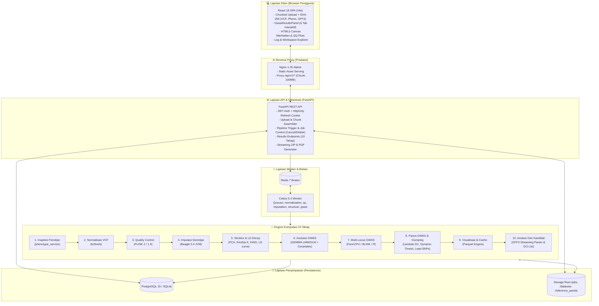
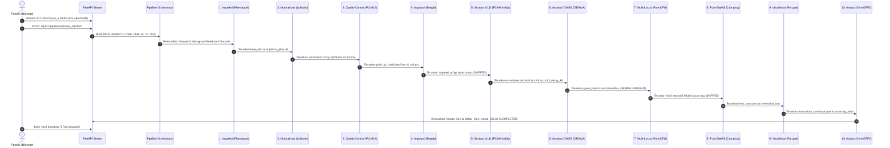

# 🧬 Automated End-to-End GWAS Web Platform (10-Phase Pipeline)

Platform bioinformatika berbasis web (*full-stack*) untuk mengotomatisasi analisis **Genome-Wide Association Study (GWAS)** dari hulu ke hilir (*end-to-end*). Mengimplementasikan panduan ilmiah komprehensif **`Pipeline_Gwas.md`** dengan prinsip utama **"Inspect $\rightarrow$ Validate $\rightarrow$ Run"**, platform ini mengubah alur kerja CLI bioinformatika yang kompleks (**bcftools**, **PLINK 2 / 1.9**, **Beagle 5.4**, **GEMMA**, **GAPIT/R**, dan parser **GFF3**) menjadi antarmuka web modern yang interaktif, transparan, dan siap direproduksi (*reproducible*).

---

## 📌 Daftar Isi

1. [Gambaran Umum & Fitur Utama](#-1-gambaran-umum--fitur-utama)
2. [Arsitektur Sistem & Alur Data](#-2-arsitektur-sistem--alur-data)
3. [Tech Stack, Fungsi, dan Alasan Pemilihan](#-3-tech-stack-fungsi-dan-alasan-pemilihan)
4. [Alur Kerja Pipeline Bioinformatika 10 Tahap](#-4-alur-kerja-pipeline-bioinformatika-10-tahap)
5. [Fitur Manajemen Workspace, Log, & Kontrol Job](#-5-fitur-manajemen-workspace-log--kontrol-job)
6. [Visualisasi Interaktif & Antarmuka Hasil Multi-Tab](#-6-visualisasi-interaktif--antarmuka-hasil-multi-tab)
7. [Skema Database & Struktur Penyimpanan Disk](#-7-skema-database--struktur-penyimpanan-disk)
8. [Referensi Lengkap REST API](#-8-referensi-lengkap-rest-api)
9. [Panduan Instalasi & Menjalankan Aplikasi](#-9-panduan-instalasi--menjalankan-aplikasi)
10. [Pengujian Otomatis (Testing) & Pemecahan Masalah](#-10-pengujian-otomatis-testing--pemecahan-masalah)

---

## ✨ 1. Gambaran Umum & Fitur Utama

Analisis GWAS konvensional menuntut peneliti untuk mengeksekusi berbagai *tool* CLI secara terfragmentasi, mencocokkan ID sampel secara manual antara VCF dan file fenotipe, memantau memori JVM/OS agar tidak terjadi *Out-Of-Memory (OOM)*, melakukan pemodelan struktur populasi terpisah, serta menulis skrip R/Python untuk clumping varian dan anotasi gen.

**GWAS Web Platform** menyatukan seluruh siklus tersebut ke dalam 10 fase terpadu:

- **Chunked File Upload & Validasi Integritas SHA-256**: Mendukung unggahan file VCF terkompresi (`.vcf.gz`), file fenotipe (`.txt`/`.tsv`/`.csv`), dan anotasi genom (`.gff3`/`.gff3.gz`) berukuran besar melalui potongan *chunk* 5 MB dengan verifikasi *checksum* SHA-256.
- **Orkestrasi Pipeline 10 Tahap Otomatis ("Inspect $\rightarrow$ Validate $\rightarrow$ Run")**:
  1. **Fase 1: Fenotipe & Inspeksi Data**: Rekonsiliasi ID sampel VCF vs Fenotipe, deteksi missingness/duplikat, statistik deskriptif, histogram otomatis aturan **Freedman-Diaconis**, boxplot outlier Tukey, serta ekspor `keep_ids.txt` dan `pheno_plink.txt`.
  2. **Fase 1B: Normalisasi VCF (`bcftools`)**: Validasi header `#CHROM POS ID REF ALT`, pengurutan koordinat kromosom (`sort`), *left-alignment* opsional terhadap genom referensi FASTA (`norm`), dan pembuatan indeks Tabix (`.tbi`).
  3. **Fase 2: Quality Control Lanjutan (`PLINK 2 / 1.9`)**: Dukungan mode organisme (`inbred` galur murni/klonal tanpa HWE vs `outcross` dengan HWE), `--snps-only just-acgt`, `--max-alleles 2`, `--set-all-var-ids @:#`, `--keep keep_ids.txt`, serta perbandingan before/after QC (`qc_comparison.json`).
  4. **Fase Imputasi Genotipe Opsional (`Beagle 5.4`)**: Mode `none` (skip jujur dengan status transparan `[SKIPPED]`), `reference` (terpandu panel 1000 Genomes), dan `reference_free`.
  5. **Fase 3 + 4D: Struktur Populasi, Kinship & LD Decay**: LD pruning pairwise, dekomposisi PCA 10 PCs + PVE + k-means, Centered Kinship Matrix ($K = \frac{1}{p}WW^T$), tabel kekerabatan robust KING untuk deteksi sampel kembar/duplikat, kurva peluruhan LD decay dengan cutoff $r^2 < 0.2$, serta rekomendasi otomatis GLM vs LMM.
  6. **Fase 4A/4B: Analisis Asosiasi GWAS (GEMMA & GLM)**: Pengujian Linear Mixed Model (`gemma -lmm 4 -c covariates.txt`) dengan kovariat PC (kolom 1 sebagai intercept), pemetaan fenotipe terurut by IID ke kolom ke-6 file `.fam`, serta normalisasi hasil asosiasi ke format kanonikal 10 kolom TSV (`gwas_results.normalized.tsv`).
  7. **Fase 4C: Multi-Locus GWAS (`FarmCPU` & `BLINK`)**: Analisis multi-lokus iteratif via GAPIT/R dengan penanganan *graceful skip* jika lingkungan R tidak tersedia.
  8. **Fase 4E/4F: Pasca-GWAS, Lambda GC, Dynamic Thresholds & Clumping**: Estimasi faktor inflasi genomik $\lambda_{GC}$ tanpa *clamping* artifisial, penentuan ambang batas dinamis (Bonferroni, Suggestive, FDR Benjamini-Hochberg, LOD), dan LD-aware clumping untuk mengekstrak **Lead SNPs** independen (`lead_snps.json`).
  9. **Fase 4G: Visualisasi & Parquet Caching Berkinerja Tinggi**: Penyimpanan cache kolom berformat **Apache Parquet (Snappy)** dengan metadata ambang batas dan Lead SNPs tersemat.
  10. **Fase 5: Anotasi Gen Kandidat GFF3**: Parser GFF3 streaming, pemetaan Lead SNPs ke fitur gen terdekat dalam jendela LD decay, klasifikasi biologis (*Genik*, *Near-gen*, *Intergenik*), dan ekspor `Daftar_Gen_Untuk_GO.txt` untuk pengayaan Gene Ontology.
- **Pemantauan Log Eksekusi Per Tahap Secara *Real-Time***: Pengguna dapat membaca log asli dari seluruh 10 tahapan langsung dari browser dengan fitur *auto-refresh*, filter *Error/Warning*, pencarian teks, dan unduhan file log.
- **Visualisasi HTML5 `<canvas>` Anti-Crash**: **Manhattan Plot** dan **QQ Plot** dirender menggunakan **HTML5 2D Canvas** dengan deduplikasi piksel 2D, mampu menampilkan ratusan ribu varian dalam waktu $< 5\text{ ms}$ tanpa membuat browser membeku.
- **Ekspor Arsip Streaming ZIP & Laporan PDF Resmi**: Unduh seluruh artefak keluaran dalam satu bundel `.zip` streaming atau cetak laporan ringkasan eksekutif `.pdf` resmi publikasi.
- **Dual-Mode Execution**: Berjalan terdistribusi penuh di Docker Compose atau langsung di Windows/Linux tanpa Docker berkat SQLite dan mesin fallback statistik NumPy/Python.

---

## 🏗️ 2. Arsitektur Sistem & Alur Data



---

## 🛠️ 3. Tech Stack, Fungsi, dan Alasan Pemilihan

| Komponen | Teknologi | Fungsi & Alasan Pemilihan (*Rationale*) |
| :--- | :--- | :--- |
| **Backend API** | **FastAPI (Python 3.11–3.13)** | Kinerja tinggi berbasis *async/await*, validasi otomatis dengan Pydantic v2 (Rust core), dokumentasi Swagger interaktif, dan integrasi mulus dengan ekosistem bioinformatika ilmiah Python. |
| **Database ORM** | **SQLAlchemy 2.0 (PostgreSQL / SQLite)** | Konsistensi data relasional transaksional ACID (`User`, `Dataset`, `AnalysisJob`, `Result`) dengan dukungan fleksibilitas parameter dinamis JSONB. Mendukung mode lokal tanpa konfigurasi menggunakan SQLite. |
| **Asynchronous Queue** | **Celery 5.4 + Redis 7** | Menjalankan rantai komputasi 10 tahap secara non-blocking, mendukung pembagian antrean berbasis beban kerja, pemantauan waktu nyata, serta pembatalan paksa tugas (`revoke`). |
| **Komputasi Genomik** | **PLINK 2, bcftools, Beagle, GEMMA** | *Gold standard* bioinformatika global untuk manipulasi VCF, filtering varian berkecepatan tinggi, estimasi genotipe hilang, dan uji regresi Linear Mixed Model yang mengoreksi stratifikasi populasi. |
| **Komputasi Ilmiah** | **NumPy, SciPy, Pandas, PyArrow** | Aljabar linier matriks kekerabatan, dekomposisi PCA, uji distribusi $\chi^2$, formula Freedman-Diaconis, estimasi LD decay, dan pembacaan/penulisan kolumnar Parquet Snappy. |
| **Visualisasi Frontend** | **React 18 + HTML5 Canvas (Vite)** | Merender puluhan ribu varian SNP pada elemen canvas 2D tunggal dengan teknik *pixel-bucket deduplication*, menjamin visualisasi tidak pernah membeku (*anti-crash*) dalam waktu render $< 5\text{ ms}$. |

---

## 🔬 4. Alur Kerja Pipeline Bioinformatika 10 Tahap

Alur kerja dirangkai oleh [`pipeline_orchestrator.py`](backend/app/tasks/pipeline_orchestrator.py) menggunakan pola *piped context*:



---

## 📊 6. Visualisasi Interaktif & Antarmuka Hasil Multi-Tab

Halaman hasil ([`ResultsPage.jsx`](frontend/src/pages/ResultsPage.jsx) & [`GwasResultsPanel.jsx`](frontend/src/components/GwasResultsPanel.jsx)) menyajikan 6 tab interaktif yang komprehensif:

1. **📊 Manhattan & QQ Plot**:
   - Manhattan Plot & QQ Plot berbasis HTML5 2D Canvas dengan kecepatan render $< 5\text{ ms}$.
   - Bilah pengatur ambang batas dinamis (Bonferroni, Suggestive, FDR, LOD) yang mengubah garis ambang secara *real-time*.
   - Filter pemilihan kromosom spesifik (`ALL`, `1`, `2`, ..., `22`).
2. **🎯 Ambang Batas & Lead SNPs**:
   - Pemilih metode threshold dengan deskripsi formula dan kartu nilai $-\log_{10}(p)$.
   - Tabel Lead SNPs hasil clumping dengan rincian alel, efek beta, standar error, dan daftar varian yang ter-clump.
3. **🧬 Struktur Populasi & LD**:
   - Kartu rekomendasi model GLM vs LMM beserta temuan PCA dan Kinship.
   - Plot sebaran PCA (PC1 vs PC2) dengan pewarnaan klaster k-means dan Scree Plot (PVE varians terjelaskan).
   - Heatmap matriks kekerabatan (Centered Kinship) dan kurva peluruhan LD decay dengan penanda garis *half-decay*.
4. **🔍 Inspeksi & QC**:
   - Panel inspeksi fenotipe dengan histogram Freedman-Diaconis, boxplot outlier, dan metrik rekonsiliasi sampel.
   - Panel perbandingan QC sebelum vs sesudah filter varian dan sampel.
5. **🔬 Multi-Locus GWAS**:
   - Tabel perbandingan lokus puncak asosiasi antara Single-Locus vs Multi-Locus (FarmCPU & BLINK).
6. **🌿 Anotasi Gen GFF3**:
   - Tabel pemetaan Lead SNPs ke fitur gen terdekat dengan badge kategori biologis (Genik, Near-gen, Intergenik).
   - Tombol unduh satu klik untuk file `Daftar_Gen_Untuk_GO.txt`.

---

## 🔌 8. Referensi Lengkap REST API

Seluruh endpoint berada di bawah prefix `/api/v1` (kecuali `/health`). Dokumentasi interaktif Swagger UI tersedia di `http://localhost:8000/docs`.

### A. Autentikasi (`/api/v1/auth`)
| Metode | Endpoint | Deskripsi |
| :--- | :--- | :--- |
| `POST` | `/api/v1/auth/register` | Mendaftarkan akun peneliti baru (`email`, `password`). |
| `POST` | `/api/v1/auth/login` | Masuk dengan kredensial; menyetel HttpOnly refresh cookie dan access token. |
| `POST` | `/api/v1/auth/refresh` | Memperbarui access token secara otomatis. |
| `POST` | `/api/v1/auth/logout` | Menghapus sesi dan membersihkan cookie refresh token. |

### B. Unggahan & Manajemen Dataset (`/api/v1/upload`)
| Metode | Endpoint | Deskripsi |
| :--- | :--- | :--- |
| `GET` | `/api/v1/upload` | Mengambil daftar seluruh dataset yang telah diunggah di ruang kerja. |
| `POST` | `/api/v1/upload/chunk` | Mengunggah satu potongan (chunk) biner 5 MB file VCF. |
| `POST` | `/api/v1/upload/complete` | Menggabungkan chunk, memverifikasi SHA-256, dan memvalidasi header VCF. |
| `POST` | `/api/v1/upload/phenotype` | Mengunggah file fenotipe dan memvalidasi kolom trait serta ID sampel. |
| `POST` | `/api/v1/upload/annotation` | Mengunggah file anotasi referensi genom GFF3 (`.gff3` / `.gff3.gz`). |
| `DELETE` | `/api/v1/upload/{file_id}` | Menghapus dataset unggahan dari disk dan database. |

### C. Eksekusi Pipeline & Manajemen Job (`/api/v1/pipeline` & `/api/v1/jobs`)
| Metode | Endpoint | Deskripsi |
| :--- | :--- | :--- |
| `POST` | `/api/v1/pipeline/{dataset_id}/start` | Memicu eksekusi 10 tahap pipeline GWAS (`HTTP 202 Accepted`). |
| `GET` | `/api/v1/jobs` | Mengambil daftar riwayat job milik pengguna. |
| `GET` | `/api/v1/jobs/{job_id}/status` | Mengambil status keseluruhan, tahap aktif, waktu berjalan, dan log per tahap. |
| `GET` | `/api/v1/jobs/{job_id}/logs` | Mengambil teks log eksekusi lengkap dari seluruh tahapan. |
| `GET` | `/api/v1/jobs/{job_id}/files` | Mengambil daftar seluruh file input, intermediate, dan output dari sebuah job. |
| `GET` | `/api/v1/jobs/{job_id}/files/content` | Pratinjau teks (150 baris pertama) atau unduhan file fisik dari job. |
| `POST` | `/api/v1/jobs/{job_id}/cancel` | Membatalkan job aktif dan mencabut task Celery terkait. |
| `POST` | `/api/v1/jobs/{job_id}/retry` | Melanjutkan job yang berhenti dari tahap terakhir (`?from_scratch=false`) atau mengulang dari Tahap 1 (`?from_scratch=true`). |
| `DELETE` | `/api/v1/jobs/{job_id}` | Menghapus riwayat job dan membersihkan direktori kerjanya di disk. |

### D. Hasil Analisis Komprehensif (`/api/v1/results`)
| Metode | Endpoint | Deskripsi |
| :--- | :--- | :--- |
| `GET` | `/api/v1/results/{job_id}/manhattan-data` | Data terkompresi CHR, BP, SNP, $-\log_{10}(p)$ untuk Manhattan & QQ Plot. |
| `GET` | `/api/v1/results/{job_id}/inspection` | Data hasil inspeksi fenotipe, histogram Freedman-Diaconis, dan boxplot (Fase 1). |
| `GET` | `/api/v1/results/{job_id}/qc-comparison` | Data perbandingan metrik sebelum/sesudah QC (Fase 2). |
| `GET` | `/api/v1/results/{job_id}/pca` | Data koordinat PCA 10 komponen utama dan nilai PVE varians terjelaskan (Fase 3). |
| `GET` | `/api/v1/results/{job_id}/kinship` | Data matriks kekerabatan Centered Kinship dan tabel KING (Fase 3). |
| `GET` | `/api/v1/results/{job_id}/ld-decay` | Data evaluasi kurva peluruhan nilai $r^2$ terhadap jarak fisik (Fase 4D). |
| `GET` | `/api/v1/results/{job_id}/model-recommendation`| Rekomendasi otomatis pemilihan model statistik GLM vs LMM (Fase 3). |
| `GET` | `/api/v1/results/{job_id}/thresholds` | Ambang signifikansi dinamis Bonferroni, FDR, LOD, Suggestive (Fase 4E). |
| `GET` | `/api/v1/results/{job_id}/lead-snps` | Daftar varian Lead SNPs independen hasil clumping (Fase 4F). |
| `GET` | `/api/v1/results/{job_id}/peak-comparison` | Perbandingan puncak Single-Locus vs Multi-Locus GWAS (Fase 4H). |
| `GET` | `/api/v1/results/{job_id}/candidate-genes` | Pemetaan Lead SNPs ke fitur gen GFF3 dan daftar GO enrichment (Fase 5). |
| `GET` | `/api/v1/results/{job_id}/export` | Aliran *streaming* unduhan berkas arsip `.zip` seluruh artefak job. |
| `GET` | `/api/v1/results/{job_id}/report` | Unduhan dokumen laporan ilmiah resmi berformat PDF. |

---

## 🧪 10. Pengujian Otomatis (Testing)

Suite pengujian otomatis mencakup **34 pengujian unit dan pengujian integrasi end-to-end** yang semuanya berhasil lulus (**34 passed**):

```powershell
# Jalankan seluruh unit & e2e testing backend
pytest backend/tests -v
```

Hasil verifikasi:
```text
backend\tests\test_annotation_service.py ...                             [  8%]
backend\tests\test_assoc_normalizer.py ....                              [ 20%]
backend\tests\test_jobs_api.py .                                         [ 23%]
backend\tests\test_m0_foundation.py ...                                  [ 32%]
backend\tests\test_m1_models_schemas.py ....                             [ 44%]
backend\tests\test_phenotype_service.py ...                              [ 52%]
backend\tests\test_pipeline_e2e.py .                                     [ 55%]
backend\tests\test_postgwas_service.py ...                               [ 64%]
backend\tests\test_process.py ..                                         [ 70%]
backend\tests\test_qc_commands.py .....                                  [ 85%]
backend\tests\test_structure_service.py .....                            [100%]
======================= 34 passed in 20.45s =======================
```

Pemeriksaan kualitas kode dan build frontend:
```powershell
npm --prefix frontend run lint   # 0 errors, 0 warnings
npm --prefix frontend run build  # built in 1.61s
```
