# 🧭 Rencana Integrasi `Pipeline_Gwas.md` → `gwas-platform`

> **Dokumen ini adalah instruksi eksekusi untuk AI coding agent.**
> Baca seluruh dokumen sebelum mulai. Kerjakan milestone **secara berurutan** (M0 → M10). Setiap milestone memiliki *Acceptance Criteria* dan *Verifikasi* yang **wajib lulus** sebelum lanjut ke milestone berikutnya.
>
> - Sumber metodologi: [`Pipeline_Gwas.md`](../Pipeline_Gwas.md) (Fase 1–5 detail, Fase 6–8 hanya di peta alur).
> - Bahasa UI & log: **Bahasa Indonesia**. Nama kode/identifier: **English**.
> - Tanggal penyusunan: 2026-10-28.

---

## 0. Aturan Main untuk Agent (WAJIB DIBACA)

1. **Jangan berasumsi struktur folder dari dokumentasi lama.** `README.md`, `PROJECT_STRUCTURE.md`, dan `docs/design.md` saat ini **menyebut path yang salah** (mis. `app/api/v1/`, `app/workers/`, `app/models/`). Path yang **benar** ada di §1.1 dokumen ini. Selalu verifikasi dengan membaca file sebelum mengedit.
2. **Pertahankan dual-mode execution**: setiap tahap baru harus berjalan di:
   - **Mode Docker/Linux** → memakai biner CLI asli (`plink2`, `plink`, `gemma`, `bcftools`, `java -jar beagle.jar`, opsional `Rscript`).
   - **Mode lokal Windows tanpa biner** → *fallback* Python/NumPy yang **secara statistik benar** (bukan data palsu). Log wajib menulis baris `[FALLBACK] ...` yang menjelaskan bahwa fallback dipakai dan kenapa.
3. **Integritas ilmiah > "asal jalan"**. Dilarang:
   - membuat fenotipe sintetis dari genotipe untuk analisis sungguhan (circular → asosiasi palsu),
   - meng-*clamp* nilai statistik (mis. λGC) ke rentang "cantik",
   - mencocokkan fenotipe ke sampel **berdasarkan urutan baris** (wajib berdasarkan `IID`).
   Jika data tidak memadai → gagalkan tahap dengan pesan jelas, atau tandai tahap `skipped` beserta alasannya.
4. **Semua subprocess** lewat helper yang sudah ada (`run_cli_command` di [`app/utils/process.py`](../backend/app/utils/process.py)) dengan argumen *list* (`shell=False`) dan log ke file tahap.
5. **Jangan menghapus** file legacy (`app/tasks/pipeline_tasks.py`, `app/api/routes/datasets_and_jobs_isolation_example.py`) kecuali sudah diverifikasi tidak di-import di mana pun; itu di luar scope.
6. **Komentar & docstring yang tidak terkait perubahan harus dipertahankan.**
7. **Tidak menambah pustaka chart frontend baru.** Semua visualisasi baru memakai HTML5 `<canvas>` (konsisten dengan `ManhattanPlot.jsx`/`QQPlot.jsx`) untuk performa data besar.
8. Setelah setiap milestone jalankan verifikasi standar (§11). Jangan lanjut jika ada test/lint yang gagal.

---

## 1. Kondisi Kode Saat Ini (Hasil Audit)

### 1.1 Peta file yang relevan (path AKTUAL)

| Area | File | Peran saat ini |
| :--- | :--- | :--- |
| Entrypoint | `backend/app/main.py` | FastAPI app, `_init_database()` (create_all + seed reference panel), router prefix `/api/v1` |
| Config | `backend/app/core/config.py` | `settings.STORAGE_ROOT`, fallback SQLite `backend/gwas_local.db` |
| Model DB | `backend/app/db/engine/models.py` | `User`, `Dataset`, `AnalysisJob`, `Result`, `ReferencePanel`; enum `PipelineStep`, `JobStatus`, `ResultType`, `UploadStatus`; tipe `UUID` & `JSONVariant` |
| Migrasi | `backend/alembic/versions/b5f7c68dd45f_create_users_table.py` | Satu-satunya migrasi |
| Schema | `backend/app/schemas/pipeline.py` | `QCPipelineConfig`, `ImputationPipelineConfig`, `GWASPipelineConfig`, `FullPipelineRequest` |
| Schema | `backend/app/schemas/jobs.py`, `results.py`, `upload.py` | Status job, `StepLogEntry`, Manhattan payload, upload |
| Route | `backend/app/api/routes/pipeline.py` | `POST /pipeline/{dataset_id}/start` |
| Route | `backend/app/api/routes/jobs.py` | list/status/logs/files/content/results/cancel/delete; `_STEP_DEFINITIONS`, `_STAGE_LABELS`, `_collect_step_logs`, `_discover_job_files` |
| Route | `backend/app/api/routes/upload.py` | `GET /upload/datasets`, `init`, `chunk`, `finalize`, `status`, `download`, `DELETE` |
| Route | `backend/app/api/routes/results.py`, `export.py`, `report.py`, `reference_panels.py` | Manhattan data, ZIP, PDF, panel |
| Orkestrator | `backend/app/tasks/pipeline_orchestrator.py` | `build_full_pipeline()` → `chain(normalization, qc, imputation, gemma)` |
| Celery | `backend/app/tasks/celery_app.py` | Celery asli **atau** `_LocalCelery`/`_LocalChain` (thread lokal) bila Celery/Redis tidak ada |
| Task | `backend/app/tasks/normalization_tasks.py` | `run_vcf_normalization` → `bcftools.log` |
| Task | `backend/app/tasks/qc_tasks.py` | `run_qc_pipeline` (PLINK 1.9) → `qc/plink_qc.{bed,bim,fam,vcf.gz}`, `plink_qc.log` |
| Task | `backend/app/tasks/imputation_tasks.py` | `run_imputation` (Beagle; fallback salin VCF QC) → `imputation/imputed.vcf.gz`, `beagle.log` |
| Task | `backend/app/tasks/gemma_tasks.py` | `run_gemma_gwas`: konversi VCF→bfile, kinship `-gk 1`, `-lmm 4`/`-lm 1`, fallback statistik, **plus** cache Manhattan & set `COMPLETED` |
| Service | `backend/app/services/qc_service.py` | `build_plink_qc_command()` |
| Service | `backend/app/services/manhattan_parser.py` | `generate_manhattan_cache`, `compute_assoc_summary_stats`, `cap_manhattan_dataframe` |
| Service | `backend/app/services/report_generator.py` | PDF, `parse_qc_summary_from_log` |
| Frontend page | `frontend/src/pages/GwasUploadPage.jsx` | Upload VCF + form konfigurasi + tracker |
| Frontend page | `frontend/src/pages/ResultsPage.jsx` | `ResultDashboard`, `GwasResultsPanel`, `JobFilesPanel`, `JobProcessLogs` |
| Frontend API | `frontend/src/api/jobsApi.js`, `httpClient.js`, `apiClient.js` | Axios client & fungsi API |
| Frontend comp | `ManhattanPlot.jsx`, `QQPlot.jsx`, `JobStatusTracker.jsx`, `JobProcessLogs.jsx`, `JobFilesPanel.jsx`, `WorkspaceExplorer.jsx`, `VcfUploader.jsx` | UI eksisting |
| Tests | `backend/tests/test_pipeline_e2e.py` (memakai `InMemoryDB`), `test_jobs_api.py`, `test_process.py`, `conftest.py`; `frontend/src/components/JobStatusTracker.test.jsx` | |
| Docker | `backend/Dockerfile` | Menginstal `bcftools`, **PLINK 1.9**, GEMMA 0.98.5, Beagle 22Jul22 (5.4). **Belum ada `plink2` & R** |

### 1.2 Masalah yang ditemukan dan WAJIB diperbaiki dalam rencana ini

| # | Lokasi | Masalah | Dampak |
| :-: | :--- | :--- | :--- |
| B1 | `gemma_tasks._prepare_phenotype_vector` | Jika fenotipe tidak diberikan, fenotipe **disintesis dari dosis genotipe** | Asosiasi palsu (circular) — hasil tidak valid secara ilmiah |
| B2 | `gemma_tasks._prepare_phenotype_vector` | Fenotipe dibaca **berdasarkan urutan baris**, bukan dicocokkan `IID` | Fenotipe salah pasang ke sampel |
| B3 | `manhattan_parser.compute_assoc_summary_stats` | Tanpa `scipy`, λGC dihitung dengan aproksimasi lalu di-**clamp** ke `[0.85, 1.35]` | λGC menyesatkan; `scipy` tidak ada di `requirements.txt` |
| B4 | `GwasUploadPage.jsx` | Fenotipe hanya berupa *text path* di volume worker, tidak bisa diunggah user | Fase 1 tidak mungkin dilakukan dari UI |
| B5 | `qc_tasks` / `qc_service` | Tidak ada `--keep`, mode organisme, `--snps-only`, `--max-alleles 2`, `--set-all-var-ids`, ringkasan sebelum/sesudah | Tidak sesuai Fase 2 |
| B6 | `gemma_tasks` | Kinship dihitung di tahap GWAS; tidak ada LD pruning/PCA; PC tidak bisa jadi kovariat | Tidak sesuai Fase 3 & 4B |
| B7 | Tasks | Tidak ada *checkpoint* pembatalan di task; di mode lokal `revoke` tidak berefek sehingga chain tetap jalan | Cancel tidak andal di mode lokal |
| B8 | Tasks | `_mark_job` diduplikasi di banyak file | Rawan inkonsisten |
| B9 | `gemma_tasks` | Tahap visualisasi (5) tergabung di task GEMMA | Sulit menambah tahap pasca-GWAS |
| B10 | Docs | Path di README/PROJECT_STRUCTURE/design.md tidak sesuai kode | Menyesatkan |

### 1.3 Bagian `Pipeline_Gwas.md` yang belum lengkap & keputusan default

| Bagian di dokumen | Kondisi | Keputusan default dalam rencana ini |
| :--- | :--- | :--- |
| 2.1 "Kawin silang/Outcross" | Hanya tertulis `HWE` | Mode `outcross` = parameter QC inbred **+** `--hwe 1e-6` (dapat diubah) |
| 3.3.2 Scree plot | `placeholder` | Implementasi di frontend: bar PVE per PC + garis kumulatif |
| 3.2 PCA R code | `pve <- eigenval$V1 / sum(eigenval$V1 * 100)` (**salah tanda kurung**) | Gunakan `PVE_i = λ_i / Σλ × 100` |
| 4B GEMMA `-cov` | GEMMA **tidak punya** flag `-cov`; flag kovariat adalah `-c` (file tanpa header, kolom pertama = 1 untuk intercept, urutan baris = urutan `.fam`) | Pakai `-c covariates.txt` |
| 4C Multi-locus (FarmCPU/BLINK GAPIT3) | Blok kode kosong | Implementasi **opsional** via `Rscript` + GAPIT3, *feature-flag*; jika R/GAPIT tidak tersedia → tahap `skipped` dengan alasan |
| 4G Manhattan | "ini belom kelar" | Pakai `ManhattanPlot.jsx` eksisting + garis threshold dinamis |
| Kinship (Catatan B) | Tabel mengacu ke **KING (PLINK2)**, sedangkan LMM memakai matriks GEMMA `cXX` | Hitung **dua-duanya**: KING (keputusan kekerabatan/duplikat) dan GEMMA `cXX` (model LMM). Label estimator selalu ditampilkan |
| 5 "hasil GO enrichment" | Metode tidak dijelaskan | Scope: **ekspor** `Daftar_Gen_Untuk_GO.txt` saja. Enrichment = backlog |
| Fase 6–8 (flanking, Primer3, BLAST) | Hanya di peta alur | **Di luar scope** rencana ini → Backlog §12 |

---

## 2. Arsitektur Target

### 2.1 Urutan tahap pipeline baru

```mermaid
flowchart LR
    A["0. Pre-run Inspection (sinkron, sebelum job)"] --> S1
    S1["1. inspection"] --> S2["2. normalization"]
    S2 --> S3["3. qc"]
    S3 --> S4["4. imputation (opsional)"]
    S4 --> S5["5. structure: LD prune, PCA, KING, kinship cXX, LD decay"]
    S5 --> S6["6. gwas: GLM plink2 / LMM GEMMA"]
    S6 --> S7["7. postgwas: lambda, threshold, clumping"]
    S7 --> S8["8. visualization cache"]
    S8 --> S9["9. annotation GFF3 (opsional)"]
    S6 -.-> S10["6b. multilocus GAPIT (opsional, flag)"]
    S10 -.-> S7
```



| Kunci tahap (`PipelineStep`) | Fase dokumen | Tool utama | Fallback lokal | Log | Folder output |
| :--- | :--- | :--- | :--- | :--- | :--- |
| `inspection` | Fase 1 | `bcftools query -l` | parser header VCF Python | `inspection/inspection.log` | `jobs/{id}/inspection/` |
| `normalization` | (eksisting) | `bcftools` | eksisting | `normalization/bcftools.log` | `jobs/{id}/normalization/` |
| `qc` | Fase 2 | `plink2` (fallback `plink` 1.9) | eksisting + filter Python | `qc/plink_qc.log` | `jobs/{id}/qc/` |
| `imputation` | Fase 2 (opsional) | Beagle | lewati (*skip*) | `imputation/beagle.log` | `jobs/{id}/imputation/` |
| `structure` | Fase 3 + 4D | `plink2 --indep-pairwise/--pca/--make-king-table/--r2-unphased`, `gemma -gk 1` | NumPy | `structure/structure.log` | `jobs/{id}/structure/` |
| `gwas` | Fase 4A/4B | `plink2 --glm`, `gemma -lmm 4` | NumPy (OLS/GLS) | `gwas/gemma.log` (nama dipertahankan agar kompatibel) | `jobs/{id}/gwas/` |
| `multilocus` | Fase 4C | `Rscript` + GAPIT3 | **tidak ada** → `skipped` | `multilocus/multilocus.log` | `jobs/{id}/multilocus/` |
| `postgwas` | Fase 4E/4F/4H | `plink2 --clump` | clumping greedy Python | `postgwas/postgwas.log` | `jobs/{id}/postgwas/` |
| `visualization` | 4G | Pandas/PyArrow | — | `visualization/visualization.log` | `jobs/{id}/visualization/` |
| `annotation` | Fase 5 | Python (parser GFF3) | — | `annotation/annotation.log` | `jobs/{id}/annotation/` |

### 2.2 Pola passing data antar task (WAJIB)

Saat ini setiap task mengembalikan dict kecil (mis. `{"output_vcf": ...}`). Untuk tahap baru yang butuh banyak artefak, gunakan **context akumulatif**:

```python
# setiap task menerima `ctx` (hasil task sebelumnya) sebagai argumen posisional pertama
def run_structure(self, ctx: dict, job_id: str, params: dict) -> dict:
    ...
    return {**ctx, "pruned_snplist": str(p), "eigenvec_path": str(ev), "kinship_cxx_path": str(k), "ld_decay_kb": 50.0}
```

- Ubah task eksisting agar juga mengembalikan `{**(prev or {}), ...kunci_baru}` (tetap pertahankan kunci lama seperti `normalized_vcf_path`, `qc_vcf_path`, `output_prefix`, `output_vcf`).
- Kunci kanonik: `job_id`, `dataset_id`, `keep_ids_path`, `pheno_path`, `trait`, `normalized_vcf_path`, `qc_bfile_prefix`, `qc_vcf_path`, `genotype_vcf_path` (hasil imputasi atau QC), `genotype_bfile_prefix`, `pruned_snplist`, `eigenvec_path`, `eigenval_path`, `king_table_path`, `kinship_cxx_path`, `ld_decay_kb`, `model_used`, `assoc_raw_path`, `assoc_normalized_path`, `threshold`, `lead_snps_path`, `manhattan_cache_path`, `candidate_genes_path`.

### 2.3 Modul bersama baru: `backend/app/tasks/_common.py`

Pindahkan/duplikasi-kan (B8) helper berikut ke satu modul dan pakai di semua task (task lama boleh tetap memakai helper lokal bila refactor berisiko, tetapi task baru WAJIB memakai `_common`):

- `mark_job(job_id, *, status=None, error=None, **fields)`
- `append_log(log_file: Path, message: str)` (timestamp opsional)
- `stage_dir(job_id, stage) -> Path` (`settings.STORAGE_ROOT/jobs/{id}/{stage}`, `mkdir`)
- `ensure_not_cancelled(job_id)` → baca `overall_status`; jika `CANCELLED` lempar `JobCancelledError` (B7). **Panggil di awal setiap task dan di antara sub-langkah berat.**
- `upsert_result(db, job_id, result_type, file_path, summary_stats)`
- `which_tool(name_env, default) -> str | None` (resolve biner via env var + `shutil.which`)
- `write_json(path, obj)` / `read_json(path)`

`JobCancelledError` harus ditangani: task tidak menandai `FAILED`, cukup tulis `[CANCELLED]` ke log dan *re-raise* agar chain berhenti (di `_LocalChain`, exception menghentikan loop — verifikasi di `celery_app.py`).

---

## 3. Perubahan Data Model & Konfigurasi

### 3.1 Enum (`backend/app/db/engine/models.py`)

```python
class PipelineStep(str, enum.Enum):
    INSPECTION = "inspection"
    NORMALIZATION = "normalization"
    QC = "qc"
    IMPUTATION = "imputation"
    STRUCTURE = "structure"
    GWAS = "gwas"
    MULTILOCUS = "multilocus"
    POSTGWAS = "postgwas"
    VISUALIZATION = "visualization"
    ANNOTATION = "annotation"

class JobStatus(str, enum.Enum):
    # nilai lama dipertahankan, tambahkan:
    RUNNING_INSPECTION = "running_inspection"
    RUNNING_STRUCTURE = "running_structure"
    RUNNING_MULTILOCUS = "running_multilocus"
    RUNNING_POSTGWAS = "running_postgwas"
    RUNNING_ANNOTATION = "running_annotation"

class ResultType(str, enum.Enum):
    # nilai lama dipertahankan, tambahkan:
    INSPECTION_REPORT = "inspection_report"
    QC_COMPARISON = "qc_comparison"
    PCA_DATA = "pca_data"
    KINSHIP_DATA = "kinship_data"
    LD_DECAY = "ld_decay"
    MODEL_RECOMMENDATION = "model_recommendation"
    THRESHOLDS = "thresholds"
    LEAD_SNPS = "lead_snps"
    MULTILOCUS_RESULTS = "multilocus_results"
    PEAK_COMPARISON = "peak_comparison"
    CANDIDATE_GENES = "candidate_genes"
```

### 3.2 Kolom baru `Dataset`

| Kolom | Tipe | Keterangan |
| :--- | :--- | :--- |
| `phenotype_file_path` | (sudah ada) | Sekarang diisi oleh endpoint upload fenotipe |
| `annotation_file_path` | `String(1024)`, nullable | File GFF3 (`.gff3` / `.gff3.gz`) |
| `extra_metadata` | `JSONVariant`, nullable | `{ "phenotype": {...ringkasan kolom...}, "vcf_samples_count": n, "organism_name": "...", "annotation": {...} }` |

### 3.3 Migrasi

1. Buat migrasi Alembic baru di `backend/alembic/versions/` yang:
   - `ALTER TYPE ... ADD VALUE IF NOT EXISTS` untuk enum `pipeline_step`, `job_status`, `result_type` (khusus PostgreSQL; bungkus dengan `op.get_bind().dialect.name == "postgresql"` dan jalankan di luar transaksi: `with op.get_context().autocommit_block():`).
   - `op.add_column("datasets", ...)` untuk dua kolom baru.
2. **Mode lokal SQLite** (`gwas_local.db` sudah ada & `create_all` tidak menambah kolom): tambahkan fungsi `_ensure_sqlite_columns(engine)` di `main._init_database()` yang memeriksa `PRAGMA table_info(datasets)` dan menjalankan `ALTER TABLE datasets ADD COLUMN ...` bila kolom belum ada. SQLAlchemy `Enum` default `create_constraint=False` sehingga nilai enum baru aman di SQLite — **verifikasi** dengan test.

### 3.4 Dependensi

- `backend/requirements.txt`: tambah `scipy` (B3; dipakai untuk `chi2`, `t`, `norm`, clustering heatmap).
- `backend/Dockerfile`: tambah instalasi **PLINK 2** ke `/usr/local/bin/plink2` (binary resmi `plink2_linux_x86_64_*.zip` dari s3 plink2-assets; versi dijadikan `ARG`). Tambah ENV `PLINK2_BINARY_PATH=plink2`.
- (Opsional M8) Image terpisah atau stage opsional `r-gapit` dengan `r-base` + paket `GAPIT` (via `devtools::install_github("jiabowang/GAPIT")`). Gunakan `ARG ENABLE_GAPIT=false` agar build default tidak membengkak. ENV `RSCRIPT_BINARY_PATH=Rscript`.
- `.env.example`: dokumentasikan `PLINK2_BINARY_PATH`, `RSCRIPT_BINARY_PATH`, `ENABLE_MULTILOCUS`.

### 3.5 Schema request pipeline baru (`backend/app/schemas/pipeline.py`)

Perluas tanpa merusak klien lama (semua field baru punya default; `imputation.reference_vcf_path` menjadi opsional):

```python
class PopulationType(str, Enum):
    INBRED = "inbred"      # inbred / selfing / klonal / vegetatif -> TANPA HWE
    OUTCROSS = "outcross"  # kawin silang -> dengan HWE

class PhenotypeConfig(BaseModel):
    trait: str                                  # nama kolom trait di file fenotipe (WAJIB)
    id_column: str = "IID"
    fid_column: str | None = "FID"
    missing_tokens: list[str] = ["", ".", "NA", "-9"]

class QCPipelineConfig(BaseModel):
    population_type: PopulationType = PopulationType.INBRED
    maf: float = Field(0.05, ge=0, le=0.5)
    geno: float = Field(0.05, ge=0, le=1)
    mind: float = Field(0.05, ge=0, le=1)
    hwe: float | None = Field(None, ge=0, le=1)   # diabaikan (dipaksa None) bila population_type == inbred
    snps_only: bool = True                         # --snps-only just-acgt
    max_alleles: int = Field(2, ge=2, le=2)        # --max-alleles 2
    set_missing_var_ids: bool = True               # --set-all-var-ids @:#
    memory_mb: int | None = Field(None, ge=512)    # --memory
    max_snp_loss_warning: float = 0.5              # peringatan bila >50% SNP hilang

class ImputationPipelineConfig(BaseModel):
    mode: Literal["none", "reference", "reference_free"] = "none"
    reference_vcf_path: str | None = None          # wajib bila mode == "reference"
    nthreads: int = Field(2, ge=1, le=64)
    beagle_max_memory: str | None = Field(None, pattern=r"^-Xmx\d+[mMgG]$")
    chromosome: str | None = None
    map_path: str | None = None

class StructureConfig(BaseModel):
    prune_window: int = 50
    prune_step: int = 5
    prune_r2: float = Field(0.2, gt=0, lt=1)
    n_pcs: int = Field(10, ge=2, le=20)
    ld_decay_window_kb: int = Field(1000, ge=10, le=5000)
    ld_decay_bin_kb: int = Field(10, ge=1, le=100)
    ld_decay_r2_cutoff: float = Field(0.2, gt=0, lt=1)
    ld_decay_max_snps: int = Field(20000, ge=500)  # thinning agar tidak meledak
    ld_decay_fallback_kb: int = 100                # dipakai jika kurva tidak tembus cutoff

class GWASPipelineConfig(BaseModel):
    phenotype_path: str | None = None              # kompatibilitas lama; default ambil dari Dataset
    model: Literal["auto", "glm", "lmm", "lm"] = "auto"
    n_pc_covariates: int = Field(3, ge=0, le=20)
    enable_multilocus: bool = False
    multilocus_methods: list[Literal["FarmCPU", "BLINK"]] = ["FarmCPU", "BLINK"]

class ThresholdConfig(BaseModel):
    method: Literal["bonferroni", "fdr", "lod"] = "bonferroni"
    alpha: float = Field(0.05, gt=0, lt=1)
    lod_score: float = Field(5.6, gt=0)
    suggestive_p: float = 1e-5

class ClumpConfig(BaseModel):
    p2: float = 1e-4
    r2: float = 0.2
    kb: int | None = None                          # None -> pakai ld_decay_kb hasil tahap structure

class AnnotationConfig(BaseModel):
    enabled: bool = True                           # otomatis skip bila dataset tidak punya GFF3
    feature_type: str = "gene"
    window_kb: int | None = None                   # None -> pakai ld_decay_kb

class FullPipelineRequest(BaseModel):
    phenotype: PhenotypeConfig
    qc: QCPipelineConfig = Field(default_factory=QCPipelineConfig)
    imputation: ImputationPipelineConfig = Field(default_factory=ImputationPipelineConfig)
    structure: StructureConfig = Field(default_factory=StructureConfig)
    gwas: GWASPipelineConfig = Field(default_factory=GWASPipelineConfig)
    threshold: ThresholdConfig = Field(default_factory=ThresholdConfig)
    clump: ClumpConfig = Field(default_factory=ClumpConfig)
    annotation: AnnotationConfig = Field(default_factory=AnnotationConfig)
```

Validator (`model_validator`):
- `qc.population_type == inbred` → set `qc.hwe = None`; `outcross` dan `hwe is None` → `1e-6`.
- `imputation.mode == "reference"` → `reference_vcf_path` wajib.
- `gwas.enable_multilocus` → hanya diterima jika capability `multilocus` tersedia (cek di route, kembalikan `422` dengan pesan).

Route `start_pipeline_endpoint` wajib menolak (`409`) bila `dataset.phenotype_file_path` kosong atau kolom `phenotype.trait` tidak ada di file.

---

## 4. Endpoint API Baru / Berubah

Semua di bawah `/api/v1`, memakai `get_current_user` dan cek kepemilikan (pola `_owned_dataset` / `_is_admin` yang sudah ada).

### 4.1 Dataset: fenotipe, anotasi, inspeksi (file `backend/app/api/routes/upload.py`)

| Metode | Path | Deskripsi |
| :--- | :--- | :--- |
| `POST` | `/upload/{file_id}/phenotype` | Multipart `file` (`.txt/.tsv/.csv`, ≤ 50 MB). Deteksi delimiter (tab/spasi/koma), wajib header. Simpan ke `datasets/{file_id}/phenotype.<ext>`; isi `Dataset.phenotype_file_path` & `extra_metadata.phenotype = {columns, n_rows, numeric_columns}`. Response: kolom, 5 baris preview, kolom numerik kandidat trait |
| `DELETE` | `/upload/{file_id}/phenotype` | Hapus file fenotipe (tolak `409` jika ada job aktif memakai dataset) |
| `POST` | `/upload/{file_id}/annotation` | Multipart GFF3 (`.gff3`, `.gff`, `.gff3.gz`; ≤ 95 MB karena `client_max_body_size 100M` di Nginx). Validasi baris `##gff-version 3` atau 9 kolom; hitung jumlah fitur `gene`, daftar `seqid` |
| `DELETE` | `/upload/{file_id}/annotation` | Hapus GFF3 |
| `GET` | `/upload/{file_id}/inspection?trait=COL&id_column=IID` | **Pre-run Inspection (Fase 1) sinkron**: lihat §5.1. Untuk VCF besar, baca hanya header (`#CHROM`). Response JSON `InspectionReport` |
| `GET` | `/upload/{file_id}/inspection/files/{name}` | Unduh `keep_ids.txt`, `id_hanya_vcf.txt`, `id_hanya_fenotipe.txt`, `sampel_vcf.txt` |

`GET /upload/datasets` ditambah field: `has_phenotype`, `phenotype_columns`, `has_annotation`.

### 4.2 Kapabilitas tool (file baru `backend/app/api/routes/capabilities.py`, daftarkan di `main.py`)

`GET /pipeline/capabilities` →
```json
{ "plink2": true, "plink": true, "gemma": true, "bcftools": true, "beagle": false, "rscript": false, "gapit": false,
  "multilocus_available": false, "mode": "docker|local-fallback" }
```
Frontend memakai ini untuk menonaktifkan opsi yang tidak tersedia & menampilkan badge "Fallback Python".

### 4.3 Hasil analisis baru (file `backend/app/api/routes/results.py`)

| Metode | Path | Isi response |
| :--- | :--- | :--- |
| `GET` | `/results/{job_id}/inspection` | `InspectionReport` yang dibekukan saat job berjalan |
| `GET` | `/results/{job_id}/qc-comparison` | `{before:{n_snps,n_samples,maf_hist,missing_hist}, after:{...}, removed:{maf,geno,mind,hwe,non_snp,multiallelic}, snp_loss_fraction, warning}` |
| `GET` | `/results/{job_id}/pca` | `{samples:[{fid,iid,pcs:[...],cluster}], eigenvalues:[...], pve:[...], cumulative_pve:[...], k_clusters}` |
| `GET` | `/results/{job_id}/kinship?max_samples=300` | `{estimator:"gemma_cXX", order:[iid...], matrix:[[...]], downsampled:bool, king:{estimator:"KING-robust", pairs_summary:{duplicate:n, first_degree:n, second_degree:n, third_degree:n}, top_pairs:[...], histogram:{...}}}` |
| `GET` | `/results/{job_id}/ld-decay` | `{bins:[{bin_kb, mean_r2, n_pairs}], cutoff_r2, cutoff_kb|null, chosen_kb, reason, min_r2_observed}` |
| `GET` | `/results/{job_id}/model-recommendation` | `{pca_finding, kinship_finding, recommended_model, model_used, rationale:[...]}` |
| `GET` | `/results/{job_id}/thresholds` | `{n_tests, bonferroni, fdr|null, lod_p, lod_score, suggestive, selected_method, selected_p}` |
| `GET` | `/results/{job_id}/lead-snps` | Tabel hasil clumping `[{snp, chr, pos, p, beta, se, n_clumped, clumped_snps:[...]}]` |
| `GET` | `/results/{job_id}/peak-comparison` | Hanya bila multilocus: `{consistent:[...], multi_only:[...], single_only:[...]}` |
| `GET` | `/results/{job_id}/candidate-genes` | `{window_bp, rows:[{snp,chr,pos,nearest_gene,distance_bp,category,genes_in_window:[...]}], counts:{Genik,Near-gen,Intergenik}}` |
| `GET` | `/results/{job_id}/manhattan` (ubah) | Tambah `thresholds` (bonferroni, fdr, lod_p, suggestive, selected) & `lead_snps` (id) agar plot bisa menggambar garis & menyorot lead SNP |

Semua data disimpan sebagai JSON di folder tahap (mis. `structure/pca.json`) dan didaftarkan ke tabel `results` (`ResultType` baru, `file_path` → JSON). Endpoint cukup membaca JSON (cepat). Kembalikan `404` dengan `detail` jelas bila tahap belum selesai/skipped.

### 4.4 Endpoint eksisting yang harus diperbarui (`jobs.py`)

- `_STEP_DEFINITIONS` & `_STAGE_LABELS`: tambahkan 10 tahap §2.1 sesuai urutan.
- `_collect_step_logs`: tambahkan kandidat log baru; status `skipped` bila task menulis `skipped.json`/baris `[SKIPPED]` (tambahkan dukungan status ini).
- `_discover_job_files`: tambahkan folder `inspection`, `structure`, `multilocus`, `postgwas`, `visualization`, `annotation`; tambahkan `.json`, `.eigenvec`, `.eigenval`, `.prune.in`, `.clumps`, `.glm.linear`, `.kin0`, `.gff3` ke `_PREVIEWABLE_SUFFIXES` bila teks.
- `get_job_results_summary`: tambahkan `lambda_gc`, `threshold`, `n_lead_snps`, `model_used`, `n_candidate_genes`.

---

## 5. Spesifikasi Tahap Backend (Detail Algoritma)

> Untuk setiap tahap: (a) tulis header log `=== TAHAP n: NAMA ===`, waktu mulai, input, parameter, command; (b) `ensure_not_cancelled`; (c) jalankan CLI atau fallback; (d) tulis JSON hasil; (e) `upsert_result`; (f) `[SUCCESS]`/`[SKIPPED] alasan`; (g) kembalikan context.

### 5.1 Fase 1 — `inspection` (service baru `backend/app/services/phenotype_service.py`, task baru `backend/app/tasks/inspection_tasks.py`)

Service murni (dipakai endpoint pre-run **dan** task):

```python
def read_vcf_sample_ids(vcf_path) -> list[str]            # bcftools query -l; fallback: parse baris #CHROM (gzip/plain)
def load_phenotype_table(path) -> pandas.DataFrame       # dtype=str, auto-delimiter, strip spasi kolom & nilai
def inspect_phenotype(vcf_ids, df, trait, id_column="IID", missing_tokens=...) -> InspectionReport
```

`InspectionReport` berisi (mengikuti skrip R §1.2 & §1.3):
- `n_vcf_samples`, `n_pheno_rows`, `n_valid_pheno` (tidak missing & numerik), `n_matched` (irisan `IID` ∩ VCF dengan fenotipe valid)
- `vcf_empty_ids`, `vcf_duplicate_ids`, `pheno_empty_ids`, `pheno_duplicate_ids` (jumlah + max 50 contoh)
- `only_in_vcf`, `only_in_pheno` (jumlah + contoh)
- `non_numeric_values` (jumlah + contoh nilai)
- `stats`: `N, mean, median, sd, min, q1, q3, max, skewness`
- `histogram`: bin Freedman–Diaconis (batas 10–60 bin) `{edges:[...], counts:[...]}`
- `boxplot`: `{q1, median, q3, whisker_low, whisker_high, outliers:[{iid, value}]}` (1.5×IQR)
- `warnings`: mis. `n_matched < 30` ("Sampel terlalu sedikit untuk GWAS yang andal"), duplikat ID, >20% sampel VCF tidak punya fenotipe
- `blocking_errors`: kolom `IID`/trait tidak ada, `n_matched < 3` → job **tidak boleh** dimulai

Task `run_inspection(ctx=None, job_id, dataset_id, phenotype_cfg)`:
- tulis `inspection/sampel_vcf.txt`, `keep_ids.txt` (format PLINK2 `--keep`: **dua kolom `FID IID`**; bila VCF di-import dengan `--double-id`, FID=IID), `id_hanya_vcf.txt`, `id_hanya_fenotipe.txt`, `inspection_report.json`
- tulis `inspection/pheno_plink.txt`: header `FID IID <TRAIT>` hanya untuk sampel matched, nilai missing → `NA`
- gagal (`FAILED`) bila ada `blocking_errors`
- context: `keep_ids_path`, `pheno_path`, `trait`

### 5.2 `normalization` (eksisting)
Hanya: ganti helper ke `_common`, panggil `ensure_not_cancelled`, kembalikan `{**ctx, ...}`.

### 5.3 Fase 2 — `qc` (ubah `qc_service.py` & `qc_tasks.py`)

Command builder baru `build_plink2_qc_commands(cfg, input_vcf, keep_ids, pheno, trait, out_dir) -> list[list[str]]`:

```text
# langkah 0 – ringkasan sebelum QC
plink2 --vcf <in> --allow-extra-chr --double-id --freq --missing --out qc/before_qc

# langkah 1 – QC varian (sesuai §2.1 dokumen)
plink2 --vcf <in> --double-id --keep keep_ids.txt --snps-only just-acgt --max-alleles 2
       --set-all-var-ids @:# --allow-extra-chr --pheno pheno_plink.txt --pheno-name <TRAIT>
       --maf <maf> --geno <geno> [--hwe <hwe>  (HANYA outcross)] [--memory <mb>]
       --make-bed --out qc/qc_step1

# langkah 2 – QC sampel lanjutan
plink2 --bfile qc/qc_step1 --allow-extra-chr --mind <mind> --maf <maf> --make-bed --out qc/plink_qc

# langkah 3 – VCF untuk imputasi & parser genotipe
plink2 --bfile qc/plink_qc --allow-extra-chr --export vcf-4.2 bgz id-paste=iid --out qc/plink_qc

# langkah 4 – ringkasan sesudah QC
plink2 --bfile qc/plink_qc --allow-extra-chr --freq --missing --out qc/after_qc
```

- Jika `plink2` tidak ada tapi `plink` 1.9 ada → builder ekuivalen PLINK 1.9 (`--snps-only just-acgt`, `--biallelic-only strict`, `--set-missing-var-ids @:#`, `--recode vcf-iid bgz`). Jika keduanya tidak ada → fallback Python: filter MAF/GENO/MIND(/HWE exact-test bila outcross) pada matriks dosis, tulis `.bim/.fam` + `.bed` **SNP-major yang valid** (bukan 3 byte magic saja) dan `.vcf.gz`.
- **Pertahankan nama output `qc/plink_qc.*`** agar kompatibel dengan kode & test lain.
- `qc_comparison.json`: n SNP/sampel sebelum & sesudah (hitung baris `.bim`/`.fam`, atau `.pvar`), jumlah terbuang per filter (parse log PLINK: "variants removed due to ..."), histogram MAF & missingness (dari `.afreq`, `.vmiss`, `.smiss`), `snp_loss_fraction`; jika `> max_snp_loss_warning` → `warning` "SNP turun >50% — periksa filter (terutama HWE pada populasi inbred/klonal) atau pertimbangkan imputasi".
- Simpan ringkasan juga ke `job.parameters["qc_summary"]` (kompatibel dengan `parse_qc_summary_from_log` & PDF).

### 5.4 `imputation` (ubah `imputation_tasks.py`)
- `mode == "none"` → tulis `[SKIPPED] Imputasi tidak diminta`, context `genotype_vcf_path = qc_vcf_path`, `genotype_bfile_prefix = qc_bfile_prefix`.
- `mode == "reference"` → perilaku sekarang (Beagle `gt= ref= out=`).
- `mode == "reference_free"` → Beagle `gt=<qc.vcf.gz> out=imputation/imputed` (tanpa `ref=`).
- Bila Beagle/Java tidak tersedia → **jangan diam-diam menyalin**; tulis `[SKIPPED] Beagle tidak tersedia (mode lokal)` dan lanjut memakai data QC (status tahap `skipped`, bukan `done`).
- Setelah imputasi sukses: konversi balik `plink2 --vcf imputed.vcf.gz --double-id --allow-extra-chr --make-bed --out imputation/imputed` lalu **jalankan ulang filter QC ringan** (`--maf`, `--geno`) sesuai catatan dokumen ("lakukan imputasi sebelum mengulangi langkah QC").

### 5.5 Fase 3 + 4D — `structure` (task baru `backend/app/tasks/structure_tasks.py`, service `backend/app/services/structure_service.py`)

1. **LD pruning**: `plink2 --bfile <geno> --allow-extra-chr --indep-pairwise <w> <s> <r2> --out structure/ld_pruned` → `ld_pruned.prune.in`.
2. **PCA**: `plink2 --bfile <geno> --allow-extra-chr --extract structure/ld_pruned.prune.in --pca <n_pcs> --out structure/pca_results` → `.eigenvec`, `.eigenval`. Batasi `n_pcs ≤ n_samples − 1`.
3. **KING**: `plink2 --bfile <geno> --allow-extra-chr --extract ...prune.in --make-king-table --out structure/king` → `king.kin0`. Klasifikasi pasangan (KING-robust): `>0.354` duplikat/MZ, `0.177–0.354` derajat-1, `0.0884–0.177` derajat-2, `0.0442–0.0884` derajat-3.
4. **Kinship GEMMA**: pindahkan dari `gemma_tasks` ke sini: `gemma -bfile <geno> -gk 1 -outdir structure -o kinship` → `structure/kinship.cXX.txt`. (Pastikan kolom 6 `.fam` berisi fenotipe — lihat §5.6 langkah 1 — karena GEMMA mengabaikan individu dengan fenotipe missing.)
5. **LD decay** (pakai data QC, bukan pruned):
   - thinning bila SNP > `ld_decay_max_snps`: `plink2 ... --thin-count <max> --seed 42 --make-bed --out structure/ld_thin`
   - `plink2 --bfile structure/ld_thin --allow-extra-chr --r2-unphased --ld-window-kb <W> --ld-window-r2 0 --out structure/ld_decay_allchr` (**verifikasi nama flag dengan `plink2 --help r2-unphased`** sebelum menulis builder; versi plink2 berbeda dapat memakai `--ld-window` vs `--ld-window-kb`)
   - **Parsing streaming** (`pandas.read_csv(chunksize=500_000)`): `Distance_kb = |POS_B − POS_A|/1000`, bin per `ld_decay_bin_kb`, akumulasi `sum_r2` & `n` per bin (jangan load seluruh file).
   - `cutoff_kb` = bin terkecil dengan `mean_r2 < cutoff`; jika tidak ada → `cutoff_kb = null`, `chosen_kb = ld_decay_fallback_kb`, `reason = "r² terendah X di Y kb; tidak tembus 0.2, interval ditetapkan ±Z kb"` (sesuai catatan dokumen).
   - Hapus file `.vcor` mentah setelah binning bila > 200 MB (simpan hanya `ld_decay.json`) dan catat di log.
6. **Model recommendation** (`model_recommendation.json`) — engine berbasis aturan sesuai tabel Catatan A/B/C:
   - `pca_structure_detected` = PVE(PC1)+PVE(PC2) ≥ 10% **atau** silhouette k-means (k=2..4, pilih terbaik) ≥ 0.5
   - `pca_outliers` = sampel dengan |PC1| atau |PC2| > 6 SD
   - `kinship_detected` = proporsi pasangan KING ≥ derajat-2 ≥ 1% **atau** ada pasangan duplikat
   - Keputusan (Catatan C): struktur+kinship → `lmm` + PC; struktur saja → `glm` + PC; kinship saja → `lmm`; tidak keduanya → `glm` + PC sebagai pembanding (dengan teks "jangan berasumsi kontrol tidak diperlukan"). Untuk `population_type == inbred` default condong ke `lmm`.
   - Simpan juga `cluster` k-means per sampel ke `pca.json` (untuk pewarnaan scatter).
7. **Fallback Python** (tanpa plink2/gemma): matriks dosis dari VCF (mean-impute missing), pruning greedy sliding-window, PCA via SVD matriks terstandar (`eigenval = s²/(p)`; PVE relatif terhadap trace total → dokumentasikan perbedaan dengan PLINK yang relatif terhadap top-k), KING-robust via NumPy, kinship `K = W Wᵀ / p` (W = genotipe terpusat), LD r² = korelasi Pearson² dosis pada pasangan dalam jendela (batasi jumlah pasangan, mis. sampling 2 juta).
8. Context: `pruned_snplist`, `eigenvec_path`, `eigenval_path`, `king_table_path`, `kinship_cxx_path`, `ld_decay_kb`, `recommended_model`.

### 5.6 Fase 4A/4B — `gwas` (refactor `gemma_tasks.py`)

1. **Fenotipe (fix B1/B2)**: hapus pembuatan fenotipe sintetis untuk jalur produksi. Ambil `pheno_path` + `trait` dari context; tulis nilai fenotipe ke kolom 6 `.fam` **dengan mencocokkan IID** (`NA`/missing → `-9`). Jika tidak ada fenotipe → `FAILED` dengan pesan "File fenotipe wajib untuk analisis GWAS".
   - Fungsi sintetis lama boleh dipindahkan ke `backend/tests/fixtures/` untuk keperluan test saja.
2. **Kovariat PC**: `covariates.txt` = kolom `1` (intercept) + `PC1..PCk` (`k = n_pc_covariates`), **tanpa header**, urutan baris = urutan `.fam`, dicocokkan IID dari `.eigenvec`.
3. **Pemilihan model**: `model == "auto"` → pakai `recommended_model`; simpan `model_used` ke `job.parameters` dan log alasan.
4. **GLM (4A)**: `plink2 --bfile <geno> --allow-extra-chr --pheno pheno_plink.txt --pheno-name <TRAIT> --covar structure/pca_results.eigenvec --covar-col-nums 3-<2+k> --covar-variance-standardize --glm hide-covar --out gwas/gwas_glm` → `gwas_glm.<TRAIT>.glm.linear`. (Verifikasi format kolom `.eigenvec` plink2: `#FID IID PC1..` atau `#IID PC1..`.)
5. **LMM (4B)**: `gemma -bfile <geno> -k structure/kinship.cXX.txt -c gwas/covariates.txt -lmm 4 -n 1 -outdir gwas/output -o association` (catatan: **`-c`, bukan `-cov`**). `lm` legacy tetap didukung (`-lm 1`).
6. **Normalisasi output**: service baru `backend/app/services/assoc_normalizer.py` → `gwas/gwas_results.normalized.tsv` dengan kolom kanonik `chr  pos  rs  a1  a0  af  beta  se  p  n` dari GEMMA (`chr rs ps allele1 allele0 af beta se p_wald`) maupun plink2 (`#CHROM POS ID REF ALT A1 ... BETA SE ... P`, filter baris `TEST == ADD`). Semua tahap hilir **hanya** membaca file kanonik ini.
7. **Fallback Python**: OLS dengan kovariat PC (GLM) atau GLS setelah rotasi eigen `K` dengan estimasi δ (REML grid sederhana) untuk LMM; p-value dari distribusi `t` (scipy). Log `[FALLBACK]`.
8. **Pindahkan pembuatan cache Manhattan & status `COMPLETED` keluar dari task ini** (B9) ke tahap `visualization`/terakhir.

### 5.7 Fase 4C — `multilocus` (opsional, task baru `backend/app/tasks/multilocus_tasks.py`)
- Aktif hanya jika `gwas.enable_multilocus` dan capability `gapit` true; selain itu tulis `[SKIPPED]`.
- Siapkan input GAPIT: `GD` numerik (0/1/2) + `GM` (SNP, Chromosome, Position) dari bfile hasil QC (`plink2 --export A`), `Y` (Taxa, trait), `CV` = PC.
- Template R di `backend/app/templates/gapit_runner.R` (parameter via argumen CLI, bukan interpolasi string), jalankan `Rscript gapit_runner.R --gd ... --gm ... --y ... --cv ... --models FarmCPU,BLINK --out multilocus/`.
- Normalisasi `GAPIT.Association.GWAS_Results.<model>.<trait>.csv` → `multilocus/<model>.normalized.tsv`.
- Timeout via env `MULTILOCUS_TIMEOUT_SECONDS`.

### 5.8 Fase 4E/4F/4H — `postgwas` (task baru `backend/app/tasks/postgwas_tasks.py`, service `backend/app/services/postgwas_service.py`)
1. **λGC (fix B3)**: `chi2 = scipy.stats.chi2.isf(p, df=1)`; `λ = median(chi2) / chi2.ppf(0.5, 1)`. Hapus *clamp*. Ganti juga implementasi di `manhattan_parser.compute_assoc_summary_stats` (p dibaca streaming; median eksak boleh pakai sampel reservoir besar ≥ 1 juta atau seluruh nilai bila muat).
2. **Threshold** (`thresholds.json`): `bonferroni = alpha/n_tests`; `fdr` = p maksimum dengan BH-q < alpha (`null` bila tidak ada); `lod_p = 10^(−lod_score)`; `suggestive`; `selected_p` sesuai `threshold.method` (bila `fdr` tapi `null` → fallback bonferroni + warning).
3. **Clumping (4F, hanya single-locus)**: `plink2 --bfile <geno> --allow-extra-chr --clump gwas/gwas_results.normalized.tsv --clump-id-field rs --clump-p-field p --clump-p1 <selected_p> --clump-p2 <p2> --clump-r2 <r2> --clump-kb <kb atau ld_decay_kb> --out postgwas/clumped` → `.clumps`. Fallback: greedy (urut p naik; SNP lead menyerap SNP lain dalam ±kb dengan r² ≥ r2 dan p ≤ p2). Hasil → `lead_snps.json` + `lead_snps.tsv`.
4. **Peak comparison (4H)** bila multilocus ada: `consistent` = lead single ∩ signifikan multi; `multi_only` = "Potensi minor-effect"; `single_only` = "Dicurigai false positive (perlu validasi)". Tulis `postgwas/Ringkasan_Puncak_GWAS.csv` (nama dari dokumen). Pencocokan SNP **berbasis ID `@:#`** (chr:pos) agar konsisten antar tool.
5. Tanpa lead SNP lolos threshold → tahap tetap `done`, `lead_snps = []`, warning di log & UI.

### 5.9 4G — `visualization` (task baru `backend/app/tasks/visualization_tasks.py`)
- Pindahan kode Tahap 5 dari `gemma_tasks` (cache Parquet, `compute_assoc_summary_stats`, `visualization.log`), membaca file kanonik.
- Payload Manhattan menyertakan `thresholds` dan `lead_snps` (pastikan lead SNP **selalu** ikut di cache, tambahkan ke himpunan yang dipertahankan `cap_manhattan_dataframe`).
- Simpan log di `visualization/visualization.log` (perbarui kandidat log di `jobs.py`; pertahankan kandidat lama `gwas/visualization.log` agar job lama tetap terbaca).

### 5.10 Fase 5 — `annotation` (task baru `backend/app/tasks/annotation_tasks.py`, service `backend/app/services/annotation_service.py`)
- Skip (`[SKIPPED]`) bila `Dataset.annotation_file_path` kosong atau `annotation.enabled=False` atau lead SNP kosong.
- Parser GFF3 streaming (gzip didukung), ambil fitur `type == feature_type`; atribut `ID`, `Name`, `Note`/`description`. Bangun indeks per `seqid` (list terurut start/end; pencarian `bisect`).
- **Normalisasi nama kromosom** antara VCF/bim dan GFF3 (`chr1` ↔ `1` ↔ `Chr1`; buat peta dan log ketidakcocokan; bila 0 kromosom cocok → `FAILED` dengan pesan jelas).
- Untuk tiap lead SNP (dari `lead_snps.json`; bila multilocus ada, prioritaskan `consistent` lalu sisanya — beri kolom `source`):
  - `nearest_gene`, `distance_bp` (0 bila di dalam gen)
  - `category`: `Genik` (0), `Near-gen` (≤ `window_bp`), `Intergenik` (> `window_bp`), `window_bp = (window_kb or ld_decay_kb) × 1000`
  - `genes_in_window`: semua gen yang beririsan dengan `[pos − window_bp, pos + window_bp]`
- Output: `annotation/Ekstraksi_Gen_Mentah.csv`, `Anotasi_Kategori_SNP.csv`, `Daftar_Gen_Untuk_GO.txt` (unik, hanya Genik + Near-gen), `candidate_genes.json`.
- Tahap terakhir yang berjalan menandai job `COMPLETED` (`completed_at`), apa pun tahap mana yang terakhir aktif.

### 5.11 Orkestrator (`pipeline_orchestrator.py`)
```python
chain(
  run_inspection.s(job_id=..., dataset_id=..., phenotype_cfg=...),   # task pertama: ctx=None
  run_vcf_normalization.s(job_id=..., dataset_id=...),
  run_qc_pipeline.s(job_id=..., dataset_id=..., qc_params=...),
  run_imputation.s(job_id=..., params=...),
  run_structure.s(job_id=..., params=...),
  run_gemma_gwas.s(job_id=..., params=...),
  run_multilocus.s(job_id=..., params=...),        # selalu ada di chain, skip sendiri bila tidak aktif
  run_postgwas.s(job_id=..., threshold=..., clump=...),
  run_visualization.s(job_id=...),
  run_annotation.s(job_id=..., params=...),
)
```
- **Perhatian signature**: `run_vcf_normalization` saat ini adalah task pertama (tanpa argumen posisional). Setelah `run_inspection` ditambahkan di depan, `run_vcf_normalization` akan menerima context sebagai argumen posisional pertama → ubah signature-nya menjadi `run_vcf_normalization(self, ctx=None, job_id=..., dataset_id=...)`. Verifikasi `_LocalChain` di `celery_app.py` (index 0 tanpa prev_result) tetap konsisten.
- Daftarkan queue baru di Celery routing (`structure`, `postgwas`, `annotation` → boleh pakai queue `gwas`; `inspection` → `normalization`). Periksa konfigurasi worker di `infra/docker-compose.yml` (`-Q`) agar queue baru dikonsumsi.

---

## 6. Spesifikasi Frontend

### 6.1 API (`frontend/src/api/jobsApi.js`)
Tambahkan: `uploadPhenotype(fileId, file)`, `deletePhenotype(fileId)`, `uploadAnnotation(fileId, file, onProgress)`, `deleteAnnotation(fileId)`, `fetchInspection(fileId, {trait, idColumn})`, `downloadInspectionFile(fileId, name)`, `fetchCapabilities()`, dan `fetchJobInspection`, `fetchQcComparison`, `fetchPca`, `fetchKinship`, `fetchLdDecay`, `fetchModelRecommendation`, `fetchThresholds`, `fetchLeadSnps`, `fetchPeakComparison`, `fetchCandidateGenes` (semua `GET /results/{jobId}/...`).

### 6.2 Utilitas canvas bersama
- `frontend/src/utils/canvas.js`: `setupHiDpiCanvas(canvas, width, height)`, `niceTicks(min, max, n)`, `drawAxes(ctx, {...})`, `colorPalette` (Okabe-Ito: `#0072B2 #E69F00 #009E73 #D55E00 #CC79A7 #56B4E9 #F0E442`).
- `frontend/src/hooks/useResizeObserver.js` (lebar responsif).
- `frontend/src/utils/stats.js`: `histogramBins`, `fiveNumberSummary` (untuk test & fallback klien).

### 6.3 Komponen baru (`frontend/src/components/`)

| Komponen | Isi | Sumber data |
| :--- | :--- | :--- |
| `PhenotypeUploader.jsx` | Upload file fenotipe, preview 5 baris, dropdown kolom ID & trait (hanya numerik), tombol hapus | `uploadPhenotype` |
| `AnnotationUploader.jsx` | Upload GFF3 + progress, ringkasan (#gen, seqid), tombol hapus | `uploadAnnotation` |
| `DataInspectionPanel.jsx` | Kartu ringkasan (VCF, fenotipe, valid, cocok), daftar warning/blocking, tabel ID bermasalah, tombol unduh `keep_ids.txt` dll., `HistogramChart`, `BoxPlotChart`, tabel statistik deskriptif | `fetchInspection` / `fetchJobInspection` |
| `HistogramChart.jsx` | Canvas histogram | `histogram` |
| `BoxPlotChart.jsx` | Canvas boxplot + outlier dengan tooltip IID | `boxplot` |
| `QcComparisonPanel.jsx` | Tabel sebelum/sesudah, bar terbuang per filter, banner merah jika `snp_loss_fraction > 0.5`, histogram MAF & missingness | `fetchQcComparison` |
| `PcaScatterPlot.jsx` | Canvas scatter PC-x vs PC-y (selector PC), warna cluster k-means, tooltip IID, sorot outlier | `fetchPca` |
| `ScreePlot.jsx` | Bar PVE + garis kumulatif | `fetchPca` |
| `KinshipHeatmap.jsx` | Canvas heatmap (palet `#0d233a → #ffffff → #b2182b`, urutan clustering dari backend), legend, tooltip pasangan; panel ringkasan KING (duplikat/derajat 1–3) | `fetchKinship` |
| `ModelRecommendationCard.jsx` | Temuan PCA, temuan kinship, model rekomendasi vs model dipakai, alasan; render tabel keputusan A/B/C dari dokumen dengan baris yang cocok disorot | `fetchModelRecommendation` |
| `LdDecayPlot.jsx` | Kurva mean r² per bin, garis putus merah r²=cutoff, garis vertikal `chosen_kb`, catatan bila tidak tembus | `fetchLdDecay` |
| `ThresholdSelector.jsx` | Radio Bonferroni/FDR/LOD dengan nilai p masing-masing; mengubah garis di Manhattan **secara klien** (tidak re-run job) | `fetchThresholds` |
| `LeadSnpTable.jsx` | Tabel lead SNP (sortable, ekspansi SNP ter-clump, unduh TSV) | `fetchLeadSnps` |
| `PeakComparisonTable.jsx` | 3 kategori + jumlah, unduh CSV | `fetchPeakComparison` |
| `CandidateGenesTable.jsx` | Tabel SNP→gen, filter kategori, badge hitungan Genik/Near-gen/Intergenik, unduh `Daftar_Gen_Untuk_GO.txt` | `fetchCandidateGenes` |

`ManhattanPlot.jsx` (ubah): terima prop `thresholds` + `selectedThreshold` + `leadSnpIds`; gambar garis suggestive (biru) & signifikan (merah); titik lead SNP diperbesar/outline. Jangan merusak optimasi deduplikasi piksel.
`QQPlot.jsx` (ubah kecil): tampilkan λGC dari backend.

### 6.4 Halaman

**`GwasUploadPage.jsx` → wizard bertahap** (tetap satu halaman, section bernomor):
1. Unggah/pilih genotipe VCF (eksisting `VcfUploader` + `WorkspaceExplorer`).
2. **Unggah fenotipe & pilih trait** (`PhenotypeUploader`) → otomatis panggil `fetchInspection` → `DataInspectionPanel`. Tombol "Mulai analisis" **disabled** bila ada `blocking_errors`.
3. (Opsional) **Unggah anotasi GFF3** (`AnnotationUploader`).
4. **Konfigurasi**:
   - *Tipe populasi*: kartu pilihan "Inbred / Selfing / Klonal / Vegetatif" vs "Kawin silang (Outcross)" dengan penjelasan dari dokumen (HWE dinonaktifkan untuk inbred; input HWE disembunyikan/disabled).
   - QC (MAF, GENO, MIND, HWE*, opsi lanjutan collapsible: snps-only, max-alleles, set-var-ids, memory).
   - Imputasi: `none` / `reference` / `reference_free` (+ panel referensi bila `reference`; disable bila `capabilities.beagle=false`).
   - Struktur populasi: jumlah PC, parameter pruning, parameter LD decay (collapsible).
   - GWAS: model `auto` (default, dengan tooltip "dipilih otomatis dari hasil PCA & kinship") / GLM / LMM; jumlah PC kovariat; toggle multi-locus (disabled + alasan bila tidak tersedia).
   - Threshold & clumping.
   - Anotasi (enabled bila GFF3 ada; window: "ikuti LD decay" atau angka).
   - Hapus input teks `phenotype_path` (B4).
5. Progress, log & file (eksisting).

**`ResultsPage.jsx` → tab** (lazy-load per tab; jangan fetch semua sekaligus):
`Ringkasan` · `Inspeksi Data` · `Quality Control` · `Struktur Populasi` (PCA, Scree, Kinship, Rekomendasi Model) · `GWAS` (ThresholdSelector + Manhattan + QQ) · `LD Decay` · `Lead SNP` · `Single vs Multi-locus` (hanya bila ada) · `Gen Kandidat` · `File` · `Log`.
Tab untuk tahap `skipped` tampil dengan alasan, bukan error.

**`JobStatusTracker.jsx` & `JobProcessLogs.jsx`**: ambil daftar tahap dari response `steps` backend (jangan hardcode 5 tahap); dukung status `skipped`. Perbarui `JobStatusTracker.test.jsx`.

---

## 7. Data Uji (Fixtures)

`sampelkecil.vcf` di root hanya 2 sampel × 3 varian → **tidak cukup**. Buat generator deterministik:

`backend/tests/fixtures/make_fixtures.py` (seed 42) menghasilkan ke `backend/tests/fixtures/data/`:
- `toy_gwas.vcf.gz`: 120 sampel, 3 kromosom × 400 SNP (posisi 1–5 Mb), 3 subpopulasi (frekuensi alel berbeda), beberapa blok LD, 2 pasangan sampel berkerabat dekat + 1 duplikat, 2% missing.
- `toy_pheno.txt`: header `FID IID TRAIT1 TRAIT_TEXT`, efek kausal pada `1:2500000` dan `2:1200000` + efek subpopulasi + noise; 5 sampel `NA`, 2 sampel `-9`, 1 nilai non-numerik, 3 IID yang tidak ada di VCF, 1 IID duplikat.
- `toy_annotation.gff3`: gen sintetis termasuk satu gen yang memuat SNP kausal pertama dan satu gen berjarak ~30 kb dari SNP kausal kedua; seqid memakai awalan `Chr` (menguji normalisasi kromosom).
Fixtures dibangkitkan saat test (fixture `session`) bila belum ada; file hasil **tidak** perlu di-commit (tambahkan ke `.gitignore`).

---

## 8. Strategi Testing

### 8.1 Backend unit test (baru)
| File test | Cakupan minimum |
| :--- | :--- |
| `test_phenotype_service.py` | missing tokens, duplikat, ID kosong, irisan, non-numerik, histogram & boxplot, blocking errors, delimiter tab/spasi/koma |
| `test_qc_commands.py` | inbred tanpa `--hwe`, outcross dengan `--hwe`, `--keep`, `--snps-only just-acgt`, `--max-alleles 2`, `--set-all-var-ids @:#`, builder PLINK 1.9 fallback |
| `test_structure_service.py` | PCA fallback (PC1 memisahkan subpopulasi fixture), PVE jumlah ≤100, KING mendeteksi pasangan duplikat, LD decay binning & kasus "tidak tembus" → `chosen_kb = fallback` |
| `test_model_recommendation.py` | 4 baris tabel keputusan C |
| `test_assoc_normalizer.py` | GEMMA & plink2 `.glm.linear` (filter `TEST==ADD`) → kolom kanonik |
| `test_postgwas_service.py` | λGC = 1 (±0.05) untuk p uniform (n=100k, seed), Bonferroni, FDR (termasuk `null`), LOD, clumping greedy |
| `test_annotation_service.py` | Genik/Near-gen/Intergenik, normalisasi `Chr1`/`chr1`/`1`, gzip GFF3, genes_in_window |
| `test_cancellation.py` | `ensure_not_cancelled` menghentikan chain lokal |
| `test_phenotype_required.py` | start pipeline tanpa fenotipe → 409; tidak ada fenotipe sintetis di jalur produksi |

### 8.2 Backend E2E (`test_pipeline_e2e.py` diperluas)
Jalankan seluruh chain dengan fixtures pada mode fallback (tanpa biner): job `COMPLETED`; setiap tahap punya log; endpoint §4.3 mengembalikan data; SNP kausal `1:2500000` masuk lead SNP (p < bonferroni) dan teranotasi `Genik`; λGC tidak di-*clamp*; ZIP berisi file tahap baru; PDF tetap ter-generate. Perluas `InMemoryDB` bila perlu untuk model/kolom baru.

### 8.3 Frontend (Jest)
`stats.test.js` (histogram/five-number), `canvas.test.js` (niceTicks), render test `DataInspectionPanel`, `ModelRecommendationCard`, `ThresholdSelector` (mengubah garis), `JobStatusTracker` dengan status `skipped`.

---

## 9. Milestone Eksekusi

> Format: **Tugas** → **Acceptance Criteria (AC)**. Verifikasi standar §11 setelah setiap milestone.

### M0 — Persiapan & fondasi
- Buat `app/tasks/_common.py` (§2.3) + `JobCancelledError`.
- Tambah `scipy` ke `requirements.txt`; perbaiki λGC (B3) di `manhattan_parser.py`.
- Buat fixture generator (§7).
- **AC**: test lama tetap lulus; test λGC uniform lulus; fixtures terbangkit.

### M1 — Model data, migrasi, schema
- Enum & kolom baru (§3.1–3.2), migrasi Alembic + `_ensure_sqlite_columns` (§3.3), schema pipeline baru (§3.5) dengan validator.
- **AC**: app start di SQLite lama tanpa error; `FullPipelineRequest` lama (tanpa field baru, kecuali `phenotype`) tervalidasi dengan default; unit test validator lulus.

### M2 — Fase 1: Fenotipe & inspeksi
- `phenotype_service.py`, endpoint §4.1, task `inspection`, guard fenotipe wajib di `pipeline.py`.
- Frontend: `PhenotypeUploader`, `DataInspectionPanel`, `HistogramChart`, `BoxPlotChart`, wizard step 2; hapus input `phenotype_path`.
- **AC**: upload `toy_pheno.txt` → laporan menampilkan 3 ID hanya-fenotipe, 1 duplikat, 7 missing, 1 non-numerik; tombol mulai disabled saat blocking; file `keep_ids.txt` dapat diunduh.

### M3 — Fase 2: QC
- Builder plink2/plink1.9/fallback, `--keep`, mode populasi, ringkasan sebelum/sesudah, `qc_comparison.json`, peringatan >50%.
- Frontend: konfigurasi tipe populasi + `QcComparisonPanel`.
- **AC**: inbred → command tidak berisi `--hwe`; outcross → berisi; E2E: tab QC menampilkan angka sebelum/sesudah dan sampel yang tidak ada di `keep_ids` tidak ada di `.fam`.

### M4 — Imputasi opsional
- Mode `none/reference/reference_free`, status `skipped` yang jujur, konversi balik + QC ulang.
- **AC**: default `none` → log `[SKIPPED]`, tahap berstatus `skipped` di `/jobs/{id}/logs`.

### M5 — Fase 3 + 4D: Struktur populasi & LD decay
- Task & service `structure`, pindahkan kinship dari GEMMA, KING, LD decay streaming, model recommendation.
- Frontend: `PcaScatterPlot`, `ScreePlot`, `KinshipHeatmap`, `ModelRecommendationCard`, `LdDecayPlot`.
- **AC**: pada fixture, k-means menemukan 3 cluster yang sesuai subpopulasi (≥90% akurasi), pasangan duplikat terdeteksi, `ld_decay.json` berisi bin, rekomendasi = `lmm`; heatmap ≤300×300 tetap responsif.

### M6 — Fase 4A/4B: GWAS GLM/LMM + kovariat
- Fenotipe by-IID (B1/B2), `covariates.txt` (`-c`), GLM plink2, LMM GEMMA, `auto`, normalizer kanonik, fallback OLS/GLS, pisahkan visualisasi (B9).
- **AC**: SNP kausal fixture p < 1e-6 di GLM+PC & LMM; tidak ada kode jalur produksi yang mensintesis fenotipe (grep `_prepare_phenotype_vector` hanya membaca file); `model_used` tercatat.

### M7 — Fase 4E/4F/4G: Pasca-GWAS & visualisasi
- `postgwas` (λ, threshold, clumping), `visualization` task terpisah, payload Manhattan + threshold + lead SNP.
- Frontend: `ThresholdSelector`, `LeadSnpTable`, update `ManhattanPlot`/`QQPlot`.
- **AC**: mengganti metode threshold di UI langsung memindahkan garis tanpa request ulang; lead SNP fixture ≥1 per lokus kausal dan SNP dalam LD ter-clump di bawahnya.

### M8 — Fase 4C/4H: Multi-locus (opsional, feature-flag)
- `capabilities` endpoint, task `multilocus` + `gapit_runner.R`, perbandingan puncak, Dockerfile `ARG ENABLE_GAPIT`.
- Frontend: toggle multi-locus, `PeakComparisonTable`.
- **AC**: tanpa R → tahap `skipped` dengan alasan, UI menonaktifkan toggle; dengan R+GAPIT (Docker) → CSV ringkasan puncak tersedia. (Test otomatis cukup memverifikasi jalur `skipped` + fungsi perbandingan puncak dengan data tiruan.)

### M9 — Fase 5: Anotasi gen kandidat
- `annotation_service`, upload GFF3, task `annotation`, endpoint `candidate-genes`.
- Frontend: `AnnotationUploader`, `CandidateGenesTable`.
- **AC**: SNP kausal 1 → `Genik`, SNP kausal 2 → `Near-gen` (window = LD decay ≥ 30 kb) atau `Intergenik` sesuai window; `Daftar_Gen_Untuk_GO.txt` unik & hanya Genik+Near-gen; tanpa GFF3 → `skipped`.

### M10 — Integrasi akhir, ekspor, laporan, dokumentasi
- `ResultsPage` bertab lengkap, `JobStatusTracker`/`JobProcessLogs` dinamis, ZIP menyertakan folder tahap baru (`export.py` `_collect_job_export_files`), PDF ditambah: tipe populasi, ringkasan QC sebelum/sesudah, model dipakai + alasan, threshold, tabel lead SNP & gen kandidat (`report_template.html`, `report_generator.build_report_context`).
- **Perbaiki dokumentasi (B10)**: `README.md`, `PROJECT_STRUCTURE.md`, `docs/design.md` → path aktual + tahap baru + endpoint baru.
- **AC**: seluruh verifikasi §11 lulus; alur manual §10 berhasil end-to-end.

---

## 10. Skenario Uji Manual (untuk user)

1. Jalankan backend & frontend mode lokal (README §9 Opsi A).
2. Login → unggah `backend/tests/fixtures/data/toy_gwas.vcf.gz`.
3. Unggah `toy_pheno.txt`, pilih trait `TRAIT1` → periksa panel inspeksi (warning duplikat/missing tampil, histogram & boxplot muncul).
4. Unggah `toy_annotation.gff3`.
5. Pilih tipe populasi **Inbred**, model **Auto**, threshold **Bonferroni** → Mulai.
6. Pantau tracker: 10 tahap tampil, `imputation` & `multilocus` berstatus *skipped* (di mode lokal).
7. Di halaman hasil, cek setiap tab; ganti threshold ke FDR/LOD dan lihat garis berpindah; unduh ZIP & PDF.
8. Uji cancel di tengah tahap `structure` → job `cancelled`, tahap berikutnya tidak berjalan.

---

## 11. Perintah Verifikasi Standar

Jalankan dari root repositori `gwas-platform`:

```powershell
# Backend
C:\Python313\python.exe -m pip install -r backend/requirements.txt   # bila dependensi baru ditambah (butuh jaringan)
C:\Python313\python.exe -m pytest backend/tests -v

# Frontend
npm --prefix frontend run lint
npm --prefix frontend test -- --runInBand
npm --prefix frontend run build
```

Kriteria lulus: **0 test gagal, 0 error/warning lint, build sukses.**

---

## 12. Backlog (di luar scope rencana ini)

| Item | Catatan |
| :--- | :--- |
| Fase 6 — sekuens flanking & variasi sekitar | Butuh FASTA genom referensi + `samtools faidx`/`bcftools consensus` |
| Fase 7 — desain primer (Primer3) | `primer3-py` |
| Fase 8 — validasi spesifisitas (BLAST / OligoAnalyzer) | BLAST+ lokal / API NCBI; OligoAnalyzer = layanan web IDT |
| GO enrichment | `goatools` + file GAF organisme |
| Multi-trait dalam satu job | Saat ini 1 trait per job |
| Kovariat non-PC (lokasi, tahun, dll.) | Perluas `PhenotypeConfig` dengan `covariate_columns` |

---

## 13. Ringkasan Pemetaan Fase → Implementasi

| Fase `Pipeline_Gwas.md` | Tahap pipeline | Backend utama | Frontend utama |
| :--- | :--- | :--- | :--- |
| 1.1–1.3 Inspect & konsistensi | pre-run + `inspection` | `phenotype_service.py`, `inspection_tasks.py`, `upload.py` | `PhenotypeUploader`, `DataInspectionPanel`, `HistogramChart`, `BoxPlotChart` |
| 2.1 QC inbred/outcross + catatan | `qc` (+ `imputation`) | `qc_service.py`, `qc_tasks.py`, `imputation_tasks.py` | Form tipe populasi, `QcComparisonPanel` |
| 3.1–3.3 LD prune, PCA, kinship, keputusan model | `structure` | `structure_service.py`, `structure_tasks.py` | `PcaScatterPlot`, `ScreePlot`, `KinshipHeatmap`, `ModelRecommendationCard` |
| 4A/4B GLM & LMM | `gwas` | `gemma_tasks.py`, `assoc_normalizer.py` | Form model, `GwasResultsPanel` |
| 4C Multi-locus | `multilocus` (opsional) | `multilocus_tasks.py`, `gapit_runner.R` | Toggle, `PeakComparisonTable` |
| 4D LD decay | `structure` | `structure_service.py` | `LdDecayPlot` |
| 4E Threshold | `postgwas` | `postgwas_service.py` | `ThresholdSelector` |
| 4F Clumping | `postgwas` | `postgwas_service.py` | `LeadSnpTable` |
| 4G Manhattan / QQ | `visualization` | `visualization_tasks.py`, `manhattan_parser.py` | `ManhattanPlot`, `QQPlot` |
| 4H Perbandingan puncak | `postgwas` | `postgwas_service.py` | `PeakComparisonTable` |
| 5.1–5.2 Anotasi gen | `annotation` | `annotation_service.py`, `annotation_tasks.py` | `AnnotationUploader`, `CandidateGenesTable` |
| 6–8 | — | Backlog | Backlog |
