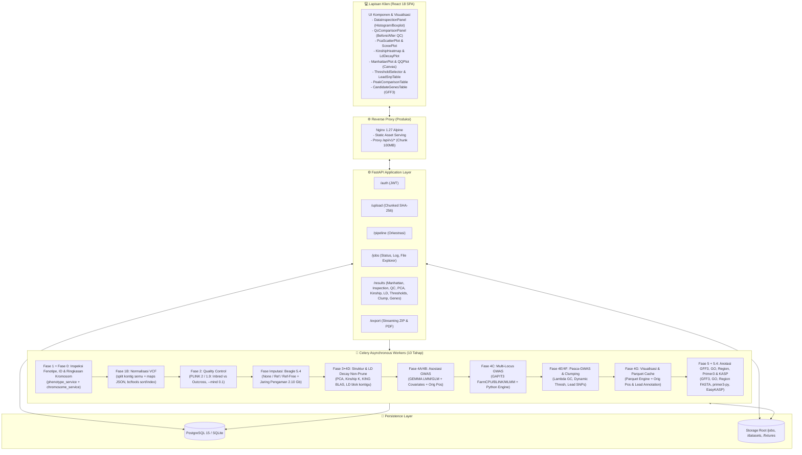

# 📐 System Design Document: Automated End-to-End GWAS Web Platform (10-Phase Pipeline)

**Dokumen Spesifikasi Teknis & Desain Arsitektur Sistem**
- **Status**: Implementasi Aktif — Seluruh Milestone M0–M10 Tersedia (Sebagian Tahap Opsional Memerlukan Alat Eksternal / Runtime Container)
- **Prinsip Utama**: *"Inspect $\rightarrow$ Validate $\rightarrow$ Run"*
- **Cakupan**: Arsitektur Sistem, Rasional Pemilihan Tech Stack, Orkestrasi Pipeline Bioinformatika 10 Tahap, Kalkulasi Statistik GEMMA (`-lm 1` / `-lmm 4`), Multi-Locus GAPIT3 (`FarmCPU`/`BLINK`/`MLMM`), Struktur Populasi & LD Decay, Post-GWAS & Clumping, Anotasi GFF3 + GO & Primer3, Optimasi Visualisasi Data Besar, Skema Penyimpanan, Keamanan, dan Spesifikasi API.

---

## 1. Ringkasan Eksekutif & Filosofi Desain

Analisis **Genome-Wide Association Study (GWAS)** bertujuan menemukan asosiasi statistik antara varian genetik (*Single Nucleotide Polymorphisms* / SNPs) dan sifat fenotipe atau penyakit tertentu. Secara tradisional, alur kerja ini terfragmentasi di berbagai *command-line tools* (**bcftools**, **PLINK 2 / 1.9**, **Beagle 5.4**, **GEMMA**, **GAPIT/R**, parser **GFF3**) dengan format input/output yang berbeda-beda serta tuntutan memori (RAM) dan CPU yang tinggi.

Platform ini dibangun di atas panduan rujukan [`Pipeline_Gwas.md`](../Pipeline_Gwas.md) (dipertahankan utuh; perubahan perilaku dicatat pada [`ADR-010`](./decisions/ADR-010-gwas-workflow-2026-11-21.md)) dalam satu sistem berbasis web yang modern, modular, dan transparan:

1. **Filosofi "Inspect $\rightarrow$ Validate $\rightarrow$ Run"**:
   - Memastikan integritas data dan rekonsiliasi ID sampel antara file VCF dan file fenotipe pada tahap awal (Fase 1) sebelum proses komputasi berat dimulai.
   - Deteksi dini sampel yang hilang (*missingness*), token invalid, dan ID duplikat sehingga pipeline tidak mengalami kegagalan fatal di tengah jalan.
2. **Observabilitas Penuh (*Full Pipeline Transparency*)**:
   - Menyediakan akses *real-time* ke log eksekusi setiap tahap (`inspection.log`, `bcftools.log`, `plink_qc.log`, `beagle.log`, `structure.log`, `gemma.log`, `multilocus.log`, `postgwas.log`, `visualization.log`, `annotation.log`).
   - Penjelajah file kerja job (*Job File Browser & Inline Preview*) untuk memantau artefak di setiap tahapan.
   - Status `[SKIPPED]` yang jujur dan transparan jika tahapan opsional dilewati (mis. imputasi Beagle atau multi-locus R jika runtime tidak tersedia).
3. **Dual-Mode Deployment (Docker Compose Produksi & Pengembangan Lokal)**:
   - Berjalan terdistribusi penuh menggunakan **Docker Compose** (PostgreSQL + Redis + Celery Worker dengan biner CLI lengkap & R/GAPIT3) maupun secara lokal untuk inspeksi & API ringan; fallback ke **SQLite** kini bersifat *opt-in* (`ALLOW_SQLITE_FALLBACK=true`), sedangkan tahap CLI bioinformatika utama (`bcftools`, `plink`/`plink2`, `gemma`) bersifat *fail-fast* saat biner tidak tersedia.
4. **Ketahanan & Keselamatan Memori (*Memory Safety*)**:
   - Melindungi *host server* dari kegagalan *Out-Of-Memory (OOM)* saat menjalankan Beagle 5.4 atau mem-parsing jutaan SNP melalui pembatas memori tingkat OS (`RLIMIT_AS`), batas *heap* JVM (`-Xmx`), pembacaan bertahap (*chunked streaming*), dan pembuatan arsip ZIP secara *on-the-fly*.
5. **Visualisasi Anti-Crash untuk Data Genomik Besar**:
   - Menggabungkan *stratified downsampling* berbasis **Apache Parquet** di *backend* dengan perenderan **HTML5 2D `<canvas>`** + deduplikasi piksel di *frontend* agar plot jutaan SNP tetap interaktif dalam waktu $< 5\text{ ms}$.

---

## 2. Arsitektur Tingkat Tinggi & Pemilihan Tech Stack

### 2.1 Diagram Arsitektur Komponen



### 2.2 Matriks Keputusan Pemilihan Tech Stack (*Architectural Decision Records*)

| Komponen | Pilihan Teknologi | Alternatif yang Dipertimbangkan | Alasan Teknis Pemilihan (*Rationale*) |
| :--- | :--- | :--- | :--- |
| **API Framework** | **FastAPI (Python)** | Django REST, Flask | Mendukung *async/await* native untuk unggahan *chunk* dan *StreamingResponse*, validasi skema otomatis berbasis Pydantic v2 (inti Rust), serta integrasi langsung dengan ekosistem ilmiah Python (NumPy, SciPy, Pandas, PyArrow). |
| **Database ORM & Engine** | **SQLAlchemy 2.0 + PostgreSQL 15 (Fallback SQLite Opt-in)** | MongoDB, Raw SQL | Menjamin konsistensi transaksional ACID (relasi `users` $\rightarrow$ `datasets` $\rightarrow$ `jobs` $\rightarrow$ `results`) sekaligus fleksibilitas parameter dinamis (`JSONB`). Melalui `TypeDecorator` kustom pada [`database.py`](../backend/app/db/engine/database.py), pengembang dapat mengaktifkan fallback SQLite secara *opt-in* lewat `ALLOW_SQLITE_FALLBACK=true` (default `"false"` agar produksi gagal cepat saat DB down). |
| **Task Queue & Broker** | **Celery 5.4 + Redis 7 (Fallback Synchronous)** | RabbitMQ, RQ, Cron | Mendukung *task chaining* multi-tahap (`chain(...)`), penyampaian *piped context* antar-tahap, pemisahan antrean (`celery`, `normalization`, `qc`, `imputation`, `gwas`), serta pencabutan tugas (`control.revoke`) saat pengguna menghentikan job. |
| **Cache Visualisasi** | **Apache Parquet (PyArrow + Snappy)** | CSV, JSON, SQLite | Format kolumnar Parquet memangkas ukuran file hingga $>85\%$ dan memuat puluhan ribu koordinat CHR/BP/P-value ke DataFrame dalam hitungan milidetik tanpa membebani memori browser. |
| **Engine Visualisasi Frontend** | **HTML5 2D `<canvas>` + Pixel Deduplication** | D3.js SVG, Recharts, Plotly SVG | Pustaka berbasis SVG membuat node DOM untuk setiap SNP, menyebabkan *browser freeze* pada $>20.000$ titik. HTML5 `<canvas>` menggambar ratusan ribu titik pada satu bitmap dalam $<5\text{ ms}$. |
| **Generator Laporan Ilmiah** | **Jinja2 + WeasyPrint (+ Pure-Python PDF Fallback)** | ReportLab murni, LaTeX | Merender laporan eksekutif ilmiah berstandar publikasi dalam format PDF 1.4 menggunakan template HTML/CSS, lengkap dengan generator PDF murni Python jika pustaka C GTK/Pango tidak terpasang di host Windows. |

---

## 3. Spesifikasi Rinci Pipeline Bioinformatika 10 Tahap

### Fase 1: Fenotipe & Inspeksi Data ([`inspection_tasks.py`](../backend/app/tasks/inspection_tasks.py) & [`phenotype_service.py`](../backend/app/services/phenotype_service.py))
- **Tujuan**: Mencegah kegagalan runtime di tahap komputasi lanjut melalui rekonsiliasi ID sampel dan verifikasi distribusi data.
- **Logika & Operasi**:
  1. Rekonsiliasi ID sampel antara VCF header (`#CHROM POS ID ...`) dan tabel fenotipe (`FID`, `IID`).
  2. Pengecekan sampel duplikat, token missing (`""`, `"."`, `"NA"`, `"-9"`, `"NaN"`), dan nilai non-numerik.
  3. Perhitungan statistik deskriptif: $N$, mean, median, standar deviasi, IQR, skewness, min, max.
  4. Histogram otomatis menggunakan aturan **Freedman-Diaconis**:
     $$h = 2 \frac{\text{IQR}}{n^{1/3}}, \quad k = \left\lceil \frac{\max(x) - \min(x)}{h} \right\rceil$$
  5. Boxplot dengan identifikasi outlier berbasis aturan Tukey ($< Q_1 - 1.5\text{IQR}$ atau $> Q_3 + 1.5\text{IQR}$).
  6. Ekspor artefak: `keep_ids.txt`, `pheno_plink.txt`, dan pemindaian Fase 0 ke `chromosome_characteristics_summary.txt` (serta `inspection_report.json["chromosome_summary"]`) secara streaming $O(\text{kromosom})$ RAM via `chromosome_service.py`.

### Fase 1B: Normalisasi VCF ([`normalization_tasks.py`](../backend/app/tasks/normalization_tasks.py))
- **Tujuan**: Memecah kromosom yang melampaui batas integer 32-bit tanpa kehilangan varian valid (`POS > 0`), memastikan file VCF terurut secara koordinat (*sorted*), dan terindeks `.tbi`/`.csi`.
- **Perintah CLI & Split**:
  ```bash
  bcftools view --no-version -h <vcf>
  # Streaming Python: split kontig overflow ke <chrom>_p<k> + tulis chrom_split_map.json, saring POS <= 0
  bcftools sort -Oz -o normalized.vcf.gz split_input.vcf
  bcftools index -t normalized.vcf.gz  # fallback otomatis ke bcftools index -c bila koordinat >512 Mb
  ```
- **Fail-fast**: Tahap normalisasi wajib memakai biner `bcftools` (`normalization_tasks.py`); bila tidak ditemukan atau gagal memvalidasi/mengurutkan VCF, proses langsung gagal cepat (*fail-fast*) tanpa fallback Python diam-diam.

### Fase 2: Quality Control / QC ([`qc_tasks.py`](../backend/app/tasks/qc_tasks.py) & [`qc_service.py`](../backend/app/services/qc_service.py))
- **Tujuan**: Mengeliminasi artefak genotipe dan varian langka dengan membedakan mode organisme.
- **Aturan Mode Organisme**:
  - `inbred` (klonal, galur murni, vegetatif, selfing): **TANPA** filter HWE (`--hwe` dimatikan).
  - `outcross` (kawin silang): **DENGAN** filter HWE (default `--hwe 1e-6`).
- **Perintah PLINK 2**:
  ```bash
  plink2 --vcf normalized.vcf.gz --snps-only just-acgt --max-alleles 2 \
         --set-all-var-ids @:# --keep keep_ids.txt \
         --maf 0.05 --geno 0.05 --mind 0.1 \
         [--hwe 1e-6 bila outcross] \
         --make-bed --out plink_qc
  plink2 --bfile plink_qc --export vcf-4.2 bgz id-paste=iid --out plink_qc
  ```
- **Hasil & Evaluasi**: Menghasilkan `qc_comparison.json` yang membandingkan metrik sebelum vs sesudah filter (beserta metadata kromosom dipecah), serta memberikan peringatan jika kehilangan SNP $> 50\%$.

### Fase Imputasi Genotipe Opsional ([`imputation_tasks.py`](../backend/app/tasks/imputation_tasks.py))
- **Tujuan**: Mengestimasi alel yang tidak terukur menggunakan **Beagle 5.4**.
- **Mode Eksekusi**:
  1. `none`: Dilewati secara sadar dengan pencatatan status `[SKIPPED]`.
  2. `reference`: Imputasi terpandu menggunakan panel referensi populasi (1000 Genomes).
  3. `reference_free`: Phasing dan imputasi mandiri tanpa panel luar.
- **Batas Memori & Pra-Filter Contig**: JVM heap dialokasikan maksimal 75% limit cgroup (`MaxRAMPercentage=75%` / override `-XmxN` dipotong 75%, `RLIMIT_AS` tidak dipakai untuk JVM) dengan proteksi `-XX:+ExitOnOutOfMemoryError`, serta penyaringan streaming `_prepare_beagle_safe_vcf` terhadap kontig tidak dipecah yang melewati `MAX_32BIT_POS` (`2.100.000.000` bp — proteksi *sliding window* Beagle 40 cM) / tanpa SNP pembanding. Jika Java atau panel tidak tersedia, task menghasilkan status `[SKIPPED]` yang bersih dan melanjutkan analisis menggunakan genotipe hasil QC.

### Fase 3 + 4D: Struktur Populasi, Kinship & LD Decay ([`structure_tasks.py`](../backend/app/tasks/structure_tasks.py) & [`structure_service.py`](../backend/app/services/structure_service.py))
- **Tujuan**: Mengukur stratifikasi populasi, kekerabatan antar-sampel, dan laju peluruhan LD untuk rekomendasi model statistik.
- **Langkah-langkah Komputasi**:
  1. **LD Pruning**: `--indep-pairwise 50 5 0.2` untuk membuang redundansi korelasi antar-varian sebelum PCA & Kinship.
  2. **PCA (Principal Component Analysis)**: Dekomposisi 10 PC utama, perhitungan PVE (*Proportion of Variance Explained*), dan pengelompokan k-means.
  3. **Centered Kinship Matrix ($K$)**:
     $$K = \frac{1}{p} W W^T, \quad w_{ik} = \frac{g_{ik} - 2p_k}{\sqrt{2p_k(1 - p_k)}}$$
  4. **KING Kinship Matrix**: Menghitung koefisien kekerabatan robust $\phi_{ij}$ menggunakan operasi matriks BLAS tervektorisasi per-potongan (*chunked*) untuk mendeteksi sampel kembar/duplikat ($\phi > 0.354$) dan kerabat tingkat pertama ($\phi > 0.177$).
  5. **LD Decay Curve**: Menghitung $r^2$ *unphased* berpasangan dari **bfile QC/imputasi non-prune** (dibatasi blok kontigu hingga `ld_decay_max_snps` default `20.000`), mencatat `method` serta `source_bfile`, dan mengestimasi titik *half-decay* serta jarak saat $r^2 < 0.2$.
  6. **Rekomendasi Model Otomatis**: Menentukan penggunaan **GLM** (jika tidak ada stratifikasi & tidak ada kekerabatan) vs **LMM** (jika terdeteksi struktur populasi atau kekerabatan signifikan).
  7. **Ekspor Kovariat**: Menghasilkan `covariates.txt` untuk GEMMA (kolom pertama bernilai 1 sebagai intercept) dan `covariates_plink.txt` untuk PLINK 2.

### Fase 4A/4B: Analisis Asosiasi GWAS GLM / LMM ([`gemma_tasks.py`](../backend/app/tasks/gemma_tasks.py) & [`assoc_normalizer.py`](../backend/app/services/assoc_normalizer.py))
- **Tujuan**: Melakukan uji asosiasi varian terhadap fenotipe dengan koreksi kovariat dan matriks kekerabatan.
- **Model Matematika LMM**:
  $$y = W\alpha + x\beta + u + \epsilon, \quad u \sim \mathcal{N}(0, \lambda \tau^{-1} K), \quad \epsilon \sim \mathcal{N}(0, \tau^{-1} I_n)$$
- **Penanganan Kovariat**:
  - Menggunakan kovariat PC hasil PCA (`-c covariates.txt`).
  - Nilai fenotipe disinkronkan secara ketat berdasarkan IID ke kolom ke-6 file `.fam`.
- **Eksekusi GEMMA Nyata (*Fail-Fast*)**:
  - GLM dijalankan via `gemma -lm 1`, sedangkan LMM dijalankan via `gemma -lmm 4 -k <kinship>`. Biner `gemma` bersifat wajib pada tahap ini (gagal cepat bila tidak tersedia).
- **Normalisasi Hasil Asosiasi**:
  - `assoc_normalizer.py` memetakan output PLINK2 (`--glm`) atau GEMMA (`.assoc.txt`) ke dalam format kanonikal 10 kolom:
    `chr`, `pos`, `rs`, `a1`, `a0`, `af`, `beta`, `se`, `p`, `n`.
  - Disimpan sebagai `gwas_results.normalized.tsv`.

### Fase 4C: Multi-Locus GWAS ([`multilocus_tasks.py`](../backend/app/tasks/multilocus_tasks.py))
- **Tujuan**: Mencegah *false positives* dan mendeteksi lokus independen menggunakan model multi-lokus iteratif (**FarmCPU**, **BLINK**, dan **MLMM**).
- **Eksekusi**: Memanggil skrip R **GAPIT3** (`gapit_runner.R`) saat runtime `Rscript` tersedia. Bila `Rscript` tidak tersedia dan `ALLOW_PYTHON_MULTILOCUS=true`, tugas beralih ke *Python Native Engine* (NumPy/SciPy) dan mencatat sumber engine pada hasil; bila Multi-Locus tidak diaktifkan di konfigurasi job, tahap dicatat bersih sebagai `[SKIPPED]`.

### Fase 4E/4F: Pasca-GWAS, Lambda GC, Dynamic Thresholds & Clumping ([`postgwas_tasks.py`](../backend/app/tasks/postgwas_tasks.py) & [`postgwas_service.py`](../backend/app/services/postgwas_service.py))
- **Kalkulasi Faktor Inflasi Genomik ($\lambda_{GC}$)**:
  $$\lambda_{GC} = \frac{\text{median}(\chi^2_{\text{observed}})}{0.4549364}, \quad \text{dengan } \chi^2_i = \left(\frac{\beta_i}{\text{SE}_i}\right)^2$$
  *Catatan penting*: $\lambda_{GC}$ dihitung secara jujur tanpa *clamping* artifisial ($\lambda < 1.0$ tidak dipaksa menjadi 1.0) sehingga deflasi dapat terdeteksi.
- **Ambang Signifikansi Dinamis**:
  1. *Bonferroni*: $\alpha / M$ (dengan $M$ = jumlah uji varian).
  2. *Suggestive*: $1 \times 10^{-5}$ atau $1 / M$.
  3. *FDR (Benjamini-Hochberg)*: Nilai kritis $p$-value yang memenuhi $q < 0.05$.
  4. *LOD Score*: Konversi skor LOD ke $p$-value ($p = 10^{-\text{LOD}}$).
- **LD-Aware Clumping**:
  - Menggunakan jarak peluruhan LD decay dari Fase 3 sebagai radius clumping.
  - Mengekstrak **Lead SNPs** independen dan mencatat varian yang ter-clump di sekitarnya. Disimpan ke `lead_snps.json` dan `lead_snps.tsv`.

### Fase 4G: Visualisasi & Parquet Caching ([`visualization_tasks.py`](../backend/app/tasks/visualization_tasks.py))
- **Tujuan**: Membangun file cache Parquet terkompresi Snappy untuk perenderan instan di antarmuka web.
- **Metadata Tersemat**: Menyematkan seluruh nilai ambang batas dinamis, jumlah Lead SNPs, dan parameter visualisasi ke dalam metadata file Parquet.

### Fase 4H: Perbandingan Puncak GWAS ([`multilocus_tasks.py`](../backend/app/tasks/multilocus_tasks.py))
- **Tujuan**: Membandingkan konsistensi lokus puncak antara Single-Locus (GEMMA GLM/LMM) dan Multi-Locus (FarmCPU, BLINK, MLMM).
- **Output**: Menghasilkan `Ringkasan_Puncak_GWAS.csv` dan `peak_comparison.json` yang mengelompokkan puncak menjadi *Consistent*, *Single-Only*, dan *Multi-Only*.

### Fase 5 + Fase 5.4: Anotasi Gen, Region Kandidat, GO Enrichment, Primer3 & KASP ([`annotation_tasks.py`](../backend/app/tasks/annotation_tasks.py), [`annotation_service.py`](../backend/app/services/annotation_service.py), [`flanking_service.py`](../backend/app/services/flanking_service.py), [`go_enrichment_service.py`](../backend/app/services/go_enrichment_service.py), [`primer_service.py`](../backend/app/services/primer_service.py), [`kasp_service.py`](../backend/app/services/kasp_service.py))
- **Tujuan**: Menghubungkan varian signifikan secara statistik ke fungsi genetik biologis, region kandidat FASTA, pengayaan jalur fungsional (*Gene Ontology*), dan rancangan primer validasi basah (PCR konvensional + marker KASP).
- **Logika Pemetaan & Desain Primer**:
  1. Parser streaming GFF3 dengan normalisasi penamaan kromosom dan pemulihan koordinat asli (`restore_coord`).
  2. Pemetaan Lead SNPs gabungan Single+Multi-locus (kolom `Engine`) ke fitur gen dalam jendela LD decay ($\pm \text{window\_bp}$).
  3. Klasifikasi biologis varian:
     - **Genik**: Varian berada persis di dalam badan gen ($\text{start} \le \text{pos} \le \text{end}$).
     - **Near-gen**: Varian berada di luar gen tetapi masih dalam jarak $\le \text{window\_bp}$ (daerah promotor/regulatori).
     - **Intergenik**: Jarak varian ke gen terdekat $> \text{window\_bp}$.
  4. **Fase 5.4 Region Kandidat**: Penulisan `candidate_regions.csv`, `candidate_regions.bed`, dan `candidate_regions.fa` via indeks `.fai` streaming Python tanpa `bedtools`, dengan batas ketat `CANDIDATE_REGION_MAX_TOTAL_BP = 50.000.000`.
  5. Ekspor daftar gen kandidat unik ke `Daftar_Gen_Untuk_GO.txt` serta analisis GO Enrichment nyata dari atribut `Ontology_term` GFF3 atau berkas pemetaan GO eksternal (TSV/GAF).
  6. Ekstraksi sekuens flanking beranotasi `REF`/`ALT` & varian tetangga `.bim` melalui indeks FASTA `.fai` ($O(1)$ memori) untuk desain primer PCR (`primer3-py`), serta desain **KASP** (port Python *EasyKASP* ber-flank default `KASP_FLANK_BP = 150` dengan masking `N` tetangga, analisis hairpin/dimer `primer3-py` bertail FAM/HEX, dan ekspor `kasp_input.tsv`/`kasp_primers.tsv`/`kasp_primers_no_tail.fa`; *Fase 8 BLAST ditunda* sesuai [**ADR-010**](./decisions/ADR-010-gwas-workflow-2026-11-21.md)). Mode sintetis tidak dijalankan kecuali `ALLOW_SYNTHETIC_ANNOTATION=true`.

---

## 4. Arsitektur Antarmuka & Visualisasi Frontend

### 4.1 Tab Panel Hasil Analisis Komprehensif ([`GwasResultsPanel.jsx`](../frontend/src/components/GwasResultsPanel.jsx))
Antarmuka hasil menyajikan 7 tab navigasi interaktif:
1. **📊 Manhattan & QQ Plot**:
   - Manhattan Plot & QQ Plot berbasis HTML5 2D Canvas dengan kecepatan render $< 5\text{ ms}$.
   - Bilah pengatur ambang batas dinamis (Bonferroni, Suggestive, FDR, LOD) yang mengubah garis ambang secara *real-time*.
   - Filter pemilihan kromosom spesifik (`ALL`, `1`, `2`, ..., `22`).
2. **🎯 Ambang Batas & Lead SNPs**:
   - Pemilih metode threshold dengan deskripsi formula dan kartu nilai $-\log_{10}(p)$.
   - Tabel Lead SNPs hasil clumping dengan rincian alel, efek beta, standar error, dan daftar varian yang ter-clump.
3. **🧬 Struktur Populasi & LD**:
   - Kartu rekomendasi model GLM vs LMM beserta temuan PCA dan Kinship.
   - Plot sebaran PCA (PC1 vs PC2) dengan pewarnaan klaster k-means dan Scree Plot (PVE varians terjelaskan).
   - Heatmap matriks kekerabatan (Centered Kinship) dan kurva peluruhan LD decay dengan penanda garis *half-decay*.
4. **🔍 Inspeksi & QC**:
   - Panel inspeksi fenotipe dengan histogram Freedman-Diaconis, boxplot outlier, dan metrik rekonsiliasi sampel.
   - Panel perbandingan QC sebelum vs sesudah filter varian dan sampel.
5. **🔬 Multi-Locus GWAS**:
   - Tabel perbandingan lokus puncak asosiasi antara Single-Locus vs Multi-Locus (FarmCPU, BLINK, dan MLMM) lengkap dengan label engine.
6. **🌿 Anotasi Gen GFF3 & GO**:
   - Tabel pemetaan Lead SNPs ke fitur gen terdekat dengan badge kategori biologis (Genik, Near-gen, Intergenik) serta hasil analisis **Gene Ontology (GO) Enrichment**.
   - Tombol unduh satu klik untuk file `Daftar_Gen_Untuk_GO.txt`.
7. **🧪 Flanking & Primer3 / KASP**:
   - Sub-tab PCR konvensional (flank dinamis, `REF`/`ALT`, varian tetangga `.bim`, Region Kandidat BED/FASTA, serta primer `primer3-py`) dan sub-tab **KASP** (tail FAM/HEX bertanda teks aksesibel, peringatan struktur sekunder bertail, serta 3 ekspor `.tsv`/`.fa`).

---

## 5. Referensi Endpoint REST API Lengkap

| Metode | Endpoint | Deskripsi |
| :--- | :--- | :--- |
| `POST` | `/api/v1/auth/register` / `login` / `refresh` / `logout` / `GET /me` | Siklus autentikasi JWT access token & cookie HttpOnly `gwas_refresh_token`. |
| `GET` | `/api/v1/pipeline/capabilities` | Status ketersediaan biner/runtime (`bcftools`, `plink`, `gemma`, `beagle`, `rscript`, `gapit`) & mode execution. |
| `POST` | `/api/v1/pipeline/{dataset_id}/start` | Memicu eksekusi pipeline GWAS secara asinkron. |
| `POST` | `/api/v1/upload/init` / `chunk` / `finalize` | Sesi unggah bertahap VCF (chunk 10 MiB) serta endpoint unggah terpisah untuk fenotipe, anotasi GFF3, anotasi GO (TSV/GAF), dan FASTA referensi. |
| `GET` | `/api/v1/reference-panels` | Daftar panel referensi imputasi terkurasi yang tersedia. |
| `GET` | `/api/v1/jobs/{job_id}/status` | Mengambil status keseluruhan, tahap aktif, waktu berjalan, `step_logs`, dan `stage_summaries` 10 tahap. |
| `GET` | `/api/v1/jobs/{job_id}/logs` | Mengambil teks log eksekusi lengkap dari seluruh tahapan. |
| `GET` | `/api/v1/jobs/{job_id}/files` | Daftar seluruh file input, intermediate, dan output dari sebuah job. |
| `GET` | `/api/v1/jobs/{job_id}/files/content` | Pratinjau teks atau unduhan file fisik dari job. |
| `POST` | `/api/v1/jobs/{job_id}/cancel` | Membatalkan job aktif dan mencabut task Celery terkait. |
| `POST` | `/api/v1/jobs/{job_id}/retry` | Mengulangi eksekusi job dari konfigurasi dataset/parameter sebelumnya. |
| `DELETE` | `/api/v1/jobs/{job_id}` | Menghapus riwayat job dan membersihkan direktori kerjanya di disk. |
| `GET` | `/api/v1/results/{job_id}/manhattan-data` | Data terkompresi CHR, BP, SNP, $-\log_{10}(p)$ untuk Manhattan & QQ Plot. |
| `GET` | `/api/v1/results/{job_id}/inspection` | Data hasil inspeksi fenotipe, histogram, dan boxplot (Fase 1). |
| `GET` | `/api/v1/results/{job_id}/qc-comparison` | Data perbandingan metrik varian dan sampel sebelum/sesudah QC (Fase 2). |
| `GET` | `/api/v1/results/{job_id}/pca` | Data koordinat PCA 10 komponen utama dan nilai PVE (Fase 3). |
| `GET` | `/api/v1/results/{job_id}/kinship` | Data matriks kekerabatan Centered Kinship dan tabel KING (Fase 3). |
| `GET` | `/api/v1/results/{job_id}/ld-decay` | Data kurva penurunan nilai $r^2$ terhadap jarak fisik (Fase 4D). |
| `GET` | `/api/v1/results/{job_id}/model-recommendation`| Rekomendasi otomatis pemilihan model statistik GLM vs LMM (Fase 3). |
| `GET` | `/api/v1/results/{job_id}/thresholds` | Ambang signifikansi dinamis Bonferroni, FDR, LOD, Suggestive (Fase 4E). |
| `GET` | `/api/v1/results/{job_id}/lead-snps` | Daftar varian Lead SNPs independen hasil clumping (Fase 4F). |
| `GET` | `/api/v1/results/{job_id}/peak-comparison` | Perbandingan puncak Single-Locus vs Multi-Locus GWAS (Fase 4H). |
| `GET` | `/api/v1/results/{job_id}/multilocus-results` | Hasil detail analisis Multi-Locus GWAS (FarmCPU, BLINK, MLMM) beserta label engine (R GAPIT3 / Python Engine). |
| `GET` | `/api/v1/results/{job_id}/candidate-genes` | Pemetaan Lead SNPs ke fitur gen GFF3 dan daftar gen untuk GO enrichment (Fase 5). |
| `GET` | `/api/v1/results/{job_id}/go-enrichment` | Hasil analisis Gene Ontology (GO) Enrichment berbasis GFF3 `Ontology_term` atau pemetaan TSV/GAF (Fase 5.3). |
| `GET` | `/api/v1/results/{job_id}/primers` | Sekuens flanking dinamis + primer `primer3-py`, `regions_status`, `candidate_regions`, `nearby_variants`, dan blok `kasp` (*EasyKASP* + struktur sekunder). |
| `GET` | `/api/v1/results/{job_id}/export` | Aliran *streaming* unduhan berkas arsip `.zip` seluruh artefak job. |
| `GET` | `/api/v1/results/{job_id}/report` | Unduhan dokumen laporan ilmiah resmi berformat PDF. |
