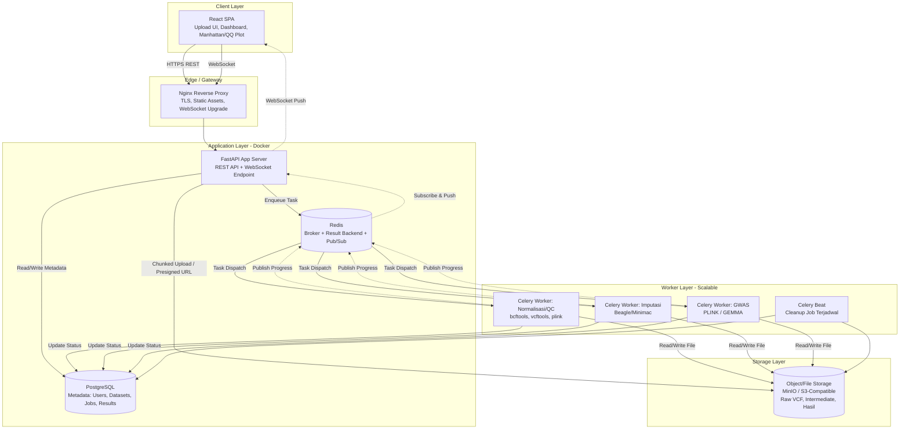
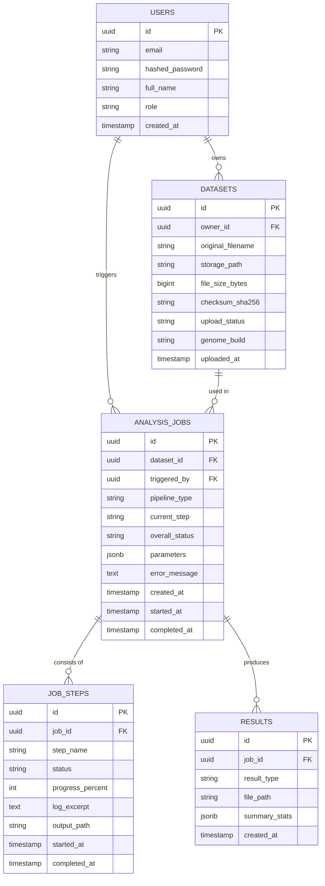
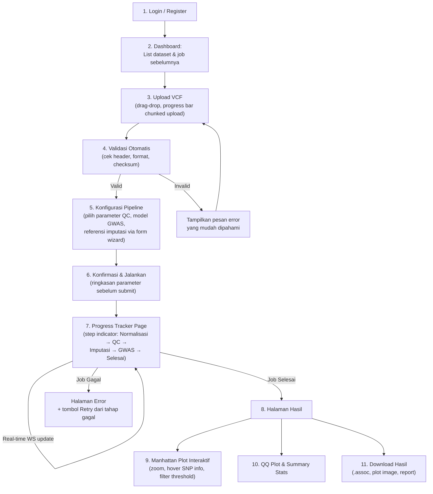

# System Architecture & Design Document
## GWAS End-to-End Analysis Pipeline (Web-Based Orchestrator)

**Versi Dokumen:** 1.0
**Status:** Draft untuk Acuan Pengembangan
**Disusun oleh:** Senior Full-Stack Engineer & Bioinformatics Developer

---

## Daftar Isi

1. [System Overview & Architecture](#1-system-overview--architecture)
2. [Data Handling Strategy](#2-data-handling-strategy)
3. [Asynchronous Task Workflow](#3-asynchronous-task-workflow)
4. [Database Schema](#4-database-schema)
5. [Core API Endpoints](#5-core-api-endpoints)
6. [UI/UX Flow](#6-uiux-flow)

---

## 1. System Overview & Architecture

### 1.1 Filosofi Desain

Sistem ini dirancang sebagai **orkestrator**, bukan re-implementasi algoritma bioinformatika. Backend tidak menjalankan logika GWAS sendiri, melainkan membungkus (*wrapping*) tools CLI yang sudah teruji secara ilmiah seperti PLINK dan GEMMA, lalu mengeksekusinya sebagai subprocess yang terisolasi.

Tiga prinsip arsitektur utama:

- **Non-blocking API layer** — FastAPI hanya bertanggung jawab menerima request, validasi, dan delegasi tugas berat ke worker terpisah. Tidak ada proses komputasi berat yang berjalan di dalam request-response cycle.
- **Isolasi komputasi berat** — Semua eksekusi CLI (PLINK/GEMMA) berjalan di dalam Celery worker, terpisah dari proses web server, agar timeout HTTP dan kegagalan proses tidak saling menjular.
- **Stateful job tracking** — Setiap tahapan pipeline (normalisasi → QC → imputasi → GWAS → visualisasi) direkam sebagai job diskrit di database, sehingga proses bisa di-resume, di-retry, atau diaudit tanpa mengulang dari awal.

### 1.2 Komponen Utama dan Interaksinya

| Komponen | Peran |
|---|---|
| **React (Frontend)** | UI upload file, dashboard progress tracker, dan visualisasi interaktif (Manhattan/QQ Plot). Berkomunikasi via REST API dan WebSocket/polling. |
| **FastAPI (Backend API)** | Gatekeeper: autentikasi, validasi request, manajemen metadata di PostgreSQL, dan pendorong task ke Celery. Tidak pernah menjalankan subprocess CLI secara langsung. |
| **PostgreSQL** | Menyimpan metadata: user, dataset, job, parameter, status, dan lokasi hasil (bukan file besar itu sendiri). |
| **Redis** | Message broker untuk Celery, sekaligus result backend sementara dan pub/sub channel untuk update progress real-time. |
| **Celery Worker** | Mengeksekusi subprocess CLI bioinformatika (PLINK, GEMMA, dll) secara asinkron, melaporkan progress, dan menangani retry/failure. |
| **Docker/Compose** | Mengemas setiap komponen (frontend, backend, worker, db, redis, storage) sebagai service terisolasi yang dapat di-scale independen. |

### 1.3 Diagram Arsitektur Sistem



### 1.4 Catatan Deployment

- Setiap service (frontend, backend, worker per-tipe tugas, db, redis, storage) adalah container Docker terpisah, diorkestrasi via `docker-compose.yml` (dev) atau Kubernetes/Swarm (produksi).
- Celery worker dipisah berdasarkan **queue** (`normalization`, `qc`, `imputation`, `gwas`) agar job berat (imputasi/GWAS) tidak memblokir job ringan, dan resource (CPU/RAM) dapat dialokasikan berbeda per queue.
- File VCF besar **tidak pernah** melewati PostgreSQL — hanya path/reference-nya yang disimpan di sana. File fisik disimpan di object storage (MinIO/S3-compatible) yang di-mount sebagai shared volume antar worker.

---

## 2. Data Handling Strategy

### 2.1 Tantangan

File VCF bisa berukuran ratusan MB hingga puluhan GB. Strategi naif (load semua ke memori, upload single HTTP request) akan menyebabkan:

- Memory exhaustion pada FastAPI worker.
- HTTP timeout pada koneksi upload yang lama.
- Kegagalan total tanpa kemungkinan resume jika koneksi putus di tengah jalan.

### 2.2 Strategi Upload: Chunked & Resumable

Gunakan pendekatan **chunked upload dengan resumable protocol** (mengikuti pola tus.io atau implementasi custom berbasis multipart):

1. **Inisiasi upload** — Frontend memanggil `POST /datasets/init-upload` dengan metadata (nama file, ukuran, checksum). Backend membuat record `Dataset` berstatus `UPLOADING` dan mengembalikan `upload_id`.
2. **Upload per-chunk** — Frontend memecah file menjadi chunk (misal 5–10 MB) dan mengirim tiap chunk via `PUT /datasets/{upload_id}/chunk/{chunk_index}`. FastAPI menulis chunk langsung ke disk/object storage secara streaming (`async` file write), **tanpa** menahan seluruh isi file di memori.
3. **Progress & resume** — Frontend menampilkan progress bar berbasis jumlah chunk terkirim. Jika koneksi putus, frontend cukup query `GET /datasets/{upload_id}/status` untuk tahu chunk mana yang sudah diterima, lalu melanjutkan dari situ.
4. **Finalisasi & verifikasi** — Setelah semua chunk diterima, backend menggabungkan chunk (atau memanfaatkan multipart upload API storage jika pakai S3/MinIO), memverifikasi checksum (MD5/SHA256), dan mengubah status menjadi `UPLOADED`. Proses penggabungan didelegasikan ke Celery task agar tidak memblokir API.

### 2.3 Penyimpanan Sementara (Staging Area)

- Setiap dataset memiliki direktori kerja terisolasi: `/storage/datasets/{dataset_id}/raw/`, `/staging/`, `/results/`.
- File mentah (`raw`) bersifat read-only setelah upload selesai.
- Setiap tahap pipeline (normalisasi, QC, imputasi) menulis output ke sub-folder `staging` miliknya sendiri, sehingga tahap sebelumnya bisa diulang tanpa merusak hasil tahap lain.
- **Retention policy**: file intermediate (hasil normalisasi/QC) dihapus otomatis oleh Celery Beat setelah N hari atau setelah job selesai sukses dan hasil akhir sudah diarsipkan, untuk menghemat storage.

### 2.4 Parsing Efisien (Streaming, Bukan Load-All)

- **Jangan pernah** membaca seluruh file VCF ke memori dengan `readlines()` atau parser yang materialize seluruh isi file.
- Gunakan tools CLI yang sudah dioptimalkan untuk file besar (`bcftools`, `vcftools`, `plink --vcf`) yang bekerja secara streaming/block-compressed (BGZF) langsung dari disk.
- Untuk kebutuhan validasi ringan di sisi Python (misal cek header VCF sebelum job di-submit), gunakan `pysam` dengan iterator (`VariantFile`) yang membaca baris demi baris, bukan library yang memuat seluruh file.
- File VCF besar sebaiknya disimpan/dikonversi ke format **BGZF-compressed + indexed** (`.vcf.gz` + `.tbi`) sesegera mungkin setelah upload, agar semua tools downstream bisa melakukan random access tanpa decompress penuh.
- Validasi ukuran & format dilakukan secara **lazy**: cek header dan beberapa baris pertama saja untuk deteksi cepat file korup, validasi penuh didelegasikan ke tools CLI saat job berjalan.

### 2.5 Batasan Server & Proteksi Resource

- Set `MAX_UPLOAD_SIZE` di level Nginx (`client_max_body_size`) dan validasi ulang di FastAPI.
- Terapkan **disk quota per user** dan monitoring storage agar satu user tidak menghabiskan seluruh kapasitas.
- Celery worker untuk tahap berat (imputasi, GWAS) diberi **resource limit** eksplisit (CPU/memory limit di Docker) dan dijalankan dengan `concurrency` rendah agar tidak terjadi oversubscription RAM saat banyak job jalan bersamaan.

---

## 3. Asynchronous Task Workflow

### 3.1 Prinsip Umum

FastAPI endpoint yang men-trigger analisis **tidak pernah** menjalankan subprocess secara langsung dalam request handler. Alurnya selalu:

```
Request masuk → Validasi cepat → Buat record Job (status: PENDING) → 
Enqueue Celery task → Return job_id ke client segera (HTTP 202 Accepted)
```

### 3.2 Membungkus CLI Tools sebagai Celery Task

Setiap tool CLI (PLINK, GEMMA, bcftools, dll) dibungkus dalam Celery task yang mengikuti pola seragam:

```python
# tasks/gwas_tasks.py
from celery import shared_task
from celery.utils.log import get_task_logger
import subprocess
import shlex

logger = get_task_logger(__name__)

@shared_task(bind=True, queue="gwas", max_retries=2, acks_late=True)
def run_plink_qc(self, job_id: str, input_vcf_path: str, output_dir: str, params: dict):
    """
    Membungkus eksekusi PLINK QC sebagai Celery task.
    Menulis progress ke Redis pub/sub dan status akhir ke PostgreSQL.
    """
    from db.session import get_job, update_job_status
    from core.progress import publish_progress

    update_job_status(job_id, status="RUNNING", step="qc")
    publish_progress(job_id, step="qc", percent=0, message="Memulai PLINK QC")

    cmd = [
        "plink",
        "--vcf", input_vcf_path,
        "--maf", str(params.get("maf", 0.01)),
        "--geno", str(params.get("geno", 0.05)),
        "--mind", str(params.get("mind", 0.1)),
        "--make-bed",
        "--out", f"{output_dir}/qc_output",
    ]

    try:
        process = subprocess.Popen(
            cmd,
            stdout=subprocess.PIPE,
            stderr=subprocess.STDOUT,
            text=True,
            bufsize=1,
        )

        # Streaming log output & parsing progress dari stdout PLINK
        for line in process.stdout:
            logger.info(line.strip())
            percent = parse_plink_progress(line)  # heuristik parsing log
            if percent is not None:
                publish_progress(job_id, step="qc", percent=percent, message=line.strip())

        return_code = process.wait(timeout=params.get("timeout_seconds", 3600))

        if return_code != 0:
            raise RuntimeError(f"PLINK exited with code {return_code}")

        update_job_status(job_id, status="COMPLETED", step="qc")
        publish_progress(job_id, step="qc", percent=100, message="QC selesai")
        return {"output_path": f"{output_dir}/qc_output"}

    except subprocess.TimeoutExpired:
        process.kill()
        update_job_status(job_id, status="FAILED", step="qc", error="Timeout")
        raise
    except Exception as exc:
        update_job_status(job_id, status="FAILED", step="qc", error=str(exc))
        raise self.retry(exc=exc, countdown=30)
```

Poin desain penting dari pola di atas:

- **`subprocess.Popen` dengan streaming stdout**, bukan `subprocess.run()` yang blocking dan menahan output di memori sampai proses selesai — ini memungkinkan progress log dibaca baris demi baris secara real-time.
- **`acks_late=True`** memastikan task hanya di-acknowledge ke broker setelah selesai, sehingga jika worker crash di tengah eksekusi, task otomatis di-requeue ke worker lain.
- **Timeout eksplisit** pada level subprocess (bukan hanya Celery task time limit) untuk mencegah proses CLI zombie yang menggantung selamanya.
- **Retry terbatas** (`max_retries=2`) hanya untuk kegagalan transient; error dari data yang memang invalid tidak perlu di-retry (harus dibedakan by exception type).

### 3.3 Chaining Antar Tahap Pipeline (Celery Canvas)

Alur normalisasi → QC → imputasi → GWAS dirangkai menggunakan **Celery `chain`**, di mana output satu task menjadi input task berikutnya:

```python
from celery import chain

pipeline = chain(
    normalize_vcf.s(job_id, raw_vcf_path),
    run_plink_qc.s(job_id),
    run_imputation.s(job_id),
    run_gwas_analysis.s(job_id),
    generate_plot_data.s(job_id),
)
pipeline.apply_async()
```

Jika satu tahap gagal, chain berhenti otomatis dan status job di database mencatat pada tahap mana kegagalan terjadi — sehingga user (atau developer) dapat retry hanya dari tahap yang gagal, tanpa mengulang seluruh pipeline dari awal.

### 3.4 Mekanisme Pengiriman Progress ke Frontend

Dua opsi dievaluasi:

| Aspek | Polling | WebSocket |
|---|---|---|
| Kompleksitas implementasi | Rendah | Sedang (perlu connection manager) |
| Real-time feel | Delay sesuai interval | Instan |
| Beban server saat job banyak | Tinggi (request berulang) | Rendah (push-based) |
| Ketahanan terhadap network putus | Baik (stateless, auto-retry) | Perlu reconnect handling |

**Rekomendasi: WebSocket sebagai primary, Polling sebagai fallback.**

Alur teknis WebSocket:

1. Frontend membuka koneksi ke `WS /ws/jobs/{job_id}`.
2. FastAPI (via `redis.asyncio` pub/sub) **subscribe** ke channel `job_progress:{job_id}`.
3. Celery worker, setiap kali ada update progress, melakukan `redis.publish("job_progress:{job_id}", payload_json)`.
4. FastAPI menerima pesan dari Redis dan langsung **push** ke koneksi WebSocket klien yang relevan.
5. Jika WebSocket gagal connect (misal karena proxy/firewall), frontend otomatis fallback ke polling `GET /jobs/{job_id}/status` setiap 3–5 detik.

```python
# api/ws_progress.py
import redis.asyncio as aioredis
from fastapi import WebSocket

@app.websocket("/ws/jobs/{job_id}")
async def job_progress_ws(websocket: WebSocket, job_id: str):
    await websocket.accept()
    redis_client = aioredis.from_url("redis://redis:6379")
    pubsub = redis_client.pubsub()
    await pubsub.subscribe(f"job_progress:{job_id}")

    try:
        async for message in pubsub.listen():
            if message["type"] == "message":
                await websocket.send_text(message["data"])
    except Exception:
        pass
    finally:
        await pubsub.unsubscribe(f"job_progress:{job_id}")
        await websocket.close()
```

### 3.5 Penanganan Kegagalan & Observability

- Setiap task mencatat log terstruktur (job_id, step, timestamp) ke stdout, dikumpulkan oleh Docker logging driver (atau diteruskan ke ELK/Loki jika tersedia).
- Celery Flower (atau alat monitoring setara) di-deploy sebagai service tambahan untuk memantau queue, worker health, dan retry rate secara visual selama development/operasional.
- Job yang gagal permanen (`FAILED`) menyimpan `error_message` dan `failed_step` di tabel `analysis_jobs`, ditampilkan ke user dalam bahasa yang dapat dipahami non-technical user, bukan raw stack trace.

---

## 4. Database Schema

PostgreSQL hanya menyimpan **metadata**, bukan isi file VCF. Skema inti:



### 4.1 Penjelasan Tabel

**`users`** — Autentikasi dan otorisasi dasar. `role` membedakan `researcher` dan `admin` untuk keperluan akses/manajemen kuota storage.

**`datasets`** — Merepresentasikan satu file VCF yang diunggah. `storage_path` menunjuk ke lokasi di object storage, bukan isi file. `upload_status` bernilai `UPLOADING`, `UPLOADED`, `VALIDATING`, `READY`, atau `FAILED`. `checksum_sha256` digunakan untuk verifikasi integritas pasca chunked upload.

**`analysis_jobs`** — Satu baris merepresentasikan satu eksekusi pipeline penuh (atau sebagian, jika user memilih menjalankan hanya beberapa tahap). `parameters` (JSONB) menyimpan konfigurasi seperti threshold MAF, model GWAS (linear/mixed model), dsb. `current_step` mengacu ke tahap pipeline yang sedang berjalan (`normalization`, `qc`, `imputation`, `gwas`, `visualization`).

**`job_steps`** — Detail granular per tahap dalam satu job, memungkinkan tracking progress per-langkah dan kemampuan retry parsial. `log_excerpt` menyimpan ringkasan log (bukan log penuh, yang disimpan sebagai file terpisah di storage).

**`results`** — Output akhir yang siap divisualisasikan/diunduh: file hasil GWAS (`.assoc`), data untuk Manhattan/QQ plot (biasanya di-precompute sebagai JSON ringkas), dan `summary_stats` (jumlah SNP signifikan, lambda GC untuk QQ plot, dll) untuk ditampilkan cepat tanpa re-parsing file hasil setiap kali halaman dibuka.

### 4.2 Indexing & Pertimbangan Performa

- Index pada `analysis_jobs.dataset_id`, `analysis_jobs.triggered_by`, dan `analysis_jobs.overall_status` untuk query dashboard yang sering memfilter berdasarkan status.
- `results.summary_stats` sebagai JSONB memungkinkan query fleksibel tanpa migrasi skema saat menambah jenis statistik baru.
- Data poin Manhattan Plot (bisa ratusan ribu SNP) **tidak** disimpan sebagai baris individual di PostgreSQL — disimpan sebagai file JSON/Parquet di object storage dan di-stream ke frontend, agar tabel database tidak membengkak.

---

## 5. Core API Endpoints

### 5.1 Autentikasi & User

| Method | Endpoint | Deskripsi |
|---|---|---|
| POST | `/auth/register` | Registrasi user baru |
| POST | `/auth/login` | Login, mengembalikan JWT access/refresh token |
| GET | `/auth/me` | Info user yang sedang login |

### 5.2 Dataset & Upload

| Method | Endpoint | Deskripsi |
|---|---|---|
| POST | `/datasets/init-upload` | Inisiasi sesi upload, kembalikan `upload_id` |
| PUT | `/datasets/{upload_id}/chunk/{chunk_index}` | Upload satu chunk file |
| GET | `/datasets/{upload_id}/status` | Cek chunk mana yang sudah diterima (untuk resume) |
| POST | `/datasets/{upload_id}/finalize` | Trigger penggabungan chunk & verifikasi checksum |
| GET | `/datasets` | List dataset milik user |
| GET | `/datasets/{dataset_id}` | Detail dataset + status validasi |
| DELETE | `/datasets/{dataset_id}` | Hapus dataset & file terkait |

### 5.3 Pipeline & Job Analisis

| Method | Endpoint | Deskripsi |
|---|---|---|
| POST | `/jobs` | Membuat job baru (pilih dataset, parameter per-tahap, mulai pipeline) |
| GET | `/jobs` | List job milik user, dengan filter status |
| GET | `/jobs/{job_id}` | Detail job: current_step, overall_status, parameter yang dipakai |
| GET | `/jobs/{job_id}/steps` | Detail progress tiap tahap (normalisasi, QC, imputasi, GWAS) |
| POST | `/jobs/{job_id}/retry` | Retry dari tahap yang gagal saja |
| POST | `/jobs/{job_id}/cancel` | Membatalkan job yang sedang berjalan (revoke Celery task) |
| WS | `/ws/jobs/{job_id}` | Koneksi real-time untuk progress tracker |

### 5.4 Hasil & Visualisasi

| Method | Endpoint | Deskripsi |
|---|---|---|
| GET | `/jobs/{job_id}/results` | Metadata hasil (summary stats, list file tersedia) |
| GET | `/jobs/{job_id}/results/manhattan-data` | Data JSON teroptimasi untuk render Manhattan Plot |
| GET | `/jobs/{job_id}/results/qq-data` | Data JSON untuk QQ Plot |
| GET | `/jobs/{job_id}/results/download/{result_type}` | Download file hasil mentah (`.assoc`, `.bed/.bim/.fam`, dll) |

### 5.5 Konvensi Response

- Semua endpoint yang men-trigger proses panjang (`POST /jobs`, `POST /datasets/{id}/finalize`) mengembalikan **HTTP 202 Accepted** beserta `job_id`/`task_id`, bukan menunggu hasil selesai.
- Error response mengikuti format konsisten: `{ "detail": "pesan yang mudah dipahami", "error_code": "VCF_HEADER_INVALID" }` — `error_code` memungkinkan frontend menampilkan pesan yang lebih ramah untuk non-technical user tanpa hardcode string matching.

---

## 6. UI/UX Flow

Dirancang agar peneliti tanpa latar belakang CLI/Linux dapat menjalankan pipeline lengkap hanya dengan klik dan isi form, dengan kejelasan status di setiap langkah.

### 6.1 Alur Langkah demi Langkah



### 6.2 Detail Tiap Tahap dari Sisi Pengguna

**Langkah 1–2 — Login & Dashboard.** Peneliti melihat ringkasan seluruh dataset dan job yang pernah dijalankan, dengan status berwarna (hijau = selesai, kuning = berjalan, merah = gagal), tanpa perlu istilah teknis.

**Langkah 3 — Upload.** Drag-and-drop area, mendukung file besar dengan progress bar yang menunjukkan persentase dan estimasi waktu tersisa. Jika koneksi putus, upload otomatis dilanjutkan (bukan diulang dari 0) saat user membuka kembali halaman.

**Langkah 4 — Validasi Otomatis.** Sistem memvalidasi header VCF dan format di background segera setelah upload selesai, sebelum user diizinkan lanjut ke konfigurasi — mencegah user menunggu lama hanya untuk tahu filenya rusak di tahap akhir.

**Langkah 5 — Konfigurasi Pipeline (Wizard).** Alih-alih form panjang berisi flag CLI, parameter disajikan sebagai wizard bertahap dengan bahasa awam beserta tooltip penjelasan (misal: "MAF Threshold — ambang batas frekuensi alel minor, default 0.01" lengkap dengan penjelasan singkat kenapa parameter ini penting). Nilai default ilmiah yang wajar sudah terisi otomatis agar user pemula tidak perlu mengisi semua manual.

**Langkah 6 — Konfirmasi.** Ringkasan seluruh parameter ditampilkan sebelum submit final, sebagai safety check terakhir.

**Langkah 7 — Progress Tracker.** Step-indicator horizontal (mirip tracking pengiriman paket) menunjukkan posisi job saat ini di antara 5 tahap pipeline, dengan estimasi waktu dan log ringkas yang di-update real-time via WebSocket. User tidak perlu me-refresh halaman.

**Langkah 8 — Halaman Hasil.** Setelah job selesai, user diarahkan otomatis (atau via notifikasi) ke halaman hasil.

**Langkah 9 — Manhattan Plot Interaktif.** Dirender di frontend (misal via Plotly/D3) menggunakan data JSON yang sudah diringkas oleh backend (bukan raw file jutaan baris). Mendukung zoom per-kromosom, hover untuk detail SNP (posisi, gen terdekat, p-value), dan slider ambang batas signifikansi genome-wide yang bisa diubah user secara dinamis tanpa re-query backend.

**Langkah 10 — QQ Plot & Summary Stats.** Menampilkan lambda GC (indikator inflasi statistik) dengan penjelasan kontekstual, bukan hanya angka mentah.

**Langkah 11 — Download.** User dapat mengunduh hasil mentah untuk analisis lanjutan di luar sistem (`.assoc`, `.bed/.bim/.fam`), serta laporan ringkas (PDF/gambar plot) untuk didokumentasikan.

### 6.3 Prinsip Desain Anti-Frustrasi untuk Non-Technical User

- **Tidak pernah menampilkan raw stack trace atau log CLI mentah** sebagai pesan error utama — selalu diterjemahkan ke bahasa yang dapat dipahami, dengan opsi "Lihat detail teknis" yang collapsible bagi user yang lebih advanced.
- **Tidak ada langkah yang mengharuskan user membuka terminal** — semua interaksi, termasuk konfigurasi parameter lanjutan, tersedia melalui form UI.
- **Setiap tahap panjang punya indikasi progress**, bukan sekadar spinner tanpa informasi — mengurangi kecemasan user saat menunggu proses yang bisa memakan waktu puluhan menit hingga jam untuk file besar.

---

*Dokumen ini adalah acuan hidup (living document) dan akan diperbarui seiring keputusan arsitektur baru selama pengembangan berlangsung.*
